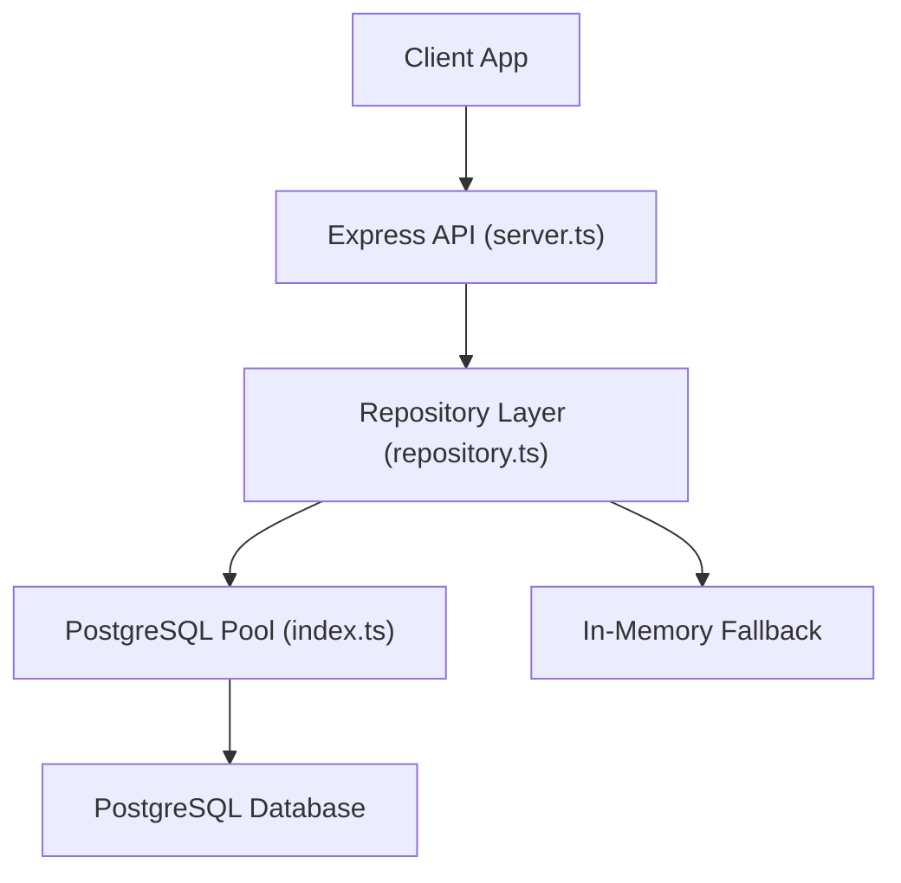
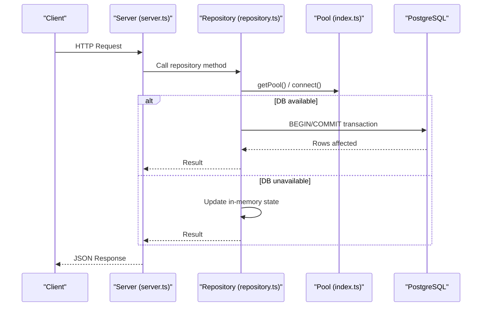
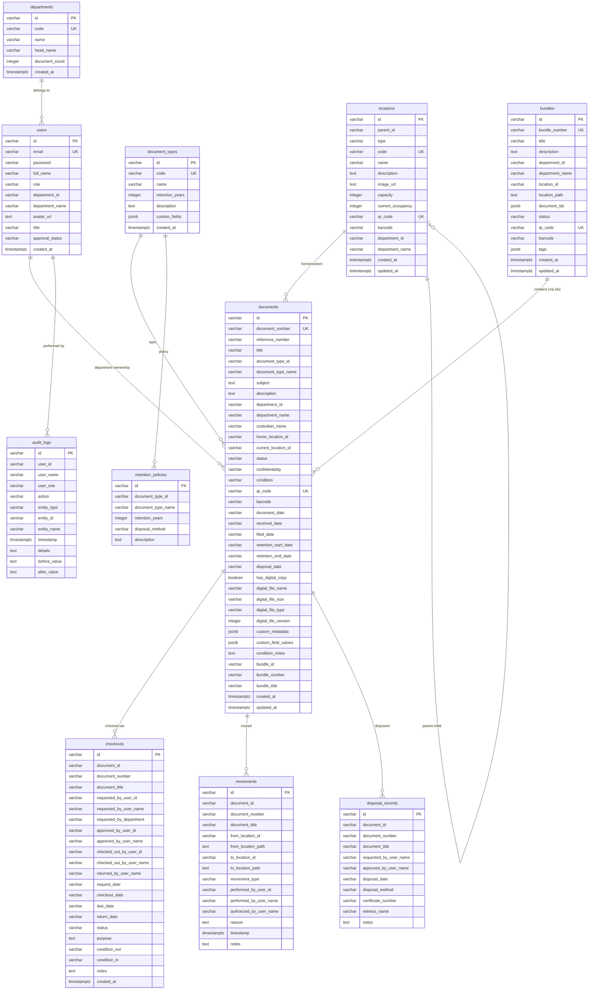
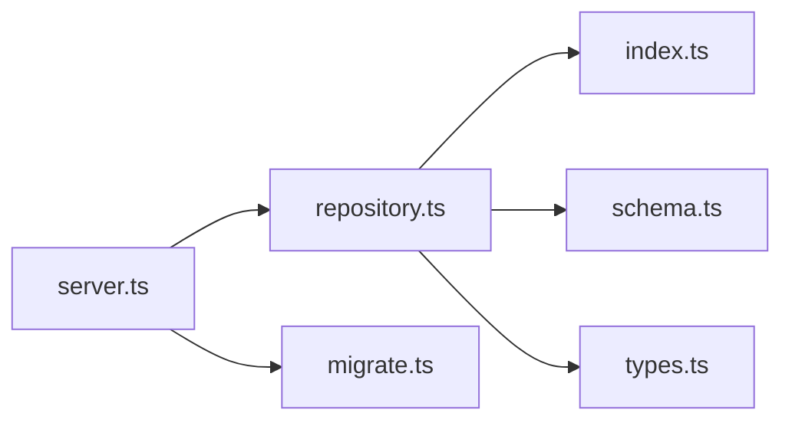
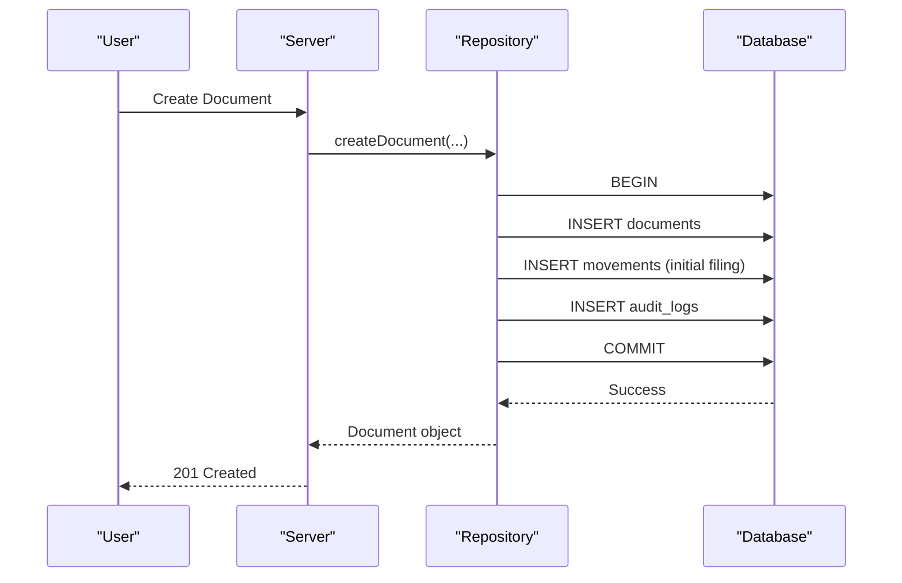
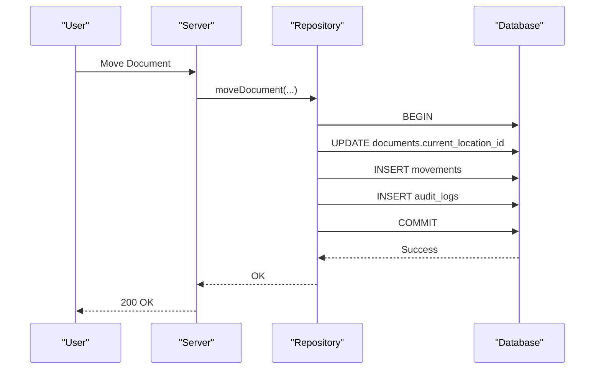

# Database Architecture

<cite>
**Referenced Files in This Document**
- [schema.ts](file://src/db/schema.ts)
- [migrate.ts](file://src/db/migrate.ts)
- [repository.ts](file://src/db/repository.ts)
- [index.ts](file://src/db/index.ts)
- [types.ts](file://src/types.ts)
- [server.ts](file://server.ts)
- [session.ts](file://src/auth/session.ts)
</cite>

## Table of Contents
1. [Introduction](#introduction)
2. [Project Structure](#project-structure)
3. [Core Components](#core-components)
4. [Architecture Overview](#architecture-overview)
5. [Detailed Component Analysis](#detailed-component-analysis)
6. [Dependency Analysis](#dependency-analysis)
7. [Performance Considerations](#performance-considerations)
8. [Troubleshooting Guide](#troubleshooting-guide)
9. [Conclusion](#conclusion)
10. [Appendices](#appendices)

## Introduction
This document describes the PostgreSQL database architecture for ArchiveHub’s physical and digital archive management system. It covers all 11 core tables (departments, users, document types, locations, documents, checkouts, movements, retention policies, disposal records, bundles, audit logs), entity relationships, data integrity rules, repository pattern implementation, migration strategy, indexing recommendations, backup/recovery procedures, JSONB usage for flexible metadata, and security considerations including password hashing, access controls, and audit logging.

## Project Structure
The database layer is implemented with:
- Schema definitions using Drizzle ORM pg-core
- Migration script that creates tables and columns idempotently
- A repository module that abstracts data access and provides fallback to in-memory storage when PostgreSQL is unavailable
- Server startup that checks DB health, runs migrations, and seeds initial data

**Diagram sources**
- [server.ts:13-38](file://server.ts#L13-L38)
- [repository.ts:106-119](file://src/db/repository.ts#L106-L119)
- [index.ts:36-69](file://src/db/index.ts#L36-L69)

**Section sources**
- [server.ts:13-38](file://server.ts#L13-L38)
- [index.ts:16-69](file://src/db/index.ts#L16-L69)

## Core Components
- Schema definitions define 11+ tables with primary keys, unique constraints, defaults, and timestamps.
- Migration script ensures schema creation and safe column additions.
- Repository functions encapsulate CRUD operations, transactions, and audit logging.
- Types define domain models used across the application.

Key responsibilities:
- Data modeling and constraints: [schema.ts](file://src/db/schema.ts)
- Idempotent migrations: [migrate.ts](file://src/db/migrate.ts)
- Data access abstraction and fallback: [repository.ts](file://src/db/repository.ts)
- Connection pooling and health checks: [index.ts](file://src/db/index.ts)
- Domain types and enums: [types.ts](file://src/types.ts)

**Section sources**
- [schema.ts:12-228](file://src/db/schema.ts#L12-L228)
- [migrate.ts:16-266](file://src/db/migrate.ts#L16-L266)
- [repository.ts:110-1217](file://src/db/repository.ts#L110-L1217)
- [index.ts:36-136](file://src/db/index.ts#L36-L136)
- [types.ts:10-283](file://src/types.ts#L10-L283)

## Architecture Overview
High-level flow from request to persistence:
- Express routes call repository methods
- Repository executes SQL via a pooled client or falls back to memory
- Transactions ensure consistency for multi-step operations
- Audit logs are recorded for critical actions

**Diagram sources**
- [server.ts:19-38](file://server.ts#L19-L38)
- [repository.ts:571-632](file://src/db/repository.ts#L571-L632)
- [index.ts:36-69](file://src/db/index.ts#L36-L69)

## Detailed Component Analysis

### Entity Relationship Model
The following diagram maps the core entities and their relationships as defined by the schema and repository logic.

**Diagram sources**
- [schema.ts:12-228](file://src/db/schema.ts#L12-L228)
- [migrate.ts:16-266](file://src/db/migrate.ts#L16-L266)

**Section sources**
- [schema.ts:12-228](file://src/db/schema.ts#L12-L228)
- [migrate.ts:16-266](file://src/db/migrate.ts#L16-L266)

### Table-by-Table Analysis

#### Departments
- Purpose: Organizational units owning records and users.
- Key fields: id (PK), code (unique), name, head_name, document_count, created_at.
- Integrity: Unique code prevents duplicates; numeric count can be maintained by triggers or application logic.

**Section sources**
- [schema.ts:12-20](file://src/db/schema.ts#L12-L20)
- [migrate.ts:16-26](file://src/db/migrate.ts#L16-L26)

#### Users
- Purpose: System users with roles and department association.
- Key fields: id (PK), email (unique), password, full_name, role, department_id/name, approval_status, created_at.
- Integrity: Unique email; approval workflow enforced at login.

**Section sources**
- [schema.ts:22-35](file://src/db/schema.ts#L22-L35)
- [migrate.ts:28-49](file://src/db/migrate.ts#L28-L49)
- [server.ts:104-150](file://server.ts#L104-L150)

#### Document Types
- Purpose: Classifies documents and defines retention and custom field schemas.
- Key fields: id (PK), code (unique), name, retention_years, description, custom_fields (JSONB), created_at.
- Integrity: Unique code; JSONB stores flexible field definitions.

**Section sources**
- [schema.ts:37-46](file://src/db/schema.ts#L37-L46)
- [migrate.ts:51-66](file://src/db/migrate.ts#L51-L66)

#### Locations (Hierarchical)
- Purpose: Physical hierarchy (building/floor/room/cabinet/rack/shelf/box/folder).
- Key fields: id (PK), parent_id (self-reference), type, code (unique), name, capacity, occupancy, qr_code (unique), barcode, department_id/name, timestamps.
- Integrity: Unique code and QR; hierarchical traversal via parent_id.

**Section sources**
- [schema.ts:48-65](file://src/db/schema.ts#L48-L65)
- [migrate.ts:68-87](file://src/db/migrate.ts#L68-L87)

#### Documents
- Purpose: Core record of each physical/digital item.
- Key fields: id (PK), document_number (unique), type references, department, custodian, home/current locations, status/confidentiality/condition, identifiers, dates, digital copy flags, JSONB metadata, bundle links, timestamps.
- Integrity: Unique document_number and qr_code; required fields enforce completeness.

**Section sources**
- [schema.ts:67-116](file://src/db/schema.ts#L67-L116)
- [migrate.ts:89-133](file://src/db/migrate.ts#L89-L133)

#### Checkouts
- Purpose: Tracks borrowing lifecycle with approvals and conditions.
- Key fields: id (PK), document refs, requester/approver/checkout/return actors, dates, status, purpose, conditions, notes, created_at.

**Section sources**
- [schema.ts:118-148](file://src/db/schema.ts#L118-L148)
- [migrate.ts:135-161](file://src/db/migrate.ts#L135-L161)

#### Movements
- Purpose: Immutable trail of physical moves between locations.
- Key fields: id (PK), document refs, from/to locations and paths, movement_type, actor names, reason, timestamp, notes.

**Section sources**
- [schema.ts:150-167](file://src/db/schema.ts#L150-L167)
- [migrate.ts:163-182](file://src/db/migrate.ts#L163-L182)

#### Retention Policies
- Purpose: Policy per document type specifying retention period and disposal method.
- Key fields: id (PK), document_type_id/name, retention_years, disposal_method, description.

**Section sources**
- [schema.ts:169-177](file://src/db/schema.ts#L169-L177)
- [migrate.ts:184-194](file://src/db/migrate.ts#L184-L194)

#### Disposal Records
- Purpose: Audit trail for destruction/disposal events.
- Key fields: id (PK), document refs, approvers, date, method, certificate, witness, notes.

**Section sources**
- [schema.ts:179-192](file://src/db/schema.ts#L179-L192)
- [migrate.ts:196-211](file://src/db/migrate.ts#L196-L211)

#### Bundles & Dossiers
- Purpose: Group related documents into logical bundles with shared metadata and location.
- Key fields: id (PK), bundle_number (unique), title, department/location refs, document_ids (JSONB array), status, identifiers, tags (JSONB), timestamps.

**Section sources**
- [schema.ts:194-211](file://src/db/schema.ts#L194-L211)
- [migrate.ts:247-266](file://src/db/migrate.ts#L247-L266)

#### Audit Logs
- Purpose: Immutable ledger of significant actions with before/after snapshots.
- Key fields: id (PK), user refs, action/entity/type/id/name, timestamp, details, before/after values.

**Section sources**
- [schema.ts:213-228](file://src/db/schema.ts#L213-L228)
- [migrate.ts:213-229](file://src/db/migrate.ts#L213-L229)

### Repository Pattern Implementation
The repository abstracts data access and provides resilience:
- DB availability detection and fallback to in-memory arrays when PostgreSQL is not configured or fails.
- Transactional writes for complex operations (e.g., document registration, movement).
- Consistent mapping of rows to typed objects.
- Centralized audit logging on key mutations.

Key patterns:
- Fallback guard: [repository.ts:106-119](file://src/db/repository.ts#L106-L119)
- User CRUD with hashing: [repository.ts:151-239](file://src/db/repository.ts#L151-L239)
- Location hierarchy safety: [repository.ts:441-468](file://src/db/repository.ts#L441-L468)
- Document create with transaction and audit: [repository.ts:571-632](file://src/db/repository.ts#L571-L632)
- Movement recording with transaction and audit: [repository.ts:742-804](file://src/db/repository.ts#L742-L804)
- Audit log creation: [repository.ts:1196-1217](file://src/db/repository.ts#L1196-L1217)

**Section sources**
- [repository.ts:106-1217](file://src/db/repository.ts#L106-L1217)

### Query Optimization Strategies
Current queries are simple selects/inserts/updates without explicit indexes beyond declared unique constraints. Recommended optimizations:
- Indexes on frequently filtered/joined columns:
  - documents: document_number, document_type_id, department_id, status, current_location_id, home_location_id
  - checkouts: document_id, status, due_date
  - movements: document_id, timestamp
  - locations: parent_id, type, code
  - audit_logs: timestamp, entity_type, entity_id, user_id
- Use partial indexes for high-cardinality filters (e.g., overdue checkouts).
- Avoid SELECT * in production; project only needed columns.
- Batch inserts where possible for bulk operations.

[No sources needed since this section provides general guidance]

### Migration Strategy Using Drizzle Migrations
- The migration script uses raw SQL within a transaction to create tables and add columns idempotently.
- On server start, migrations run automatically if DB is connected; otherwise, the app continues in memory mode.
- Seed data is applied after successful migration.

Operational steps:
- Ensure DATABASE_URL is configured; otherwise, fallback to memory mode.
- Run migrations once per environment; subsequent runs are no-ops due to IF NOT EXISTS and ADD COLUMN IF NOT EXISTS.
- Use the seed endpoint to reset operational data safely.

**Section sources**
- [server.ts:19-38](file://server.ts#L19-L38)
- [migrate.ts:3-277](file://src/db/migrate.ts#L3-L277)

### Backup and Recovery Procedures
Recommended practices:
- Logical backups:
  - Use pg_dump to export schema and data periodically.
  - Schedule incremental backups for large datasets.
- Point-in-time recovery:
  - Enable WAL archiving and configure PITR to recover to specific timestamps.
- Disaster recovery:
  - Maintain offsite copies of dumps and WAL archives.
  - Test restore procedures regularly.
- Operational data clearing:
  - Use provided clear-data endpoint to truncate operational tables safely.

**Section sources**
- [server.ts:74-82](file://server.ts#L74-L82)
- [repository.ts:1219-1257](file://src/db/repository.ts#L1219-L1257)

### JSONB Fields Usage
Flexible metadata storage:
- document_types.custom_fields: Array of custom field definitions for dynamic forms.
- documents.custom_metadata: List of key/value pairs for ad-hoc attributes.
- documents.custom_field_values: Map of field values keyed by definition names.
- bundles.document_ids: Array of document IDs included in a bundle.
- bundles.tags: Array of tags for categorization.

Usage patterns:
- Store structured but evolving metadata without schema changes.
- Validate and normalize values at the application layer before persisting.
- Query JSONB selectively using PostgreSQL operators for performance.

**Section sources**
- [schema.ts:44-45](file://src/db/schema.ts#L44-L45)
- [schema.ts:106-107](file://src/db/schema.ts#L106-L107)
- [schema.ts:204-208](file://src/db/schema.ts#L204-L208)
- [migrate.ts:59-62](file://src/db/migrate.ts#L59-L62)
- [migrate.ts:121-122](file://src/db/migrate.ts#L121-L122)
- [migrate.ts:258-262](file://src/db/migrate.ts#L258-L262)

### Security Considerations

#### Password Hashing and Authentication
- Passwords are hashed using bcrypt before storage.
- Login verifies approval status and compares passwords securely.
- JWT tokens are signed with a session secret for short-lived sessions.

Implementation highlights:
- Hashing utility: [session.ts:34-48](file://src/auth/session.ts#L34-L48)
- Token signing/verification: [session.ts:50-65](file://src/auth/session.ts#L50-L65)
- Login flow and approval checks: [server.ts:104-150](file://server.ts#L104-L150)

**Section sources**
- [session.ts:34-65](file://src/auth/session.ts#L34-L65)
- [server.ts:104-150](file://server.ts#L104-L150)

#### Access Controls
- Role-based access is modeled via users.role; enforce authorization at service layer.
- Approval workflow restricts login until admin approves accounts.

**Section sources**
- [schema.ts:28-34](file://src/db/schema.ts#L28-L34)
- [server.ts:122-138](file://server.ts#L122-L138)

#### Audit Logging Mechanisms
- Critical actions (create/update/move/document registration) write immutable audit entries.
- Before/after snapshots stored for change tracking.

Implementation highlights:
- Audit insertion on document updates and movements: [repository.ts:635-715](file://src/db/repository.ts#L635-L715), [repository.ts:742-804](file://src/db/repository.ts#L742-L804)
- Audit retrieval endpoints: [server.ts:463-480](file://server.ts#L463-L480)

**Section sources**
- [repository.ts:635-804](file://src/db/repository.ts#L635-L804)
- [server.ts:463-480](file://server.ts#L463-L480)

## Dependency Analysis
The repository depends on the pool and schema; the server orchestrates migrations and seeds.

**Diagram sources**
- [server.ts:8-11](file://server.ts#L8-L11)
- [repository.ts:1-15](file://src/db/repository.ts#L1-L15)
- [index.ts:1-7](file://src/db/index.ts#L1-L7)
- [migrate.ts:1-2](file://src/db/migrate.ts#L1-L2)

**Section sources**
- [server.ts:8-11](file://server.ts#L8-L11)
- [repository.ts:1-15](file://src/db/repository.ts#L1-L15)
- [index.ts:1-7](file://src/db/index.ts#L1-L7)
- [migrate.ts:1-2](file://src/db/migrate.ts#L1-L2)

## Performance Considerations
- Prefer targeted column selection instead of SELECT *.
- Add indexes on high-frequency filter/join columns as recommended above.
- Use transactions for multi-step writes to reduce lock contention and ensure consistency.
- Monitor query plans for expensive operations and consider materialized views for heavy reporting.

[No sources needed since this section provides general guidance]

## Troubleshooting Guide
Common issues and resolutions:
- Database not connected:
  - Verify DATABASE_URL in .env; health check will report failure and app falls back to memory.
  - Use /api/health to inspect connection status.
- Migration failures:
  - Review migration logs; errors trigger rollback; fix schema and re-run.
- Clearing operational data:
  - Use POST /api/clear-data to truncate operational tables safely.

Operational endpoints:
- Health check: GET /api/health
- Seed/reset: POST /api/seed
- Clear data: POST /api/clear-data

**Section sources**
- [server.ts:19-38](file://server.ts#L19-L38)
- [server.ts:43-82](file://server.ts#L43-L82)
- [repository.ts:1219-1257](file://src/db/repository.ts#L1219-L1257)

## Conclusion
ArchiveHub’s database architecture provides a robust foundation for managing physical and digital records with strong data integrity, flexible metadata via JSONB, comprehensive audit trails, and resilient operation through a repository pattern with in-memory fallback. With proper indexing, secure authentication, and disciplined backup/recovery procedures, the system supports scalable and compliant archival workflows.

[No sources needed since this section summarizes without analyzing specific files]

## Appendices

### Appendix A: Data Flow Sequence for Document Registration

**Diagram sources**
- [repository.ts:571-632](file://src/db/repository.ts#L571-L632)

### Appendix B: Data Flow Sequence for Document Movement

**Diagram sources**
- [repository.ts:742-804](file://src/db/repository.ts#L742-L804)