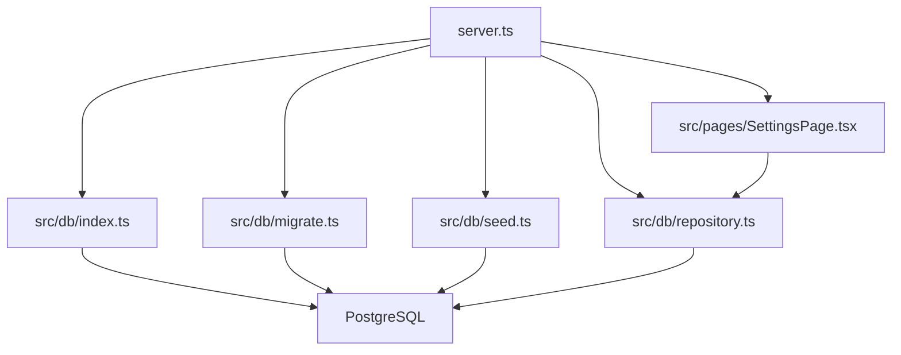
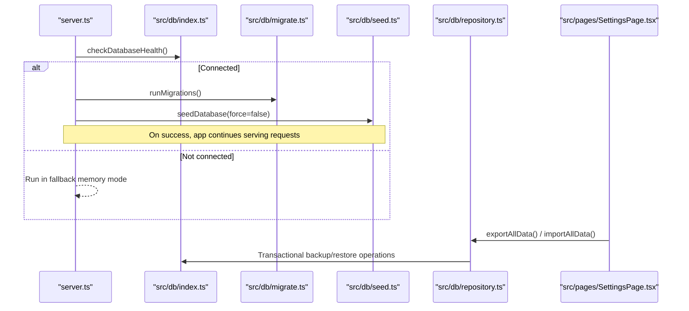
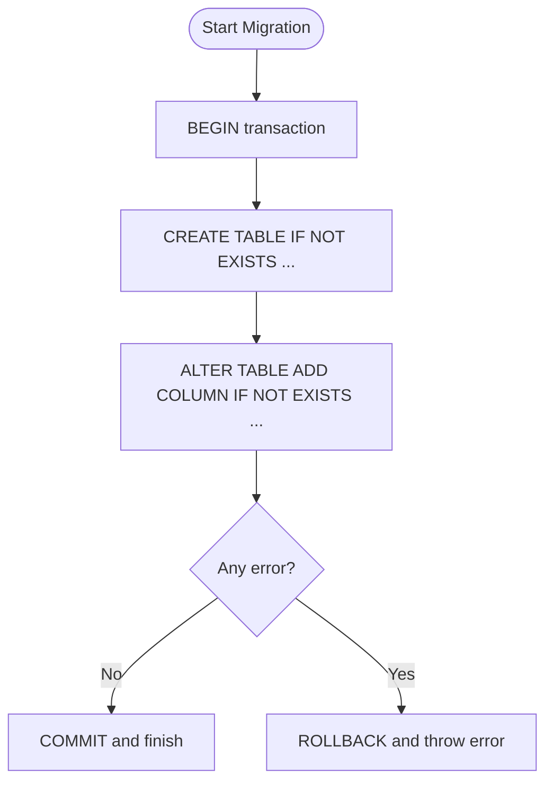
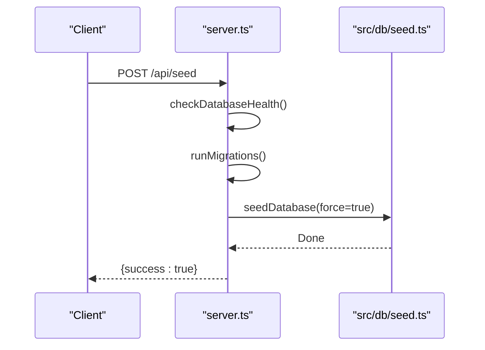
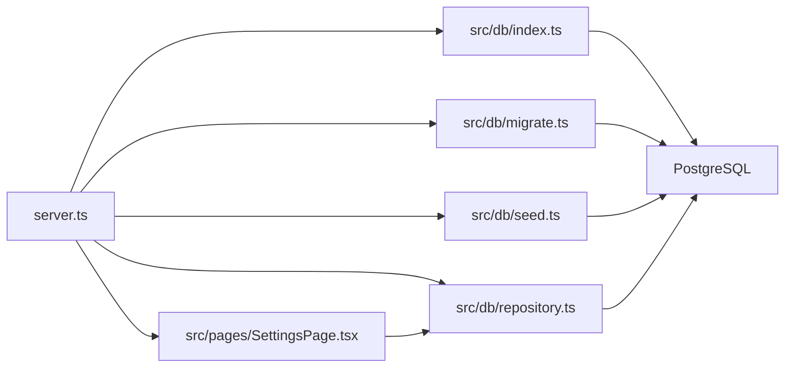

# Migrations and Backup Procedures

<cite>
**Referenced Files in This Document**
- [server.ts](file://server.ts)
- [src/db/index.ts](file://src/db/index.ts)
- [src/db/migrate.ts](file://src/db/migrate.ts)
- [src/db/schema.ts](file://src/db/schema.ts)
- [src/db/seed.ts](file://src/db/seed.ts)
- [src/db/repository.ts](file://src/db/repository.ts)
- [src/pages/SettingsPage.tsx](file://src/pages/SettingsPage.tsx)
- [package.json](file://package.json)
</cite>

## Update Summary
**Changes Made**
- Enhanced backup procedures with comprehensive full database backup and restore system
- Added transactional operations for data integrity during import/export
- Implemented whitelisted tables support for controlled data access
- Integrated automated schema detection for robust restore operations
- Updated UI components for backup management functionality

## Table of Contents
1. [Introduction](#introduction)
2. [Project Structure](#project-structure)
3. [Core Components](#core-components)
4. [Architecture Overview](#architecture-overview)
5. [Detailed Component Analysis](#detailed-component-analysis)
6. [Dependency Analysis](#dependency-analysis)
7. [Performance Considerations](#performance-considerations)
8. [Troubleshooting Guide](#troubleshooting-guide)
9. [Conclusion](#conclusion)
10. [Appendices](#appendices)

## Introduction
This document explains how ArchiveHub manages database migrations, seeding, backups, and disaster recovery. It focuses on the current implementation that uses PostgreSQL with Drizzle ORM for schema definitions and a custom migration routine executed at server startup. The system now includes enhanced backup capabilities with comprehensive full database backup and restore functionality, transactional operations, whitelisted tables support, and automated schema detection for robust data management.

## Project Structure
ArchiveHub's database layer is organized under src/db:
- index.ts: Database pool initialization, health checks, and environment configuration
- migrate.ts: Custom migration script that ensures all required tables exist
- schema.ts: Drizzle ORM table definitions (source of truth for schema)
- seed.ts: Seed guard to avoid overwriting live data
- repository.ts: Data access layer with fallback memory mode, utilities like clearing data, and comprehensive backup/restore functionality

The server bootstraps database connectivity, runs migrations, seeds initial data when appropriate, and exposes endpoints for health checks, administrative actions, and backup operations.



**Diagram sources**
- [server.ts:13-38](file://server.ts#L13-L38)
- [src/db/index.ts:36-78](file://src/db/index.ts#L36-L78)
- [src/db/migrate.ts:3-14](file://src/db/migrate.ts#L3-L14)
- [src/db/seed.ts:3-23](file://src/db/seed.ts#L3-L23)
- [src/db/repository.ts:106-108](file://src/db/repository.ts#L106-L108)
- [src/pages/SettingsPage.tsx:331-347](file://src/pages/SettingsPage.tsx#L331-L347)

**Section sources**
- [server.ts:13-38](file://server.ts#L13-L38)
- [src/db/index.ts:16-78](file://src/db/index.ts#L16-L78)
- [src/db/migrate.ts:3-14](file://src/db/migrate.ts#L3-L14)
- [src/db/seed.ts:3-23](file://src/db/seed.ts#L3-L23)
- [src/db/repository.ts:106-108](file://src/db/repository.ts#L106-L108)

## Core Components
- Database connection and health: Pool creation, SSL handling, health check function, and connection flagging are implemented in src/db/index.ts.
- Migration engine: A single transactional migration routine in src/db/migrate.ts creates or updates tables using raw SQL with IF NOT EXISTS and ALTER TABLE ADD COLUMN IF NOT EXISTS patterns.
- Schema definitions: Drizzle schema in src/db/schema.ts defines typed tables used by the ORM layer.
- Seeding guard: src/db/seed.ts prevents accidental overwrite of existing user data unless forced.
- Repository and fallback: src/db/repository.ts provides data access with in-memory fallback when PostgreSQL is unavailable, includes clear-data utility, and now features comprehensive backup/restore functionality with transactional operations.
- UI backup interface: Settings page provides user-friendly backup export and restore capabilities.

Key responsibilities:
- Ensure schema consistency across environments
- Provide safe seeding behavior
- Offer health monitoring and graceful degradation
- Enable comprehensive data backup and restore with transactional integrity

**Section sources**
- [src/db/index.ts:36-78](file://src/db/index.ts#L36-L78)
- [src/db/migrate.ts:10-277](file://src/db/migrate.ts#L10-L277)
- [src/db/schema.ts:12-228](file://src/db/schema.ts#L12-L228)
- [src/db/seed.ts:3-23](file://src/db/seed.ts#L3-L23)
- [src/db/repository.ts:106-108](file://src/db/repository.ts#L106-L108)
- [src/pages/SettingsPage.tsx:331-347](file://src/pages/SettingsPage.tsx#L331-L347)

## Architecture Overview
At application startup, the server checks database connectivity, then executes migrations and optionally seeds data. The health endpoint exposes DB status. Administrative endpoints allow re-running migrations and seeding, as well as clearing operational data. The enhanced backup system provides comprehensive data export and restore capabilities through both API endpoints and UI controls.



**Diagram sources**
- [server.ts:19-38](file://server.ts#L19-L38)
- [src/db/index.ts:97-135](file://src/db/index.ts#L97-L135)
- [src/db/migrate.ts:3-14](file://src/db/migrate.ts#L3-L14)
- [src/db/seed.ts:3-23](file://src/db/seed.ts#L3-L23)
- [src/pages/SettingsPage.tsx:331-347](file://src/pages/SettingsPage.tsx#L331-L347)

## Detailed Component Analysis

### Migration System
- Execution model: The migration function opens a client from the shared pool, starts a transaction, and issues CREATE TABLE IF NOT EXISTS and ALTER TABLE ADD COLUMN IF NOT EXISTS statements for each entity. On error, it rolls back; on success, it commits.
- Versioning strategy: There is no explicit version table or incremental migration files. The migration is idempotent per statement, ensuring repeated runs do not break existing schemas.
- Rollback procedures: No automatic rollback mechanism exists. To revert changes, you must write reverse SQL manually and execute it against the target database. For safety, always test rollbacks in non-production first.



**Diagram sources**
- [src/db/migrate.ts:10-277](file://src/db/migrate.ts#L10-L277)

Best practices:
- Keep schema.ts aligned with migrate.ts to maintain a single source of truth for column names and types.
- Introduce an explicit migration versioning system (e.g., a versions table or numbered migration files) to support forward-only deployments and safer rollbacks.
- Add pre-migration checks (e.g., feature flags) to gate risky changes.

**Section sources**
- [src/db/migrate.ts:10-277](file://src/db/migrate.ts#L10-L277)
- [src/db/schema.ts:12-228](file://src/db/schema.ts#L12-L228)

### Seed Data Process
- Behavior: The seed function connects to the database and checks whether any users exist. If users are present and force is false, it exits without modifying data. When force is true (via the /api/seed endpoint), migrations run again and seeding proceeds.
- Use cases: Ideal for local development and CI testing where deterministic initial state is needed. Avoid forcing seed in production.



**Diagram sources**
- [server.ts:53-72](file://server.ts#L53-L72)
- [src/db/seed.ts:3-23](file://src/db/seed.ts#L3-L23)

Operational notes:
- Always back up before running seed with force=true.
- Restrict /api/seed to trusted environments or admin-only access.

**Section sources**
- [server.ts:53-72](file://server.ts#L53-L72)
- [src/db/seed.ts:3-23](file://src/db/seed.ts#L3-L23)

### Enhanced Backup and Restore System

**Updated** The backup system now provides comprehensive full database backup and restore capabilities with transactional operations, whitelisted tables support, and automated schema detection.

#### Backup Tables Whitelist
The system operates on a predefined whitelist of tables to ensure data integrity and security:
- departments, users, document_types, reusable_custom_fields
- locations, documents, bundles
- checkouts, movements, retention_policies
- disposal_records, audit_logs

#### Export Functionality
- **API Endpoint**: `GET /api/export` returns complete database snapshot as JSON
- **UI Integration**: Settings page provides "Export Full Backup" button for user-friendly access
- **Format**: Standardized `archivehub-export` format with metadata including timestamp and version
- **Security**: Only whitelisted tables are exported, preventing sensitive data exposure

#### Import and Restore Functionality
- **API Endpoint**: `POST /api/import` accepts backup files with 200MB size limit
- **Transactional Operations**: All restore operations run within a single transaction for atomicity
- **Automated Schema Detection**: Uses `SELECT * FROM table LIMIT 0` to detect actual table structure
- **JSON Column Handling**: Special handling for JSON/JSONB columns with proper serialization
- **Chunked Processing**: Processes large datasets in chunks of 500 rows to avoid parameter limits

```mermaid
flowchart TD
Export[Export Request] --> Validate[Validate Database Connection]
Validate --> QueryTables[Query Whitelisted Tables]
QueryTables --> FormatData[Format as archivehub-export]
FormatData --> ReturnExport[Return JSON Payload]
Import[Import Request] --> ValidateBackup[Validate Backup Format]
ValidateBackup --> BeginTransaction[BEGIN Transaction]
BeginTransaction --> ClearTables[DELETE FROM Each Table]
ClearTables --> DetectSchema[AUTO DETECT SCHEMA]
DetectSchema --> ChunkInsert[CHUNKED INSERT (500 rows)]
ChunkInsert --> HandleJSON[Handle JSON Columns]
HandleJSON --> CommitTransaction[COMMIT Transaction]
CommitTransaction --> ReturnSuccess[Return Success with Counts]
```

**Diagram sources**
- [src/db/repository.ts:1758-1775](file://src/db/repository.ts#L1758-L1775)
- [src/db/repository.ts:1777-1838](file://src/db/repository.ts#L1777-L1838)
- [server.ts:145-153](file://server.ts#L145-L153)
- [server.ts:20-29](file://server.ts#L20-L29)

#### UI Integration
The Settings page provides intuitive backup management:
- **Export Button**: One-click backup download with timestamped filenames
- **Import Interface**: File upload with validation and confirmation dialogs
- **Status Feedback**: Real-time progress indicators and success/error notifications
- **Safety Checks**: Validates backup file format before processing

**Section sources**
- [src/db/repository.ts:1733-1839](file://src/db/repository.ts#L1733-L1839)
- [server.ts:145-153](file://server.ts#L145-L153)
- [server.ts:20-29](file://server.ts#L20-L29)
- [src/pages/SettingsPage.tsx:331-377](file://src/pages/SettingsPage.tsx#L331-L377)

### Disaster Recovery and Restoration
- **Full Backup Restore**: Use the `/api/import` endpoint or UI to restore complete database state
- **Point-in-Time Recovery**: Combine application backups with PostgreSQL WAL archiving for precise recovery points
- **Validation**: After restoration, verify data integrity by checking record counts and running health checks
- **Rollback Plan**: Maintain tested rollback procedures and keep recent backups available

Note: Implement automated restore drills to ensure recovery time objectives (RTO) are achievable.

### Testing Strategies for Migrations
- **Idempotency**: Re-run migrations multiple times to ensure they succeed without side effects.
- **Pre-deployment checks**: Validate schema alignment between schema.ts and migrate.ts.
- **Integration tests**: Spin up a temporary database, run migrations, seed data, and execute representative queries to validate behavior.
- **Rollback tests**: Execute manual rollback scripts in a test environment to confirm reversibility.
- **Backup/Restore Tests**: Verify backup export/import cycles work correctly with various data volumes.

### Best Practices for Production Databases
- **Schema Changes**:
  - Prefer additive changes (new columns, new tables) in production.
  - Use zero-downtime deployment patterns: add columns with defaults, deploy code that supports both old and new schemas, backfill data, then remove legacy fields.
- **Environment Separation**:
  - Never run seed with force=true in production.
  - Use separate databases for dev, staging, and production.
- **Data Integrity**:
  - Enforce constraints and indexes in schema.ts and ensure migrate.ts reflects them.
  - Audit critical changes via audit logs.
  - Use transactional backup/restore operations for data consistency.
- **Access Control**:
  - Limit admin endpoints to authorized roles.
  - Rotate credentials and secrets regularly.
- **Backup Strategy**:
  - Schedule regular full backups using the built-in export functionality.
  - Store backups securely with encryption at rest and restrict access.
  - Validate backups regularly by restoring to a staging environment.

## Dependency Analysis
The following diagram shows runtime dependencies among core modules involved in migrations, seeding, backup, and data access.



**Diagram sources**
- [server.ts:13-38](file://server.ts#L13-L38)
- [src/db/index.ts:36-78](file://src/db/index.ts#L36-L78)
- [src/db/migrate.ts:3-14](file://src/db/migrate.ts#L3-L14)
- [src/db/seed.ts:3-23](file://src/db/seed.ts#L3-L23)
- [src/db/repository.ts:106-108](file://src/db/repository.ts#L106-L108)
- [src/pages/SettingsPage.tsx:331-347](file://src/pages/SettingsPage.tsx#L331-L347)

**Section sources**
- [server.ts:13-38](file://server.ts#L13-L38)
- [src/db/index.ts:36-78](file://src/db/index.ts#L36-L78)
- [src/db/migrate.ts:3-14](file://src/db/migrate.ts#L3-L14)
- [src/db/seed.ts:3-23](file://src/db/seed.ts#L3-L23)
- [src/db/repository.ts:106-108](file://src/db/repository.ts#L106-L108)

## Performance Considerations
- **Connection pooling**: The pool is initialized once and reused. Ensure pool size is tuned for expected concurrency and database capacity.
- **Health checks**: Frequent health checks can add overhead; schedule them at reasonable intervals.
- **Migration cost**: Large migrations should be scheduled during maintenance windows. Consider batching DDL operations and minimizing locks.
- **Memory fallback**: In-memory mode is useful for resilience but does not persist data; rely on it only temporarily.
- **Backup performance**: 
  - Export operations query all whitelisted tables sequentially
  - Import operations use chunked processing (500 rows per batch) to optimize memory usage
  - Transactional restores ensure data consistency but may lock tables during operation
  - Consider scheduling large imports during off-peak hours

## Troubleshooting Guide
Common issues and resolutions:
- **DATABASE_URL not configured**:
  - Symptom: Health check reports missing or placeholder URL; migrations skipped.
  - Resolution: Provide a valid DATABASE_URL in .env or environment variables.
- **Migration errors**:
  - Symptom: Transaction rollback and error logged.
  - Resolution: Inspect error details, fix schema drift between schema.ts and migrate.ts, and re-run migrations in a safe environment.
- **Seed blocked due to existing data**:
  - Symptom: Seed exits early because users already exist.
  - Resolution: Use force=true only in controlled environments; otherwise, manage seed data separately.
- **Clear data failures**:
  - Symptom: TRUNCATE CASCADE fails; fallback DELETE may also fail due to constraints.
  - Resolution: Resolve foreign key constraints or order of deletes; consider disabling constraints temporarily in a controlled manner.
- **Backup/Restore Issues**:
  - Symptom: Invalid backup file errors or import failures.
  - Resolution: Ensure backup files are generated by ArchiveHub's export function; verify database connection; check table schema compatibility.

Monitoring and alerting:
- Expose /api/health to monitor database connectivity and include timestamps.
- Set up alerts for failed health checks and migration errors.
- Track error rates and response times for critical endpoints.
- Monitor backup/restore operation success rates and performance metrics.

**Section sources**
- [src/db/index.ts:97-135](file://src/db/index.ts#L97-L135)
- [server.ts:42-51](file://server.ts#L42-L51)
- [src/db/migrate.ts:270-277](file://src/db/migrate.ts#L270-L277)
- [src/db/seed.ts:11-22](file://src/db/seed.ts#L11-L22)
- [src/db/repository.ts:1232-1257](file://src/db/repository.ts#L1232-L1257)
- [src/db/repository.ts:1777-1838](file://src/db/repository.ts#L1777-L1838)

## Conclusion
ArchiveHub implements a pragmatic, idempotent migration approach with Drizzle schema definitions and a startup-driven migration runner. Seeding is guarded to protect live data, and the enhanced backup system provides comprehensive data export and restore capabilities with transactional integrity, whitelisted tables support, and automated schema detection. For robust production operations, adopt formal versioned migrations, automated full and incremental backups with PITR, and comprehensive monitoring and alerting. Follow the best practices outlined here to maintain data integrity and availability during updates.

## Appendices

### Appendix A: Key Endpoints and Scripts
- **Startup flow**: Health check -> migrations -> seed (non-force)
- **Health**: GET /api/health
- **Seed**: POST /api/seed (runs migrations and seeds with force=true)
- **Clear data**: POST /api/clear-data (clears operational tables)
- **Export backup**: GET /api/export (returns full database backup as JSON)
- **Import backup**: POST /api/import (accepts backup files up to 200MB)

**Section sources**
- [server.ts:19-38](file://server.ts#L19-L38)
- [server.ts:42-82](file://server.ts#L42-L82)
- [server.ts:145-153](file://server.ts#L145-L153)
- [server.ts:20-29](file://server.ts#L20-L29)

### Appendix B: Dependencies and Tools
- **PostgreSQL driver and ORM**: pg, drizzle-orm
- **Dev tooling**: drizzle-kit for schema-related tasks
- **Build and run**: tsx for development, esbuild for production bundle

**Section sources**
- [package.json:14-47](file://package.json#L14-L47)

### Appendix C: Backup Table Whitelist
The following tables are included in backup operations:
- **Core entities**: departments, users, document_types, reusable_custom_fields
- **Storage**: locations, documents, bundles
- **Operations**: checkouts, movements, retention_policies
- **Compliance**: disposal_records, audit_logs

**Section sources**
- [src/db/repository.ts:1736-1749](file://src/db/repository.ts#L1736-L1749)