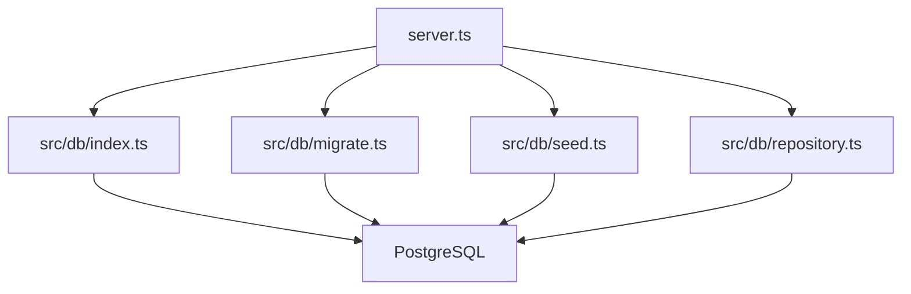
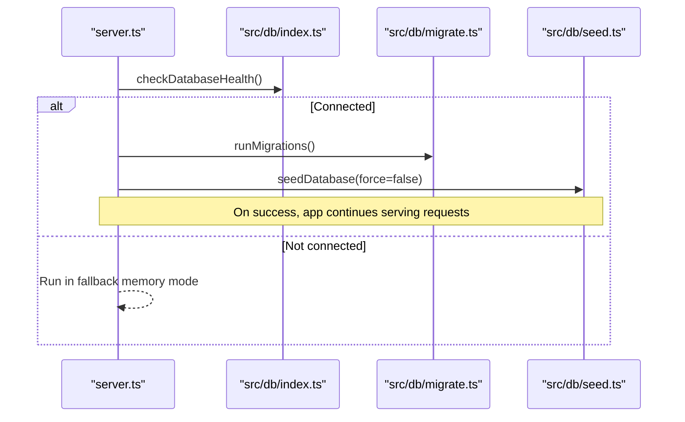
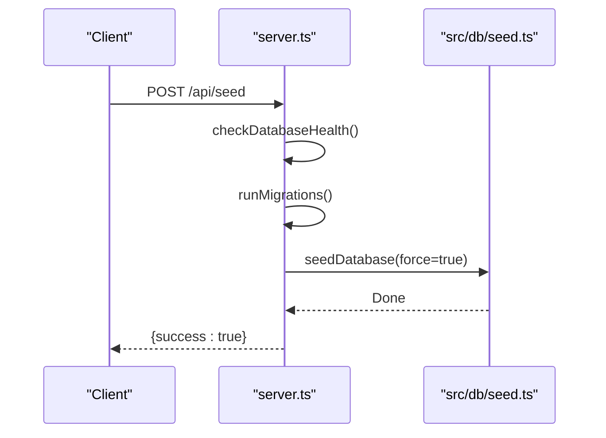
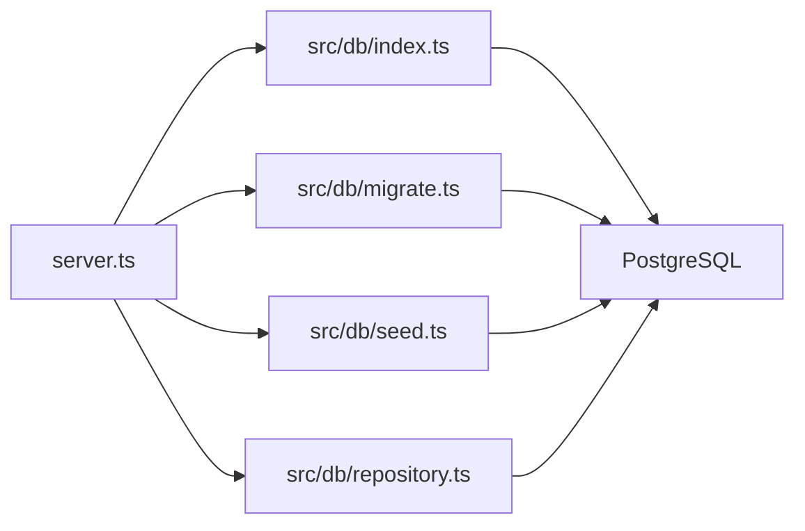

# Migrations and Backup Procedures

<cite>
**Referenced Files in This Document**
- [server.ts](file://server.ts)
- [src/db/index.ts](file://src/db/index.ts)
- [src/db/migrate.ts](file://src/db/migrate.ts)
- [src/db/schema.ts](file://src/db/schema.ts)
- [src/db/seed.ts](file://src/db/seed.ts)
- [src/db/repository.ts](file://src/db/repository.ts)
- [package.json](file://package.json)
</cite>

## Table of Contents
1. [Introduction](#introduction)
2. [Project Structure](#project-structure)
3. [Core Components](#core-components)
4. [Architecture Overview](#architecture-overview)
5. [Detailed Component Analysis](#detailed-component-analysis)
6. [Dependency Analysis](#dependency-analysis)
7. [Performance Considerations](#performance-considerations)
8. [Troubleshooting Guide](#troubleshooting-guide)
9. [Conclusion](#conclusion)
10. [Appendices](#appendices)

## Introduction
This document explains how ArchiveHub manages database migrations, seeding, backups, and disaster recovery. It focuses on the current implementation that uses PostgreSQL with Drizzle ORM for schema definitions and a custom migration routine executed at server startup. It also covers backup/export capabilities exposed via the UI and API, and provides best practices for production operations, schema change management, data integrity, monitoring, and alerting.

## Project Structure
ArchiveHub’s database layer is organized under src/db:
- index.ts: Database pool initialization, health checks, and environment configuration
- migrate.ts: Custom migration script that ensures all required tables exist
- schema.ts: Drizzle ORM table definitions (source of truth for schema)
- seed.ts: Seed guard to avoid overwriting live data
- repository.ts: Data access layer with fallback memory mode and utilities like clearing data

The server bootstraps database connectivity, runs migrations, seeds initial data when appropriate, and exposes endpoints for health checks and administrative actions.

**Diagram sources**
- [server.ts:13-38](file://server.ts#L13-L38)
- [src/db/index.ts:36-78](file://src/db/index.ts#L36-L78)
- [src/db/migrate.ts:3-14](file://src/db/migrate.ts#L3-L14)
- [src/db/seed.ts:3-23](file://src/db/seed.ts#L3-L23)
- [src/db/repository.ts:106-108](file://src/db/repository.ts#L106-L108)

**Section sources**
- [server.ts:13-38](file://server.ts#L13-L38)
- [src/db/index.ts:16-78](file://src/db/index.ts#L16-L78)
- [src/db/migrate.ts:3-14](file://src/db/migrate.ts#L3-L14)
- [src/db/seed.ts:3-23](file://src/db/seed.ts#L3-L23)
- [src/db/repository.ts:106-108](file://src/db/repository.ts#L106-L108)

## Core Components
- Database connection and health: Pool creation, SSL handling, health check function, and connection flagging are implemented in src/db/index.ts.
- Migration engine: A single transactional migration routine in src/db/migrate.ts creates or updates tables using raw SQL with IF NOT EXISTS and ALTER TABLE ADD COLUMN IF NOT EXISTS patterns.
- Schema definitions: Drizzle schema in src/db/schema.ts defines typed tables used by the ORM layer.
- Seeding guard: src/db/seed.ts prevents accidental overwrite of existing user data unless forced.
- Repository and fallback: src/db/repository.ts provides data access with in-memory fallback when PostgreSQL is unavailable and includes a clear-data utility.

Key responsibilities:
- Ensure schema consistency across environments
- Provide safe seeding behavior
- Offer health monitoring and graceful degradation

**Section sources**
- [src/db/index.ts:36-78](file://src/db/index.ts#L36-L78)
- [src/db/migrate.ts:10-277](file://src/db/migrate.ts#L10-L277)
- [src/db/schema.ts:12-228](file://src/db/schema.ts#L12-L228)
- [src/db/seed.ts:3-23](file://src/db/seed.ts#L3-L23)
- [src/db/repository.ts:106-108](file://src/db/repository.ts#L106-L108)

## Architecture Overview
At application startup, the server checks database connectivity, then executes migrations and optionally seeds data. The health endpoint exposes DB status. Administrative endpoints allow re-running migrations and seeding, as well as clearing operational data.

**Diagram sources**
- [server.ts:19-38](file://server.ts#L19-L38)
- [src/db/index.ts:97-135](file://src/db/index.ts#L97-L135)
- [src/db/migrate.ts:3-14](file://src/db/migrate.ts#L3-L14)
- [src/db/seed.ts:3-23](file://src/db/seed.ts#L3-L23)

## Detailed Component Analysis

### Migration System
- Execution model: The migration function opens a client from the shared pool, starts a transaction, and issues CREATE TABLE IF NOT EXISTS and ALTER TABLE ADD COLUMN IF NOT EXISTS statements for each entity. On error, it rolls back; on success, it commits.
- Versioning strategy: There is no explicit version table or incremental migration files. The migration is idempotent per statement, ensuring repeated runs do not break existing schemas.
- Rollback procedures: No automatic rollback mechanism exists. To revert changes, you must write reverse SQL manually and execute it against the target database. For safety, always test rollbacks in non-production first.

**Diagram sources**
- [src/db/migrate.ts:10-277](file://src/db/migrate.ts#L10-L277)

Best practices:
- Keep schema.ts aligned with migrate.ts to maintain a single source of truth for column names and types.
- Introduce an explicit migration versioning system (e.g., a versions table or numbered migration files) to support forward-only deployments and safer rollbacks.
- Add pre-migration checks (e.g., feature flags) to gate risky changes.

**Section sources**
- [src/db/migrate.ts:10-277](file://src/db/migrate.ts#L10-L277)
- [src/db/schema.ts:12-228](file://src/db/schema.ts#L12-L228)

### Seed Data Process
- Behavior: The seed function connects to the database and checks whether any users exist. If users are present and force is false, it exits without modifying data. When force is true (via the /api/seed endpoint), migrations run again and seeding proceeds.
- Use cases: Ideal for local development and CI testing where deterministic initial state is needed. Avoid forcing seed in production.

**Diagram sources**
- [server.ts:53-72](file://server.ts#L53-L72)
- [src/db/seed.ts:3-23](file://src/db/seed.ts#L3-L23)

Operational notes:
- Always back up before running seed with force=true.
- Restrict /api/seed to trusted environments or admin-only access.

**Section sources**
- [server.ts:53-72](file://server.ts#L53-L72)
- [src/db/seed.ts:3-23](file://src/db/seed.ts#L3-L23)

### Backup Strategies
Current built-in options:
- JSON export from UI: The Settings page includes an “Export Database JSON Backup” action that serializes key entities into a downloadable JSON file. This is a snapshot of the current in-memory or DB-backed dataset.
- Clear data utility: An endpoint clears operational tables (checkouts, movements, disposal_records, retention_policies, audit_logs, documents, locations, bundles) using TRUNCATE CASCADE with a fallback DELETE sequence if necessary.

Recommended strategies beyond current implementation:
- Full database backups: Use your PostgreSQL provider’s native tools (e.g., pg_dump) or managed service snapshots to create consistent full backups. Schedule regular full backups based on RPO.
- Incremental backups: Enable WAL archiving and use point-in-time recovery (PITR) to capture continuous changes between full backups.
- Point-in-time recovery: Restore to a specific timestamp using PITR to minimize data loss during incidents.

Implementation guidance:
- Store backups securely with encryption at rest and restrict access.
- Validate backups regularly by restoring to a staging environment.
- Automate backup scheduling and retention policies.

**Section sources**
- [src/pages/SettingsPage.tsx:315-335](file://src/pages/SettingsPage.tsx#L315-L335)
- [src/db/repository.ts:1232-1257](file://src/db/repository.ts#L1232-L1257)

### Disaster Recovery and Restoration
- Restore process:
  - For full backups: Restore the latest full backup to a new instance or cluster, then apply WAL archives up to the desired recovery point.
  - For PITR: Configure restore_target_time to recover to a precise moment before failure.
- Validation: After restoration, verify schema and data integrity by running health checks and smoke tests against critical endpoints.
- Rollback plan: Maintain tested rollback scripts for migrations and be prepared to revert to a known-good backup if a deployment fails.

Note: Implement automated restore drills to ensure recovery time objectives (RTO) are achievable.

[No sources needed since this section provides general guidance]

### Testing Strategies for Migrations
- Idempotency: Re-run migrations multiple times to ensure they succeed without side effects.
- Pre-deployment checks: Validate schema alignment between schema.ts and migrate.ts.
- Integration tests: Spin up a temporary database, run migrations, seed data, and execute representative queries to validate behavior.
- Rollback tests: Execute manual rollback scripts in a test environment to confirm reversibility.

[No sources needed since this section provides general guidance]

### Best Practices for Production Databases
- Schema changes:
  - Prefer additive changes (new columns, new tables) in production.
  - Use zero-downtime deployment patterns: add columns with defaults, deploy code that supports both old and new schemas, backfill data, then remove legacy fields.
- Environment separation:
  - Never run seed with force=true in production.
  - Use separate databases for dev, staging, and production.
- Data integrity:
  - Enforce constraints and indexes in schema.ts and ensure migrate.ts reflects them.
  - Audit critical changes via audit logs.
- Access control:
  - Limit admin endpoints to authorized roles.
  - Rotate credentials and secrets regularly.

[No sources needed since this section provides general guidance]

## Dependency Analysis
The following diagram shows runtime dependencies among core modules involved in migrations, seeding, and data access.

**Diagram sources**
- [server.ts:13-38](file://server.ts#L13-L38)
- [src/db/index.ts:36-78](file://src/db/index.ts#L36-L78)
- [src/db/migrate.ts:3-14](file://src/db/migrate.ts#L3-L14)
- [src/db/seed.ts:3-23](file://src/db/seed.ts#L3-L23)
- [src/db/repository.ts:106-108](file://src/db/repository.ts#L106-L108)

**Section sources**
- [server.ts:13-38](file://server.ts#L13-L38)
- [src/db/index.ts:36-78](file://src/db/index.ts#L36-L78)
- [src/db/migrate.ts:3-14](file://src/db/migrate.ts#L3-L14)
- [src/db/seed.ts:3-23](file://src/db/seed.ts#L3-L23)
- [src/db/repository.ts:106-108](file://src/db/repository.ts#L106-L108)

## Performance Considerations
- Connection pooling: The pool is initialized once and reused. Ensure pool size is tuned for expected concurrency and database capacity.
- Health checks: Frequent health checks can add overhead; schedule them at reasonable intervals.
- Migration cost: Large migrations should be scheduled during maintenance windows. Consider batching DDL operations and minimizing locks.
- Memory fallback: In-memory mode is useful for resilience but does not persist data; rely on it only temporarily.

[No sources needed since this section provides general guidance]

## Troubleshooting Guide
Common issues and resolutions:
- DATABASE_URL not configured:
  - Symptom: Health check reports missing or placeholder URL; migrations skipped.
  - Resolution: Provide a valid DATABASE_URL in .env or environment variables.
- Migration errors:
  - Symptom: Transaction rollback and error logged.
  - Resolution: Inspect error details, fix schema drift between schema.ts and migrate.ts, and re-run migrations in a safe environment.
- Seed blocked due to existing data:
  - Symptom: Seed exits early because users already exist.
  - Resolution: Use force=true only in controlled environments; otherwise, manage seed data separately.
- Clear data failures:
  - Symptom: TRUNCATE CASCADE fails; fallback DELETE may also fail due to constraints.
  - Resolution: Resolve foreign key constraints or order of deletes; consider disabling constraints temporarily in a controlled manner.

Monitoring and alerting:
- Expose /api/health to monitor database connectivity and include timestamps.
- Set up alerts for failed health checks and migration errors.
- Track error rates and response times for critical endpoints.

**Section sources**
- [src/db/index.ts:97-135](file://src/db/index.ts#L97-L135)
- [server.ts:42-51](file://server.ts#L42-L51)
- [src/db/migrate.ts:270-277](file://src/db/migrate.ts#L270-L277)
- [src/db/seed.ts:11-22](file://src/db/seed.ts#L11-L22)
- [src/db/repository.ts:1232-1257](file://src/db/repository.ts#L1232-L1257)

## Conclusion
ArchiveHub implements a pragmatic, idempotent migration approach with Drizzle schema definitions and a startup-driven migration runner. Seeding is guarded to protect live data, and basic backup/export functionality is available via the UI. For robust production operations, adopt formal versioned migrations, automated full and incremental backups with PITR, and comprehensive monitoring and alerting. Follow the best practices outlined here to maintain data integrity and availability during updates.

[No sources needed since this section summarizes without analyzing specific files]

## Appendices

### Appendix A: Key Endpoints and Scripts
- Startup flow: Health check -> migrations -> seed (non-force)
- Health: GET /api/health
- Seed: POST /api/seed (runs migrations and seeds with force=true)
- Clear data: POST /api/clear-data (clears operational tables)

**Section sources**
- [server.ts:19-38](file://server.ts#L19-L38)
- [server.ts:42-82](file://server.ts#L42-L82)

### Appendix B: Dependencies and Tools
- PostgreSQL driver and ORM: pg, drizzle-orm
- Dev tooling: drizzle-kit for schema-related tasks
- Build and run: tsx for development, esbuild for production bundle

**Section sources**
- [package.json:14-47](file://package.json#L14-L47)