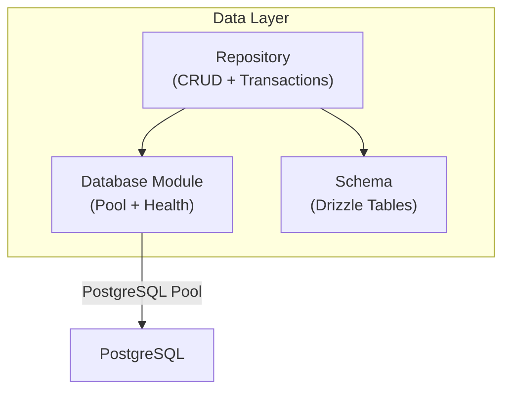
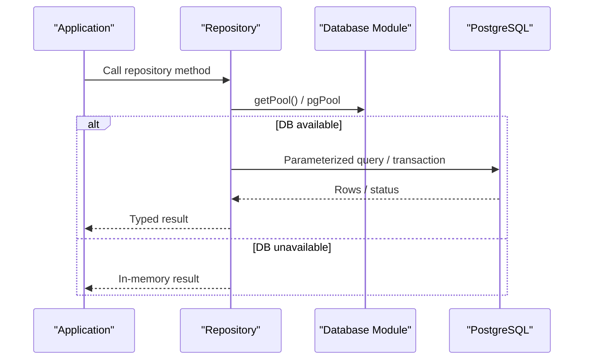
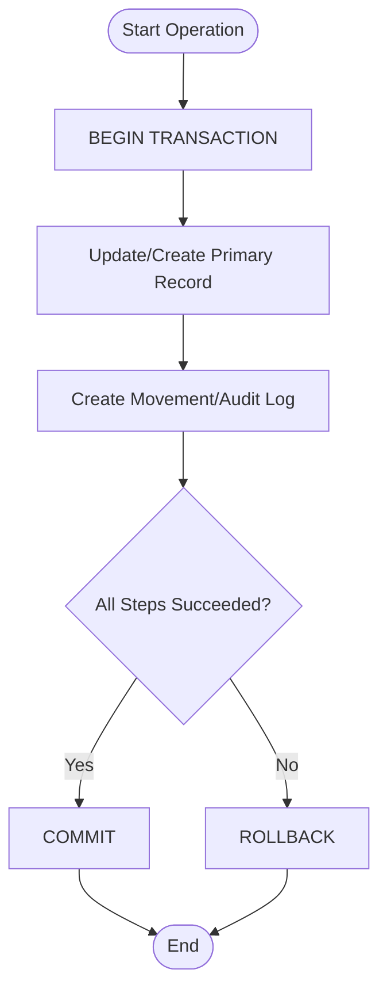
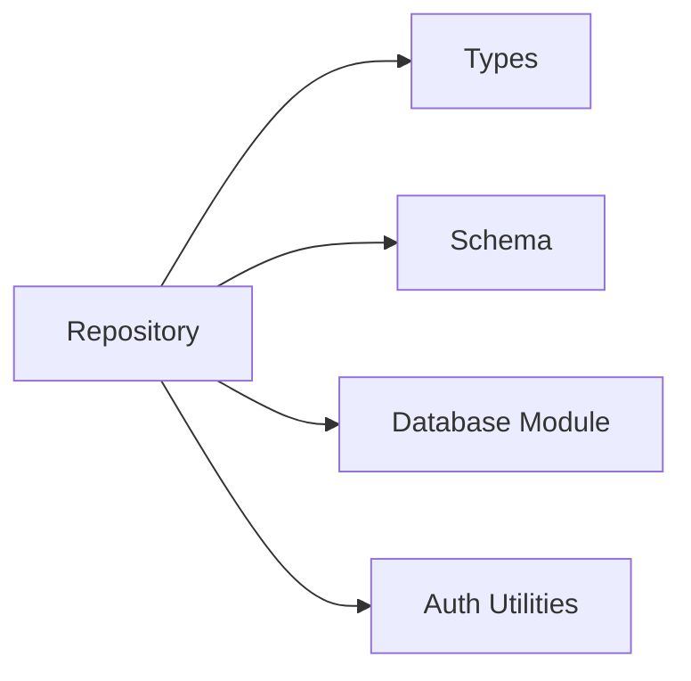

# Repository Pattern Implementation

<cite>
**Referenced Files in This Document**
- [repository.ts](file://src/db/repository.ts)
- [schema.ts](file://src/db/schema.ts)
- [index.ts](file://src/db/index.ts)
- [types.ts](file://src/types.ts)
</cite>

## Update Summary
**Changes Made**
- Enhanced user profile management with comprehensive update methods including email validation and password updates
- Added complete department CRUD operations with dependency checking and cascade updates
- Implemented advanced batch processing capabilities for bundle operations and document associations
- Strengthened security measures with parameterized queries throughout all repository methods
- Added comprehensive data backup and restore functionality with transactional integrity

## Table of Contents
1. [Introduction](#introduction)
2. [Project Structure](#project-structure)
3. [Core Components](#core-components)
4. [Architecture Overview](#architecture-overview)
5. [Detailed Component Analysis](#detailed-component-analysis)
6. [Dependency Analysis](#dependency-analysis)
7. [Performance Considerations](#performance-considerations)
8. [Troubleshooting Guide](#troubleshooting-guide)
9. [Conclusion](#conclusion)

## Introduction
This document explains ArchiveHub's repository pattern implementation for data access. The repository layer abstracts database operations behind a clean, typed interface and provides CRUD methods, complex queries, and transaction handling across multiple entities (users, departments, document types, locations, documents, checkouts, movements, retention policies, disposal records, bundles, reusable custom fields, and audit logs). It also details connection management via a PostgreSQL pool, the use of Drizzle ORM for type-safe schema definitions, and strategies for query optimization, caching, and error handling.

## Project Structure
The data access layer is organized into three primary files:
- Schema definitions using Drizzle ORM to model tables and relationships.
- A centralized database module that manages connection pooling and exposes a proxy for direct queries when needed.
- A repository module that implements entity-specific methods with fallback to in-memory state when the database is unavailable.

**Diagram sources**
- [repository.ts:1-108](file://src/db/repository.ts#L1-L108)
- [index.ts:1-136](file://src/db/index.ts#L1-L136)
- [schema.ts:1-228](file://src/db/schema.ts#L1-L228)

**Section sources**
- [repository.ts:1-108](file://src/db/repository.ts#L1-L108)
- [index.ts:1-136](file://src/db/index.ts#L1-L136)
- [schema.ts:1-228](file://src/db/schema.ts#L1-L228)

## Core Components
- Repository module: Exposes per-entity functions for reading, creating, updating, deleting, and orchestrating multi-step workflows (e.g., checkout lifecycle, document movement, bundle management). It includes robust fallback to in-memory arrays when the database is not reachable.
- Database module: Manages a single PostgreSQL connection pool, initializes Drizzle ORM with the schema, and provides health checks. It also exposes a dynamic proxy so existing code can call pgPool.query safely even before initialization.
- Schema module: Defines all tables using Drizzle ORM with appropriate column types, constraints, and defaults.
- Types module: Provides TypeScript interfaces for all domain entities used by the repository.

Key responsibilities:
- Abstraction: Consumers call repository functions without knowing whether data comes from PostgreSQL or in-memory storage.
- Type safety: Entities are strongly typed; schema enforces structure at the database level.
- Resilience: Graceful degradation to memory mode on errors or missing configuration.
- Auditing: Consistent creation of audit log entries for critical actions.

**Section sources**
- [repository.ts:1-1839](file://src/db/repository.ts#L1-L1839)
- [index.ts:1-146](file://src/db/index.ts#L1-L146)
- [schema.ts:1-229](file://src/db/schema.ts#L1-L229)
- [types.ts:1-284](file://src/types.ts#L1-L284)

## Architecture Overview
The repository layer sits between application logic and persistence. It uses a PostgreSQL pool for durable storage and falls back to in-memory arrays when the database is unavailable. Drizzle ORM is configured with the schema for type safety, while many repository methods still use parameterized SQL queries for performance and flexibility.

**Diagram sources**
- [repository.ts:106-119](file://src/db/repository.ts#L106-L119)
- [index.ts:36-95](file://src/db/index.ts#L36-L95)

## Detailed Component Analysis

### Connection Management and Drizzle Integration
- Connection pooling: A singleton pool is created lazily when first requested. SSL settings adapt to remote connections. Error events update connection flags.
- Health checks: A dedicated function tests connectivity and resets the pool on failure.
- Drizzle ORM: Initialized with the schema to enable type-safe queries where applicable.
- Proxy pool: A dynamic proxy ensures calls like pgPool.query resolve to the active pool instance once initialized.

Optimization notes:
- Connection timeout is set to reduce hanging connections.
- Health checks reset the pool on errors to recover from bad states.
- Using parameterized queries prevents SQL injection and leverages prepared statements.

**Section sources**
- [index.ts:16-95](file://src/db/index.ts#L16-L95)
- [index.ts:97-146](file://src/db/index.ts#L97-L146)

### Entity Repositories and Methods

#### Users - Enhanced Profile Management
- Read: List users, find by ID, find by email (normalized).
- Create: Hashes password if needed, sets default approval status, persists to DB or memory.
- Update: Comprehensive profile updates with email collision detection, partial field updates, and timestamp management.
- Delete: Removes user from DB or memory.
- Approval Management: Dedicated methods for approving/rejecting user accounts with status transitions.
- Password Management: Secure password updates with proper hashing.

Security and validation:
- Email normalization reduces case-sensitivity issues.
- Password hashing is applied before storage.
- Email collision detection prevents duplicate accounts.
- Partial updates only modify specified fields for efficiency.

**Section sources**
- [repository.ts:111-289](file://src/db/repository.ts#L111-L289)

#### Departments - Complete CRUD Operations
- Read: List departments ordered by name with denormalized information.
- Create: Generates unique IDs, validates uniqueness of codes, persists to DB or memory.
- Update: Dynamic field updates with cascade updates to maintain consistency across related tables.
- Delete: Validates no dependencies exist before deletion (documents, bundles, users).

Enhanced features:
- Dependency checking prevents orphaned references.
- Cascade updates maintain denormalized department names across all related tables.
- Transactional integrity for complex update operations.

**Section sources**
- [repository.ts:291-390](file://src/db/repository.ts#L291-L390)

#### Document Types
- Read: List document types with custom fields.
- Create: Persists JSONB custom fields.
- Update: Dynamic field updates with safe parameter binding.
- Delete: Removes document type.

**Section sources**
- [repository.ts:392-475](file://src/db/repository.ts#L392-L475)

#### Locations
- Read: List locations with hierarchical support.
- Create: Generates IDs, codes, QR/barcodes, timestamps; persists to DB or memory.
- Update: Partial updates with timestamp refresh.
- Delete: Validates no child locations or dependent documents exist before deletion.

**Section sources**
- [repository.ts:477-601](file://src/db/repository.ts#L477-L601)

#### Documents
- Read: List documents with full metadata mapping.
- Create: Uses a transaction to insert document, initial movement, and audit log; falls back to memory on error.
- Update: Builds dynamic update with audit logging; supports extensive fields including digital copy metadata and bundling.
- Delete: Prevents deletion if checked out; removes from DB or memory.
- Move: Transactional relocation with movement and audit log entries.

Complexity considerations:
- Batch-like updates for bundling use array parameters to update multiple documents efficiently.
- Transactions ensure consistency across related tables.

**Section sources**
- [repository.ts:603-937](file://src/db/repository.ts#L603-L937)

#### Checkouts
- Read: List checkouts ordered by creation time.
- Request: Creates checkout record and updates document status within a transaction.
- Approve/Reject: Updates checkout and document statuses atomically.
- Dispatch: Marks document as checked out, moves it to a temporary location, and records movement.
- Return: Processes check-in, updates condition and custodian, and records movement.

Transaction patterns:
- Each workflow uses BEGIN/COMMIT/ROLLBACK to maintain integrity across multiple table updates.

**Section sources**
- [repository.ts:939-1255](file://src/db/repository.ts#L939-L1255)

#### Movements
- Read: List movements with timestamps normalized to ISO strings.

**Section sources**
- [repository.ts:1257-1283](file://src/db/repository.ts#L1257-L1283)

#### Retention Policies
- Read: List policies sorted by document type name.

**Section sources**
- [repository.ts:1285-1302](file://src/db/repository.ts#L1285-L1302)

#### Disposal Records
- Note: No explicit repository methods were found in the analyzed file; schema exists for modeling disposal records.

**Section sources**
- [schema.ts:179-192](file://src/db/schema.ts#L179-L192)

#### Bundles and Dossiers - Advanced Batch Processing
- Read: List bundles with mapped fields.
- Create: Inserts bundle, optionally links multiple documents in one batch update, and creates an audit log entry.
- Update: Supports partial updates including JSONB arrays for document IDs and tags.
- Delete: Unlinks documents and deletes bundle within a transaction; optional audit log.
- Add/Remove Documents: Efficiently updates document associations using array parameters.

Batch operations:
- Uses ANY(array) to update multiple documents in a single statement for performance.
- Transactional integrity ensures all document associations are updated consistently.

**Section sources**
- [repository.ts:1495-1731](file://src/db/repository.ts#L1495-L1731)

#### Reusable Custom Fields
- Read: List custom fields with defaults.
- Create: Persists options as JSONB.
- Update: Dynamic field updates.
- Delete: Removes field.

**Section sources**
- [repository.ts:1399-1493](file://src/db/repository.ts#L1399-L1493)

#### Audit Logs
- Read: List logs with normalized timestamps.
- Create: Persists audit entries with optional before/after values.

**Section sources**
- [repository.ts:1304-1350](file://src/db/repository.ts#L1304-L1350)

### Data Validation, Sanitization, and Security
- Input sanitization:
  - Email normalization for lookups.
  - Safe parsing of stringified arrays for JSONB fields.
- Security measures:
  - Parameterized queries prevent SQL injection across all repository methods.
  - Password hashing before storage.
  - Strict status transitions enforced by repository logic during checkout lifecycles.
  - Email collision detection prevents duplicate accounts.
  - Dependency validation prevents orphaned references.
- Validation:
  - Pre-checks before deletions (e.g., locations with children or dependencies).
  - Status guards (e.g., preventing deletion of checked-out documents).
  - Department dependency checking before deletion.

**Section sources**
- [repository.ts:18-29](file://src/db/repository.ts#L18-L29)
- [repository.ts:136-149](file://src/db/repository.ts#L136-L149)
- [repository.ts:151-189](file://src/db/repository.ts#L151-L189)
- [repository.ts:230-239](file://src/db/repository.ts#L230-L239)
- [repository.ts:376-382](file://src/db/repository.ts#L376-L382)
- [repository.ts:441-468](file://src/db/repository.ts#L441-L468)
- [repository.ts:717-740](file://src/db/repository.ts#L717-L740)

### Caching Strategies and Fallback Behavior
- In-memory fallback:
  - When the database is unavailable or a query fails, repository methods return cached in-memory arrays populated via seed or prior operations.
  - This ensures continuity during development or transient outages.
- Seed support:
  - An applyMemorySeed function allows populating in-memory state for testing or offline scenarios.

Limitations:
- In-memory state is process-scoped and does not persist across restarts.
- Not suitable for production caching; intended as resilience and development aids.

**Section sources**
- [repository.ts:67-108](file://src/db/repository.ts#L67-L108)
- [repository.ts:111-119](file://src/db/repository.ts#L111-L119)

### Query Optimization Techniques
- Parameterized queries:
  - All SQL uses placeholders to leverage prepared statements and avoid injection.
- Batch updates:
  - Bundle operations update multiple documents in a single statement using array parameters.
- Selective updates:
  - Dynamic field building minimizes payload size and avoids unnecessary writes.
- Indexing recommendations (conceptual):
  - Consider indexes on frequently filtered columns such as document_number, status, current_location_id, and timestamps for read-heavy workloads.

**Section sources**
- [repository.ts:571-633](file://src/db/repository.ts#L571-L633)
- [repository.ts:1403-1456](file://src/db/repository.ts#L1403-L1456)
- [repository.ts:1528-1561](file://src/db/repository.ts#L1528-L1561)

### Transaction Handling Patterns
- Multi-step operations are wrapped in transactions to ensure atomicity:
  - Document creation includes movement and audit log insertion.
  - Checkout request updates both checkout and document status.
  - Checkout dispatch and return involve multiple updates and movement records.
  - Bundle create/delete/unlink operations are transactional.
  - Data import/export operations run as single transactions.
- Error handling:
  - On exception, transactions roll back and errors propagate to callers.
  - Fallback to in-memory state occurs only when the entire operation cannot proceed against the database.

**Diagram sources**
- [repository.ts:571-633](file://src/db/repository.ts#L571-L633)
- [repository.ts:840-896](file://src/db/repository.ts#L840-L896)
- [repository.ts:971-1052](file://src/db/repository.ts#L971-L1052)
- [repository.ts:1054-1122](file://src/db/repository.ts#L1054-L1122)
- [repository.ts:1374-1456](file://src/db/repository.ts#L1374-L1456)
- [repository.ts:1492-1526](file://src/db/repository.ts#L1492-L1526)

### Data Backup and Restore Capabilities
- Export functionality: Exports all data from whitelisted tables in a standardized format.
- Import functionality: Restores data with transactional integrity and chunked processing.
- Safety measures: Whitelisted table set prevents unauthorized table access.
- Performance optimization: Chunked inserts handle large datasets efficiently.

**Section sources**
- [repository.ts:1733-1839](file://src/db/repository.ts#L1733-L1839)

## Dependency Analysis
The repository depends on:
- Database module for pool management and Drizzle integration.
- Schema for table definitions.
- Types for entity contracts.
- Authentication utilities for password hashing.

**Diagram sources**
- [repository.ts:1-16](file://src/db/repository.ts#L1-L16)
- [index.ts:1-7](file://src/db/index.ts#L1-L7)
- [schema.ts:1-10](file://src/db/schema.ts#L1-L10)
- [types.ts:1-284](file://src/types.ts#L1-L284)

**Section sources**
- [repository.ts:1-16](file://src/db/repository.ts#L1-L16)
- [index.ts:1-7](file://src/db/index.ts#L1-L7)
- [schema.ts:1-10](file://src/db/schema.ts#L1-L10)
- [types.ts:1-284](file://src/types.ts#L1-L284)

## Performance Considerations
- Connection pooling:
  - Singleton pool reduces overhead; connection timeouts prevent resource leaks.
- Prepared statements:
  - Parameterized queries improve performance and security.
- Batch operations:
  - Array-based updates minimize round trips for bulk changes.
- Selective updates:
  - Dynamic field construction reduces write payloads.
- In-memory fallback:
  - Useful for development and resilience but should not be relied upon for production caching due to lack of persistence and concurrency controls.
- Chunked processing:
  - Large dataset imports use chunked inserts to stay within driver parameter limits.

Recommendations:
- Add database indexes for high-frequency filters and joins.
- Consider query plans for large datasets and adjust pagination accordingly.
- Monitor pool metrics and tune max connections based on workload.

## Troubleshooting Guide
Common issues and resolutions:
- Database URL misconfiguration:
  - Health check returns disconnected; verify .env and remove placeholder passwords.
- Connection failures:
  - Pool resets on error; retry operations after reconnection.
- Query errors:
  - Repository methods fall back to in-memory state; inspect logs for warnings and fix underlying SQL or schema mismatches.
- Deletion constraints:
  - Location deletion blocked if children or dependent documents exist; resolve references before deletion.
  - Department deletion blocked if documents, bundles, or users still reference it; reassign them first.
- Checkout state inconsistencies:
  - Ensure transactions complete successfully; check rollback logs and validate status transitions.
- Email conflicts:
  - User profile updates reject emails that collide with existing accounts.

Operational tips:
- Use clearCustomDataFromDb to reset test environments safely.
- Validate inputs early to avoid costly transaction rollbacks.
- Monitor transaction logs for failed operations that fell back to memory mode.

**Section sources**
- [index.ts:97-146](file://src/db/index.ts#L97-L146)
- [repository.ts:376-382](file://src/db/repository.ts#L376-L382)
- [repository.ts:441-468](file://src/db/repository.ts#L441-L468)
- [repository.ts:1219-1264](file://src/db/repository.ts#L1219-L1264)
- [repository.ts:1352-1397](file://src/db/repository.ts#L1352-L1397)

## Conclusion
ArchiveHub's repository pattern delivers a resilient, type-safe data access layer that abstracts database interactions behind a consistent API. It combines PostgreSQL connection pooling, Drizzle schema definitions, and robust fallback mechanisms to ensure reliability. The enhanced user profile management, complete department CRUD operations, advanced batch processing capabilities, and strengthened security measures provide a comprehensive foundation for archive management operations. Transactional workflows maintain data integrity across complex operations, while parameterized queries and selective updates optimize performance and security. For production deployments, consider adding indexes, monitoring pool health, and replacing in-memory fallbacks with proper caching layers.