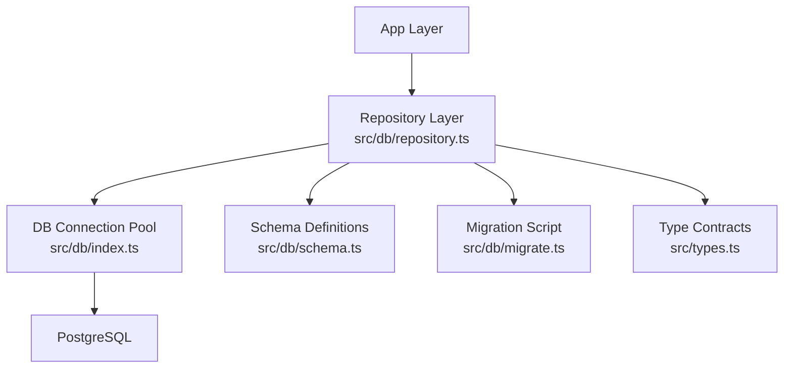
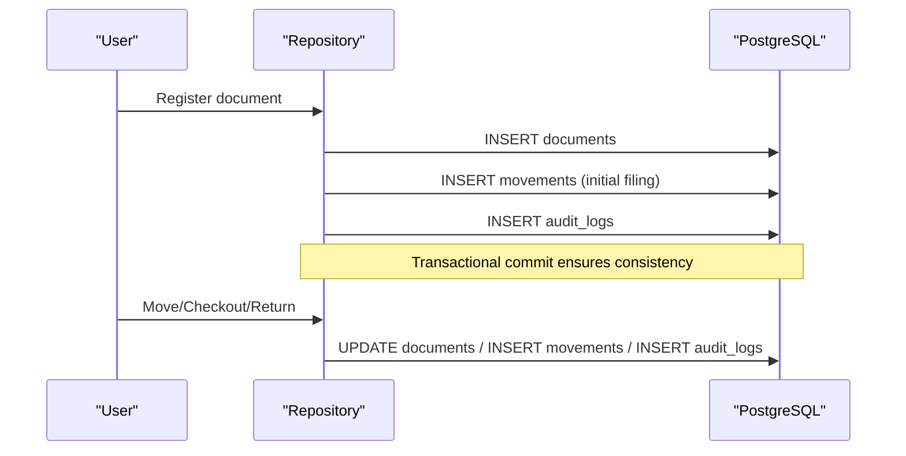
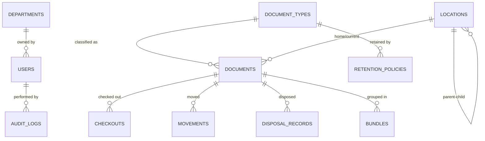

# Schema Design

<cite>
**Referenced Files in This Document**
- [schema.ts](file://src/db/schema.ts)
- [migrate.ts](file://src/db/migrate.ts)
- [index.ts](file://src/db/index.ts)
- [repository.ts](file://src/db/repository.ts)
- [types.ts](file://src/types.ts)
</cite>

## Table of Contents
1. Introduction
2. Project Structure
3. Core Components
4. Architecture Overview
5. Detailed Component Analysis
6. Dependency Analysis
7. Performance Considerations
8. Troubleshooting Guide
9. Conclusion

## Introduction
This document describes the PostgreSQL schema design for ArchiveHub’s archive management system. It covers all 11 core tables: departments, users, document types, locations (hierarchical), documents, checkouts, movements, retention policies, disposal records, bundles, and audit logs. For each table, it specifies field definitions, data types, constraints, default values, primary key strategies, unique constraints, and indexing considerations. It also explains key design decisions such as using JSONB for flexible metadata, self-referencing relationships in locations to model a building → floor → room → cabinet → shelf → box hierarchy, and denormalized fields like departmentName and documentTypeName to optimize read performance.

## Project Structure
The database schema is defined in Drizzle ORM style and materialized via migration scripts. The repository layer executes SQL against a pooled PostgreSQL connection and falls back to in-memory state when the database is unavailable.

**Diagram sources**
- [repository.ts:1-16](file://src/db/repository.ts#L1-L16)
- [index.ts:1-10](file://src/db/index.ts#L1-L10)
- [schema.ts:1-10](file://src/db/schema.ts#L1-L10)
- [migrate.ts:1-15](file://src/db/migrate.ts#L1-L15)
- [types.ts:1-10](file://src/types.ts#L1-L10)

**Section sources**
- [index.ts:16-69](file://src/db/index.ts#L16-L69)
- [migrate.ts:16-266](file://src/db/migrate.ts#L16-L266)
- [schema.ts:12-228](file://src/db/schema.ts#L12-L228)

## Core Components
ArchiveHub models physical and digital archives with these core entities:
- Departments: organizational units that own or manage records.
- Users: system actors with roles and approval workflows.
- Document Types: classifications with retention rules and custom field schemas.
- Locations: hierarchical storage containers enabling precise physical tracking.
- Documents: individual records with status, location, and metadata.
- Checkouts: workflow for borrowing and returning documents.
- Movements: immutable history of where documents have been.
- Retention Policies: per-document-type rules for how long to keep records.
- Disposal Records: auditable trail of destruction or archival actions.
- Bundles: logical groupings of documents for co-location and management.
- Audit Logs: comprehensive change tracking across the system.

Key design patterns:
- Primary keys are short, stable, string identifiers (VARCHAR(50)) generated by application logic.
- Unique constraints protect business keys (e.g., codes, document numbers, QR codes).
- Denormalization stores human-readable names alongside IDs to avoid joins on hot paths.
- JSONB fields store flexible metadata and configuration without schema changes.
- Hierarchical locations use a self-referencing parent_id to model multi-level storage.

**Section sources**
- [schema.ts:12-228](file://src/db/schema.ts#L12-L228)
- [migrate.ts:16-266](file://src/db/migrate.ts#L16-L266)
- [types.ts:10-283](file://src/types.ts#L10-L283)

## Architecture Overview
The schema supports end-to-end lifecycle management: registration, filing, movement, checkout, retention enforcement, disposal, and auditing.

**Diagram sources**
- [repository.ts:571-633](file://src/db/repository.ts#L571-L633)
- [repository.ts:767-799](file://src/db/repository.ts#L767-L799)
- [migrate.ts:89-133](file://src/db/migrate.ts#L89-L133)
- [migrate.ts:163-182](file://src/db/migrate.ts#L163-L182)
- [migrate.ts:213-229](file://src/db/migrate.ts#L213-L229)

## Detailed Component Analysis

### Departments
Purpose: Organizational units that own or manage records.

- id: VARCHAR(50), PRIMARY KEY
- code: VARCHAR(20), NOT NULL, UNIQUE
- name: VARCHAR(255), NOT NULL
- head_name: VARCHAR(255), NOT NULL
- document_count: INTEGER, DEFAULT 0
- created_at: TIMESTAMPTZ, DEFAULT NOW()

Design notes:
- code is a stable business key; unique constraint prevents duplicates.
- document_count is a denormalized counter used for quick reporting.

Indexing recommendations:
- Index on code for lookups.
- Optional index on name if frequently searched.

**Section sources**
- [schema.ts:12-20](file://src/db/schema.ts#L12-L20)
- [migrate.ts:16-26](file://src/db/migrate.ts#L16-L26)

### Users
Purpose: System actors with roles and approval workflows.

- id: VARCHAR(50), PRIMARY KEY
- email: VARCHAR(255), NOT NULL, UNIQUE
- password: VARCHAR(255)
- full_name: VARCHAR(255), NOT NULL
- role: VARCHAR(50), NOT NULL
- department_id: VARCHAR(50)
- department_name: VARCHAR(255)
- avatar_url: TEXT
- title: VARCHAR(255)
- approval_status: VARCHAR(50), DEFAULT 'APPROVED'
- created_at: TIMESTAMPTZ, DEFAULT NOW()

Design notes:
- email uniqueness enforces single account per user.
- role constrains permissions; approval_status supports onboarding workflows.
- department_name is denormalized for fast display without joining departments.

Indexing recommendations:
- Index on email (already unique).
- Optional index on role and approval_status for filtering lists.

**Section sources**
- [schema.ts:22-35](file://src/db/schema.ts#L22-L35)
- [migrate.ts:28-49](file://src/db/migrate.ts#L28-L49)
- [types.ts:10-22](file://src/types.ts#L10-L22)

### Document Types
Purpose: Classifications with retention rules and custom field schemas.

- id: VARCHAR(50), PRIMARY KEY
- code: VARCHAR(20), NOT NULL, UNIQUE
- name: VARCHAR(255), NOT NULL
- retention_years: INTEGER, NOT NULL, DEFAULT 5
- description: TEXT
- custom_fields: JSONB
- created_at: TIMESTAMPTZ, DEFAULT NOW()

Design notes:
- custom_fields uses JSONB to define dynamic form fields per type (labels, types, options, required flags).
- retention_years drives retention policy calculations.

Indexing recommendations:
- Index on code (unique).
- Optional index on name.

**Section sources**
- [schema.ts:37-46](file://src/db/schema.ts#L37-L46)
- [migrate.ts:51-66](file://src/db/migrate.ts#L51-L66)
- [types.ts:118-127](file://src/types.ts#L118-L127)

### Locations (Hierarchical)
Purpose: Multi-level physical storage model supporting building → floor → room → cabinet → shelf → box.

- id: VARCHAR(50), PRIMARY KEY
- parent_id: VARCHAR(50) (self-reference)
- type: VARCHAR(50), NOT NULL
- code: VARCHAR(50), NOT NULL, UNIQUE
- name: VARCHAR(255), NOT NULL
- description: TEXT
- image_url: TEXT
- capacity: INTEGER, DEFAULT 20
- current_occupancy: INTEGER, DEFAULT 0
- qr_code: VARCHAR(100), NOT NULL, UNIQUE
- barcode: VARCHAR(100), NOT NULL
- department_id: VARCHAR(50)
- department_name: VARCHAR(255)
- created_at: TIMESTAMPTZ, DEFAULT NOW()
- updated_at: TIMESTAMPTZ, DEFAULT NOW()

Design notes:
- Self-referencing parent_id enables arbitrary depth hierarchies.
- type enumerates levels (BUILDING, FLOOR, ROOM, CABINET, SHELF, BOX, etc.).
- capacity/current_occupancy support container utilization tracking.
- qr_code/barcode enable scanning-based navigation and verification.

Indexing recommendations:
- Index on parent_id for tree traversal.
- Index on type for filtering by level.
- Index on department_id for department-scoped browsing.

**Section sources**
- [schema.ts:48-65](file://src/db/schema.ts#L48-L65)
- [migrate.ts:68-87](file://src/db/migrate.ts#L68-L87)
- [types.ts:24-52](file://src/types.ts#L24-L52)

### Documents
Purpose: Individual records with status, location, and metadata.

- id: VARCHAR(50), PRIMARY KEY
- document_number: VARCHAR(100), NOT NULL, UNIQUE
- reference_number: VARCHAR(100)
- title: VARCHAR(500), NOT NULL
- document_type_id: VARCHAR(50), NOT NULL
- document_type_name: VARCHAR(255), NOT NULL
- subject: TEXT
- description: TEXT
- department_id: VARCHAR(50), NOT NULL
- department_name: VARCHAR(255), NOT NULL
- custodian_name: VARCHAR(255), NOT NULL
- home_location_id: VARCHAR(50), NOT NULL
- current_location_id: VARCHAR(50), NOT NULL
- status: VARCHAR(50), NOT NULL, DEFAULT 'AVAILABLE'
- confidentiality: VARCHAR(50), NOT NULL, DEFAULT 'INTERNAL'
- condition: VARCHAR(50), NOT NULL, DEFAULT 'EXCELLENT'
- qr_code: VARCHAR(100), NOT NULL, UNIQUE
- barcode: VARCHAR(100), NOT NULL
- document_date: VARCHAR(50), NOT NULL
- received_date: VARCHAR(50)
- filed_date: VARCHAR(50)
- retention_start_date: VARCHAR(50)
- retention_end_date: VARCHAR(50)
- disposal_date: VARCHAR(50)
- has_digital_copy: BOOLEAN, DEFAULT FALSE
- digital_file_name: VARCHAR(255)
- digital_file_size: VARCHAR(50)
- digital_file_type: VARCHAR(50)
- digital_file_version: INTEGER, DEFAULT 1
- custom_metadata: JSONB
- custom_field_values: JSONB
- condition_notes: TEXT
- bundle_id: VARCHAR(50)
- bundle_number: VARCHAR(100)
- bundle_title: VARCHAR(500)
- created_at: TIMESTAMPTZ, DEFAULT NOW()
- updated_at: TIMESTAMPTZ, DEFAULT NOW()

Design notes:
- Home vs current location separation allows tracking both permanent and temporary placement.
- Denormalized document_type_name and department_name reduce join overhead on common reads.
- JSONB fields allow flexible metadata and typed custom field values without schema changes.
- Status, confidentiality, and condition constrain lifecycle and handling.

Indexing recommendations:
- Index on document_number (unique).
- Index on department_id, document_type_id for filtering.
- Index on current_location_id and home_location_id for location queries.
- Index on status for workflow views.
- Composite indexes on (department_id, status) and (document_type_id, retention_end_date) can improve common reports.

**Section sources**
- [schema.ts:67-116](file://src/db/schema.ts#L67-L116)
- [migrate.ts:89-133](file://src/db/migrate.ts#L89-L133)
- [types.ts:135-183](file://src/types.ts#L135-L183)

### Checkouts
Purpose: Workflow for requesting, approving, checking out, and returning documents.

- id: VARCHAR(50), PRIMARY KEY
- document_id: VARCHAR(50), NOT NULL
- document_number: VARCHAR(100), NOT NULL
- document_title: VARCHAR(500), NOT NULL
- requested_by_user_id: VARCHAR(50), NOT NULL
- requested_by_user_name: VARCHAR(255), NOT NULL
- requested_by_department: VARCHAR(255), NOT NULL
- approved_by_user_id: VARCHAR(50)
- approved_by_user_name: VARCHAR(255)
- checked_out_by_user_id: VARCHAR(50)
- checked_out_by_user_name: VARCHAR(255)
- returned_by_user_name: VARCHAR(255)
- request_date: VARCHAR(50), NOT NULL
- checkout_date: VARCHAR(50)
- due_date: VARCHAR(50), NOT NULL
- return_date: VARCHAR(50)
- status: VARCHAR(50), NOT NULL, DEFAULT 'REQUESTED'
- purpose: TEXT, NOT NULL
- condition_out: VARCHAR(50), NOT NULL, DEFAULT 'EXCELLENT'
- condition_in: VARCHAR(50)
- notes: TEXT
- created_at: TIMESTAMPTZ, DEFAULT NOW()

Design notes:
- Denormalized names simplify UI rendering and reporting.
- Status tracks lifecycle from request through return.

Indexing recommendations:
- Index on document_id for active/outstanding checks.
- Index on status for workflow dashboards.
- Index on due_date for overdue alerts.

**Section sources**
- [schema.ts:118-148](file://src/db/schema.ts#L118-L148)
- [migrate.ts:135-161](file://src/db/migrate.ts#L135-L161)
- [types.ts:205-235](file://src/types.ts#L205-L235)

### Movements
Purpose: Immutable history of document location changes and transfers.

- id: VARCHAR(50), PRIMARY KEY
- document_id: VARCHAR(50), NOT NULL
- document_number: VARCHAR(100), NOT NULL
- document_title: VARCHAR(500), NOT NULL
- from_location_id: VARCHAR(50)
- from_location_path: TEXT, NOT NULL
- to_location_id: VARCHAR(50)
- to_location_path: TEXT, NOT NULL
- movement_type: VARCHAR(50), NOT NULL
- performed_by_user_id: VARCHAR(50)
- performed_by_user_name: VARCHAR(255), NOT NULL
- authorized_by_user_name: VARCHAR(255)
- reason: TEXT, NOT NULL
- timestamp: TIMESTAMPTZ, DEFAULT NOW()
- notes: TEXT

Design notes:
- Stores both IDs and human-readable paths for traceability and reporting.
- movement_type captures INITIAL_FILING, CHECKOUT, CHECKIN, RELOCATION, TRANSFER, AUDIT_CORRECTION.

Indexing recommendations:
- Index on document_id for timeline queries.
- Index on timestamp for chronological audits.
- Index on movement_type for filtering event types.

**Section sources**
- [schema.ts:150-167](file://src/db/schema.ts#L150-L167)
- [migrate.ts:163-182](file://src/db/migrate.ts#L163-L182)
- [types.ts:185-203](file://src/types.ts#L185-L203)

### Retention Policies
Purpose: Per-document-type rules governing retention duration and disposal methods.

- id: VARCHAR(50), PRIMARY KEY
- document_type_id: VARCHAR(50), NOT NULL
- document_type_name: VARCHAR(255), NOT NULL
- retention_years: INTEGER, NOT NULL, DEFAULT 5
- disposal_method: VARCHAR(50), NOT NULL
- description: TEXT

Design notes:
- Denormalized document_type_name simplifies reporting and avoids joins.
- disposal_method defines acceptable outcomes (e.g., shredding, incineration, digital-only).

Indexing recommendations:
- Index on document_type_id for lookup by type.

**Section sources**
- [schema.ts:169-177](file://src/db/schema.ts#L169-L177)
- [migrate.ts:184-194](file://src/db/migrate.ts#L184-L194)
- [types.ts:237-244](file://src/types.ts#L237-L244)

### Disposal Records
Purpose: Auditable trail of destruction or archival actions.

- id: VARCHAR(50), PRIMARY KEY
- document_id: VARCHAR(50)
- document_number: VARCHAR(100), NOT NULL
- document_title: VARCHAR(500), NOT NULL
- requested_by_user_name: VARCHAR(255), NOT NULL
- approved_by_user_name: VARCHAR(255), NOT NULL
- disposal_date: VARCHAR(50), NOT NULL
- disposal_method: VARCHAR(50), NOT NULL
- certificate_number: VARCHAR(100), NOT NULL
- witness_name: VARCHAR(255), NOT NULL
- notes: TEXT

Design notes:
- Captures compliance details including certificates and witnesses.
- Denormalized names ensure readability without joins.

Indexing recommendations:
- Index on document_number for retrieval by record.
- Index on disposal_date for period-based reports.

**Section sources**
- [schema.ts:179-192](file://src/db/schema.ts#L179-L192)
- [migrate.ts:196-211](file://src/db/migrate.ts#L196-L211)
- [types.ts:246-258](file://src/types.ts#L246-L258)

### Bundles & Dossiers
Purpose: Logical grouping of documents for co-location and management.

- id: VARCHAR(50), PRIMARY KEY
- bundle_number: VARCHAR(100), NOT NULL, UNIQUE
- title: VARCHAR(500), NOT NULL
- description: TEXT
- department_id: VARCHAR(50), NOT NULL
- department_name: VARCHAR(255), NOT NULL
- location_id: VARCHAR(50)
- location_path: TEXT
- document_ids: JSONB, DEFAULT []
- status: VARCHAR(50), NOT NULL, DEFAULT 'ACTIVE'
- qr_code: VARCHAR(100), NOT NULL, UNIQUE
- barcode: VARCHAR(100), NOT NULL
- tags: JSONB, DEFAULT []
- created_at: TIMESTAMPTZ, DEFAULT NOW()
- updated_at: TIMESTAMPTZ, DEFAULT NOW()

Design notes:
- document_ids and tags use JSONB for flexible membership and labeling.
- Location path stored for quick display and scanning.

Indexing recommendations:
- Index on bundle_number (unique).
- Index on department_id for department-scoped bundles.
- Index on status for active/archive views.

**Section sources**
- [schema.ts:194-211](file://src/db/schema.ts#L194-L211)
- [migrate.ts:247-266](file://src/db/migrate.ts#L247-L266)
- [types.ts:100-116](file://src/types.ts#L100-L116)

### Audit Logs
Purpose: Comprehensive change tracking across the system.

- id: VARCHAR(50), PRIMARY KEY
- user_id: VARCHAR(50)
- user_name: VARCHAR(255), NOT NULL
- user_role: VARCHAR(50), NOT NULL
- action: VARCHAR(100), NOT NULL
- entity_type: VARCHAR(50), NOT NULL
- entityId: VARCHAR(50), NOT NULL
- entity_name: VARCHAR(255), NOT NULL
- timestamp: TIMESTAMPTZ, DEFAULT NOW()
- details: TEXT, NOT NULL
- before_value: TEXT
- after_value: TEXT

Design notes:
- Captures who did what, to which entity, and why.
- before_value/after_value enable diff-style auditing.

Indexing recommendations:
- Index on entity_type and entity_id for entity-centric trails.
- Index on timestamp for chronological review.
- Index on user_id for user activity reports.

**Section sources**
- [schema.ts:213-227](file://src/db/schema.ts#L213-L227)
- [migrate.ts:213-229](file://src/db/migrate.ts#L213-L229)
- [types.ts:260-274](file://src/types.ts#L260-L274)

## Dependency Analysis
Relationships and denormalization choices:
- Documents reference locations via home_location_id and current_location_id; locations use parent_id for hierarchy.
- Checkouts and movements reference documents but store denormalized names for performance.
- Bundles store document_ids as JSONB; documents may optionally link to a bundle for cross-references.
- Retention policies reference document types; documents carry denormalized document_type_name.
- Audit logs capture actions across all entities.

**Diagram sources**
- [schema.ts:12-228](file://src/db/schema.ts#L12-L228)
- [migrate.ts:16-266](file://src/db/migrate.ts#L16-L266)

**Section sources**
- [schema.ts:12-228](file://src/db/schema.ts#L12-L228)
- [migrate.ts:16-266](file://src/db/migrate.ts#L16-L266)

## Performance Considerations
- Denormalized names: Storing department_name and document_type_name reduces frequent JOINs on high-read paths (documents, checkouts, movements).
- JSONB fields: Use JSONB for custom_metadata, custom_field_values, reusable custom fields, and bundle document_ids/tags to support evolving schemas without migrations.
- Hierarchical locations: Maintain an index on parent_id to efficiently traverse trees and compute paths. Consider generating and caching a full path string for fast display.
- Indexing strategy:
  - Unique indexes already exist for codes, document numbers, and QR codes.
  - Add indexes on foreign keys and frequently filtered columns:
    - documents: department_id, document_type_id, current_location_id, home_location_id, status
    - checkouts: document_id, status, due_date
    - movements: document_id, timestamp, movement_type
    - locations: parent_id, type, department_id
    - audit_logs: entity_type, entity_id, timestamp, user_id
- Transactions: Critical operations (create document, initial movement, audit log) are wrapped in transactions to ensure consistency.

[No sources needed since this section provides general guidance]

## Troubleshooting Guide
Common issues and mitigations:
- Database connectivity: If DATABASE_URL is missing or invalid, the pool returns null and repository functions fall back to in-memory state. Health checks report connection status and update internal flags.
- Migration errors: Migrations run within a transaction; any error triggers rollback and logs the error. Ensure schema compatibility before running migrations.
- Deletion constraints: Deleting locations is guarded by checks for child locations and references in documents to prevent orphaned data.
- Repository fallback: When PostgreSQL is unavailable, repository functions continue operating against in-memory arrays, logging warnings. This aids development but should not be used in production.

Operational tips:
- Validate environment variables and connection strings before starting the server.
- Run migrations once per environment and verify health endpoints.
- Monitor audit_logs for unexpected failures or inconsistent states.

**Section sources**
- [index.ts:16-69](file://src/db/index.ts#L16-L69)
- [index.ts:97-135](file://src/db/index.ts#L97-L135)
- [repository.ts:106-119](file://src/db/repository.ts#L106-L119)
- [repository.ts:441-468](file://src/db/repository.ts#L441-L468)
- [migrate.ts:12-14](file://src/db/migrate.ts#L12-L14)
- [migrate.ts:268-277](file://src/db/migrate.ts#L268-L277)

## Conclusion
ArchiveHub’s PostgreSQL schema balances normalization with pragmatic denormalization to deliver fast reads and clear auditability. The hierarchical locations model supports complex physical storage structures while keeping queries efficient. JSONB fields provide flexibility for evolving metadata needs without costly schema changes. Strong constraints (primary keys, unique codes, QR codes) and thoughtful indexing ensure data integrity and performance at scale. Transactions and audit logs safeguard critical operations and provide full traceability across the document lifecycle.