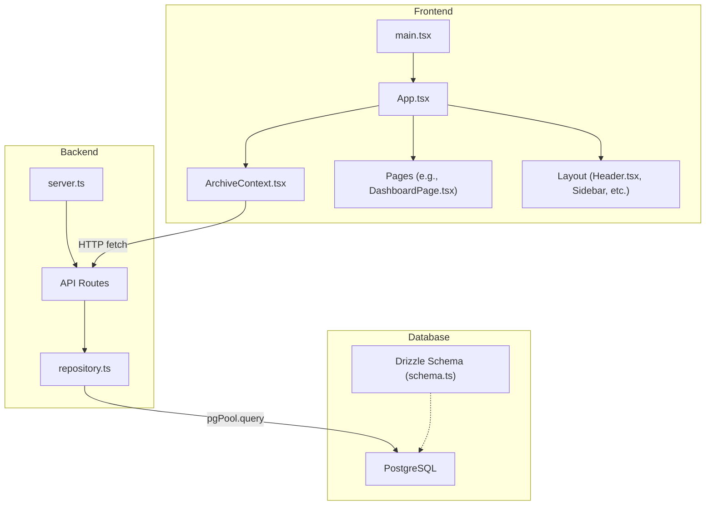
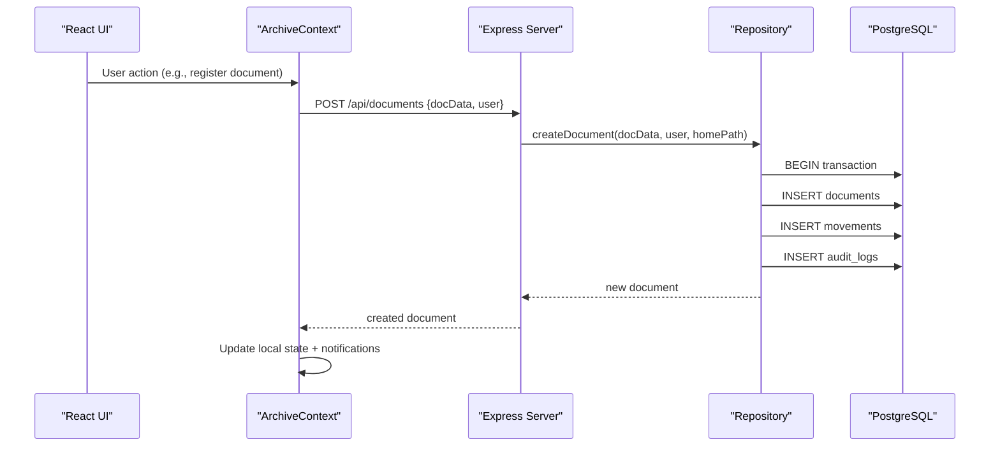
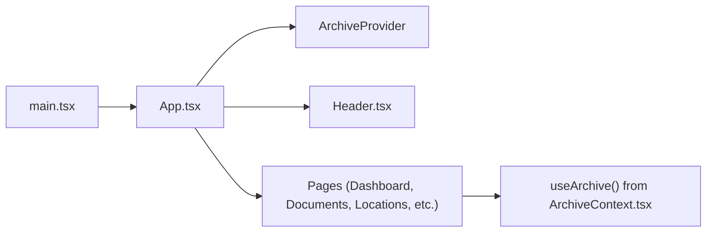
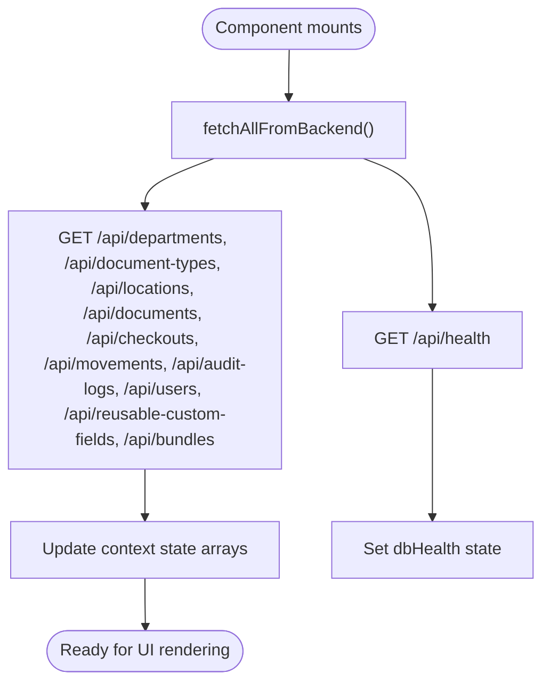
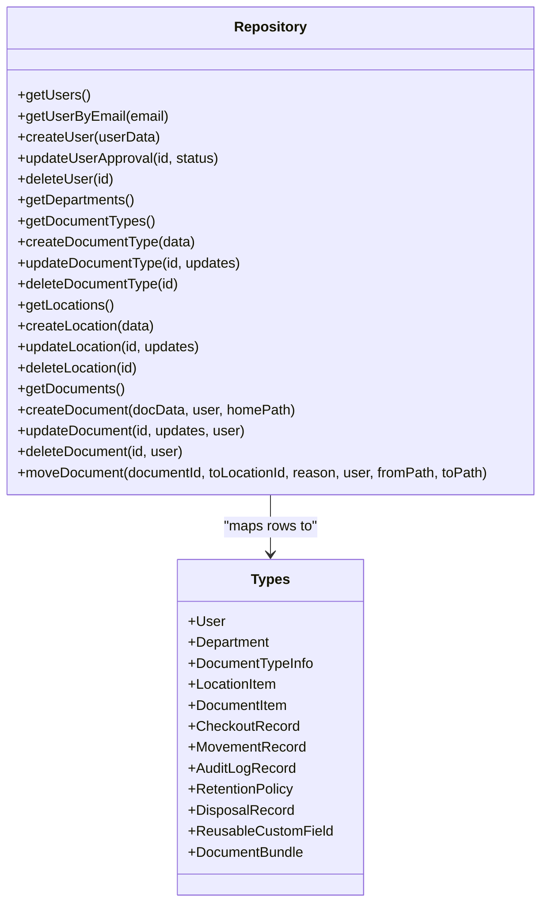
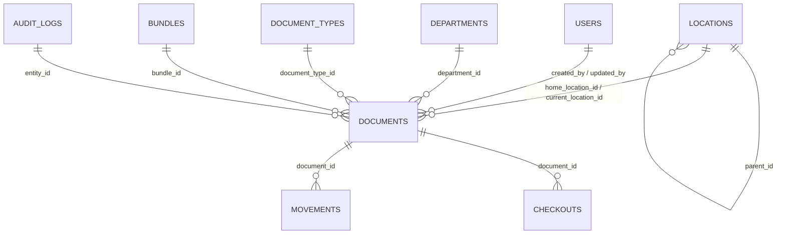
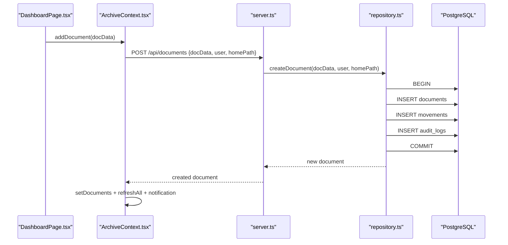
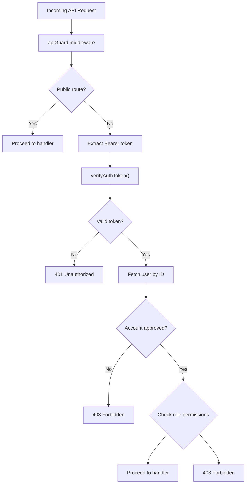
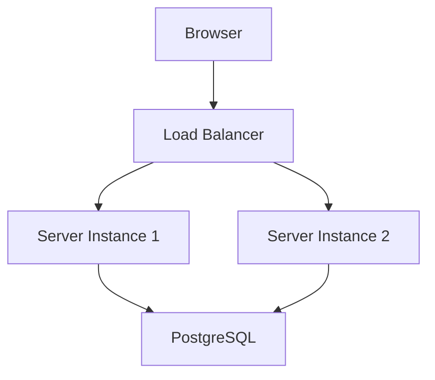

# System Architecture

<cite>
**Referenced Files in This Document**
- [App.tsx](file://src/App.tsx)
- [main.tsx](file://src/main.tsx)
- [server.ts](file://server.ts)
- [vite.config.ts](file://vite.config.ts)
- [package.json](file://package.json)
- [ArchiveContext.tsx](file://src/context/ArchiveContext.tsx)
- [repository.ts](file://src/db/repository.ts)
- [schema.ts](file://src/db/schema.ts)
- [index.ts](file://src/db/index.ts)
- [types.ts](file://src/types.ts)
- [session.ts](file://src/auth/session.ts)
- [apiGuard.ts](file://src/auth/apiGuard.ts)
- [DashboardPage.tsx](file://src/pages/DashboardPage.tsx)
- [Header.tsx](file://src/components/layout/Header.tsx)
</cite>

## Table of Contents
1. [Introduction](#introduction)
2. [Project Structure](#project-structure)
3. [Core Components](#core-components)
4. [Architecture Overview](#architecture-overview)
5. [Detailed Component Analysis](#detailed-component-analysis)
6. [Dependency Analysis](#dependency-analysis)
7. [Performance Considerations](#performance-considerations)
8. [Security Architecture](#security-architecture)
9. [Scalability and Deployment Topology](#scalability-and-deployment-topology)
10. [Troubleshooting Guide](#troubleshooting-guide)
11. [Conclusion](#conclusion)

## Introduction
This document describes the full-stack architecture of ArchiveHub, a Physical & Digital Archive Management System (PDAMS). The system combines a React frontend with an Express.js backend and a PostgreSQL database. Data access is abstracted via a repository layer that uses Drizzle ORM for type-safe schema definitions and raw SQL queries through a Node Postgres pool. State management on the frontend is context-based using a central ArchiveContext that orchestrates UI state, authentication session persistence, and synchronization with backend APIs.

The application supports hierarchical physical locations, document lifecycle tracking, checkouts and returns, retention policies, audit logging, and bundle/dossier grouping. It includes role-based API guards, JWT utilities, and a resilient fallback to in-memory mode when PostgreSQL is unavailable.

## Project Structure
At a high level:
- Frontend: React + TypeScript, Vite build tooling, Tailwind CSS styling. Entry point renders App wrapped by ArchiveProvider.
- Backend: Express server exposing REST endpoints under /api/*, integrating with repository functions and database health checks.
- Database: PostgreSQL via pg pool; Drizzle schema definitions define tables; repository layer performs CRUD operations and transactions.
- Auth: JWT signing/verification utilities and an API guard middleware enforcing role-based access control.



**Diagram sources**
- [main.tsx:1-11](file://src/main.tsx#L1-L11)
- [App.tsx:1-173](file://src/App.tsx#L1-L173)
- [ArchiveContext.tsx:197-255](file://src/context/ArchiveContext.tsx#L197-L255)
- [server.ts:13-596](file://server.ts#L13-L596)
- [repository.ts:1-120](file://src/db/repository.ts#L1-L120)
- [schema.ts:12-228](file://src/db/schema.ts#L12-L228)
- [index.ts:16-135](file://src/db/index.ts#L16-L135)

**Section sources**
- [main.tsx:1-11](file://src/main.tsx#L1-L11)
- [App.tsx:1-173](file://src/App.tsx#L1-L173)
- [server.ts:13-596](file://server.ts#L13-L596)
- [vite.config.ts:1-23](file://vite.config.ts#L1-L23)
- [package.json:1-49](file://package.json#L1-L49)

## Core Components
- Application shell and routing: App.tsx composes layout components and conditionally renders pages based on active tab and selected document. It also hosts global modals (QR scanner) and manages navigation state.
- Context state: ArchiveContext.tsx centralizes user session, data stores (documents, locations, checkouts, movements, audit logs), and provides methods to perform domain operations while syncing with backend APIs.
- Repository layer: repository.ts abstracts all data operations behind typed functions, mapping rows to domain types and providing in-memory fallback when the database is not available.
- Database layer: index.ts initializes the pg pool and Drizzle instance, exposes health checks, and provides a proxy pgPool for dynamic resolution. schema.ts defines relational tables for departments, users, document types, locations, documents, checkouts, movements, retention policies, disposal records, bundles, and audit logs.
- Authentication and authorization: session.ts provides password hashing and JWT utilities; apiGuard.ts enforces role-based access across API routes.

**Section sources**
- [App.tsx:19-173](file://src/App.tsx#L19-L173)
- [ArchiveContext.tsx:32-109](file://src/context/ArchiveContext.tsx#L32-L109)
- [repository.ts:111-149](file://src/db/repository.ts#L111-L149)
- [index.ts:16-135](file://src/db/index.ts#L16-L135)
- [schema.ts:23-228](file://src/db/schema.ts#L23-L228)
- [session.ts:23-66](file://src/auth/session.ts#L23-L66)
- [apiGuard.ts:1-98](file://src/auth/apiGuard.ts#L1-L98)

## Architecture Overview
The system follows a layered architecture:
- Presentation Layer: React components render UI and delegate actions to the context.
- Service Layer (Context): ArchiveContext coordinates business logic, local state updates, and API calls.
- API Layer: Express routes handle HTTP requests, validate inputs, and call repository functions.
- Repository Layer: Encapsulates data access, maps results to domain models, and ensures transactional integrity where needed.
- Persistence Layer: PostgreSQL database accessed via pg pool; Drizzle schema used for migrations and type safety.



**Diagram sources**
- [ArchiveContext.tsx:752-777](file://src/context/ArchiveContext.tsx#L752-L777)
- [server.ts:298-316](file://server.ts#L298-L316)
- [repository.ts:521-633](file://src/db/repository.ts#L521-L633)

**Section sources**
- [server.ts:13-596](file://server.ts#L13-L596)
- [repository.ts:521-633](file://src/db/repository.ts#L521-L633)
- [index.ts:97-135](file://src/db/index.ts#L97-L135)

## Detailed Component Analysis

### Frontend Component Hierarchy
- main.tsx bootstraps React and renders App within StrictMode.
- App.tsx wraps content with ArchiveProvider and composes Header, Sidebar, MobileBottomNav, and page components. It manages activeTab, selectedDocId, and modal states.
- Pages (e.g., DashboardPage.tsx) consume context data and trigger actions via callbacks passed from App.
- Layout components (Header.tsx, Sidebar, MobileBottomNav) provide navigation, search, notifications, and QR scanning triggers.



**Diagram sources**
- [main.tsx:1-11](file://src/main.tsx#L1-L11)
- [App.tsx:1-173](file://src/App.tsx#L1-L173)
- [ArchiveContext.tsx:115-181](file://src/context/ArchiveContext.tsx#L115-L181)
- [DashboardPage.tsx:30-50](file://src/pages/DashboardPage.tsx#L30-L50)
- [Header.tsx:26-48](file://src/components/layout/Header.tsx#L26-L48)

**Section sources**
- [App.tsx:19-173](file://src/App.tsx#L19-L173)
- [DashboardPage.tsx:30-200](file://src/pages/DashboardPage.tsx#L30-L200)
- [Header.tsx:26-200](file://src/components/layout/Header.tsx#L26-L200)

### Context-Based State Management
ArchiveContext maintains:
- Authentication session persisted in localStorage, with current user and flags.
- Domain data arrays (departments, documentTypes, reusableCustomFields, bundles, locations, documents, checkouts, movements, auditLogs).
- Methods to synchronize with backend APIs (fetchAllFromBackend) and update local state optimistically or reactively.
- Notifications and global search query.



**Diagram sources**
- [ArchiveContext.tsx:197-255](file://src/context/ArchiveContext.tsx#L197-L255)

**Section sources**
- [ArchiveContext.tsx:115-181](file://src/context/ArchiveContext.tsx#L115-L181)
- [ArchiveContext.tsx:197-255](file://src/context/ArchiveContext.tsx#L197-L255)

### Repository Pattern Implementation
The repository layer provides:
- Consistent interfaces for each entity (users, departments, document types, locations, documents, checkouts, movements, retention policies, disposal records, bundles, audit logs).
- In-memory fallback when PostgreSQL is unavailable, ensuring resilience during development or outages.
- Mapping functions to convert database rows into domain types.
- Transactional operations for multi-step writes (e.g., document registration creates movement and audit log entries atomically).



**Diagram sources**
- [repository.ts:31-65](file://src/db/repository.ts#L31-L65)
- [repository.ts:111-149](file://src/db/repository.ts#L111-L149)
- [repository.ts:242-257](file://src/db/repository.ts#L242-L257)
- [repository.ts:260-342](file://src/db/repository.ts#L260-L342)
- [repository.ts:345-468](file://src/db/repository.ts#L345-L468)
- [repository.ts:471-740](file://src/db/repository.ts#L471-L740)
- [repository.ts:742-800](file://src/db/repository.ts#L742-L800)
- [types.ts:10-283](file://src/types.ts#L10-L283)

**Section sources**
- [repository.ts:111-149](file://src/db/repository.ts#L111-L149)
- [repository.ts:521-633](file://src/db/repository.ts#L521-L633)
- [repository.ts:742-800](file://src/db/repository.ts#L742-L800)
- [types.ts:10-283](file://src/types.ts#L10-L283)

### Database Layer and Schema
- Drizzle schema defines tables for core entities including users, departments, document types, locations (hierarchical), documents (with home vs current location), checkouts, movements, retention policies, disposal records, bundles, and audit logs.
- Database initialization reads DATABASE_URL from environment or .env file, configures SSL for remote connections, and exposes health checks.
- Repository uses raw SQL via pgPool for performance and flexibility, while schema remains available for migrations and type safety.



**Diagram sources**
- [schema.ts:12-228](file://src/db/schema.ts#L12-L228)

**Section sources**
- [schema.ts:12-228](file://src/db/schema.ts#L12-L228)
- [index.ts:16-135](file://src/db/index.ts#L16-L135)

### API Workflow Example: Document Registration


**Diagram sources**
- [ArchiveContext.tsx:752-777](file://src/context/ArchiveContext.tsx#L752-L777)
- [server.ts:298-316](file://server.ts#L298-L316)
- [repository.ts:521-633](file://src/db/repository.ts#L521-L633)

**Section sources**
- [ArchiveContext.tsx:752-777](file://src/context/ArchiveContext.tsx#L752-L777)
- [server.ts:298-316](file://server.ts#L298-L316)
- [repository.ts:521-633](file://src/db/repository.ts#L521-L633)

## Dependency Analysis
- Frontend depends on ArchiveContext for state and side effects; pages consume context via useArchive hook.
- Context depends on backend APIs for data synchronization and mutations.
- Backend depends on repository for data operations and auth utilities for token handling.
- Repository depends on database connection and schema for persistence.

```mermaid
graph TB
App["App.tsx"] --> Context["ArchiveContext.tsx"]
Context --> API["server.ts"]
API --> Repo["repository.ts"]
Repo --> DBIndex["db/index.ts"]
Repo --> Schema["db/schema.ts"]
API --> Auth["auth/session.ts", "auth/apiGuard.ts"]
```

**Diagram sources**
- [App.tsx:1-173](file://src/App.tsx#L1-L173)
- [ArchiveContext.tsx:197-255](file://src/context/ArchiveContext.tsx#L197-L255)
- [server.ts:13-596](file://server.ts#L13-L596)
- [repository.ts:1-120](file://src/db/repository.ts#L1-L120)
- [index.ts:16-135](file://src/db/index.ts#L16-L135)
- [schema.ts:12-228](file://src/db/schema.ts#L12-L228)
- [session.ts:23-66](file://src/auth/session.ts#L23-L66)
- [apiGuard.ts:1-98](file://src/auth/apiGuard.ts#L1-L98)

**Section sources**
- [App.tsx:1-173](file://src/App.tsx#L1-L173)
- [ArchiveContext.tsx:197-255](file://src/context/ArchiveContext.tsx#L197-L255)
- [server.ts:13-596](file://server.ts#L13-L596)
- [repository.ts:1-120](file://src/db/repository.ts#L1-L120)
- [index.ts:16-135](file://src/db/index.ts#L16-L135)
- [schema.ts:12-228](file://src/db/schema.ts#L12-L228)
- [session.ts:23-66](file://src/auth/session.ts#L23-L66)
- [apiGuard.ts:1-98](file://src/auth/apiGuard.ts#L1-L98)

## Performance Considerations
- Connection pooling: PostgreSQL pool configured with timeouts and SSL for remote connections to optimize concurrency and reliability.
- Optimistic UI updates: Context often updates local state immediately and syncs with backend, improving perceived responsiveness.
- In-memory fallback: Ensures app continuity when database is unreachable; useful for development and temporary outages.
- Efficient queries: Repository uses targeted SELECT statements and parameterized queries to reduce overhead and prevent injection risks.
- Build optimizations: Vite for fast dev server and production builds; esbuild bundles server code for efficient deployment.

[No sources needed since this section provides general guidance]

## Security Architecture
- Password hashing: bcrypt used to hash passwords before storage; verification supports both hashed and plain text for migration scenarios.
- JWT utilities: Token signing and verification with configurable secret and expiration; tokens carry user identity and role.
- Role-based access control: API guard enforces permissions per route group (admin-only, catalog write, circulation roles, auditor read-only).
- Session persistence: LocalStorage holds authenticated user session; logout clears stored session.
- Input validation: Basic validation at API boundaries (e.g., required fields for login/signup); approval status checks prevent unauthorized access.



**Diagram sources**
- [apiGuard.ts:11-98](file://src/auth/apiGuard.ts#L11-L98)
- [session.ts:50-66](file://src/auth/session.ts#L50-L66)

**Section sources**
- [session.ts:23-66](file://src/auth/session.ts#L23-L66)
- [apiGuard.ts:1-98](file://src/auth/apiGuard.ts#L1-L98)

## Scalability and Deployment Topology
- Horizontal scaling: Stateless Express server can be scaled horizontally behind a load balancer; PostgreSQL should be provisioned with appropriate capacity and connection limits.
- Connection resilience: Pool error handling and health checks enable graceful degradation; in-memory mode keeps the app functional during DB outages.
- Build and deploy: Vite builds the SPA; esbuild bundles the server into a single executable; production serves static assets and handles SPA fallback routing.
- Environment configuration: DATABASE_URL and SESSION_SECRET must be provided; SSL enabled for remote databases.



[No sources needed since this diagram shows conceptual topology, not actual code structure]

**Section sources**
- [server.ts:579-596](file://server.ts#L579-L596)
- [index.ts:16-135](file://src/db/index.ts#L16-L135)
- [package.json:6-12](file://package.json#L6-L12)

## Troubleshooting Guide
- Database connectivity issues: Check DATABASE_URL and network access; use /api/health to verify connection status.
- Migration failures: Review startup logs; ensure migrations run successfully on first connect.
- Authentication errors: Validate token presence and validity; confirm user account approval status.
- Permission denied: Ensure user role matches required permissions for the requested operation.
- In-memory mode: If DB is unavailable, operations fall back to memory; verify behavior and re-sync after DB recovery.

**Section sources**
- [server.ts:19-38](file://server.ts#L19-L38)
- [index.ts:97-135](file://src/db/index.ts#L97-L135)
- [apiGuard.ts:27-98](file://src/auth/apiGuard.ts#L27-L98)

## Conclusion
ArchiveHub’s architecture cleanly separates concerns across presentation, service, API, repository, and persistence layers. The context-based state management simplifies UI coordination while maintaining clear boundaries with backend APIs. The repository pattern abstracts data access and provides robust fallback behavior. Security is enforced via JWT and role-based guards, and the system is designed for scalability and operational resilience.

[No sources needed since this section summarizes without analyzing specific files]