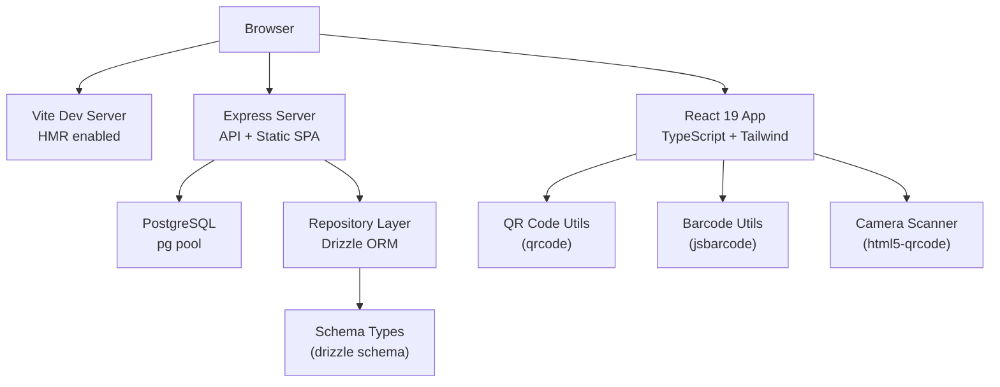
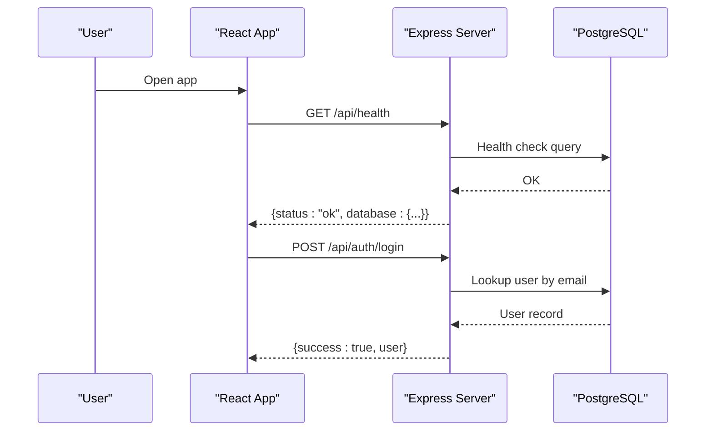
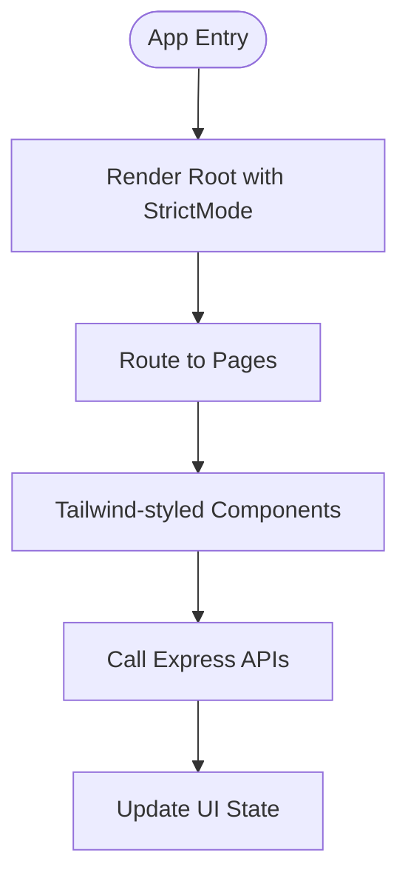
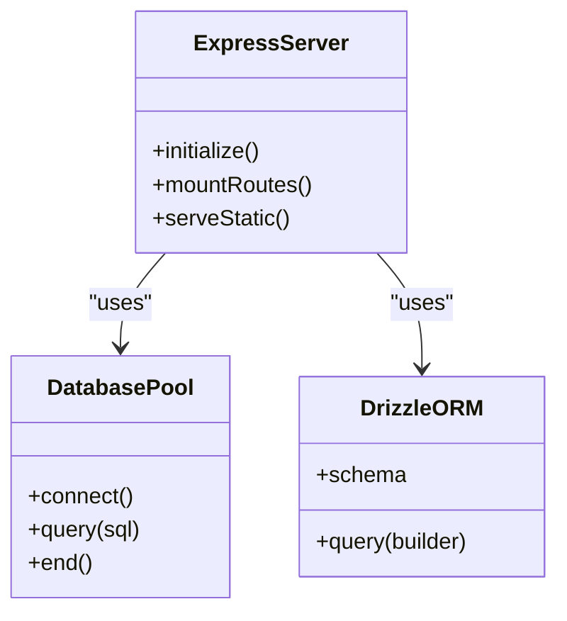
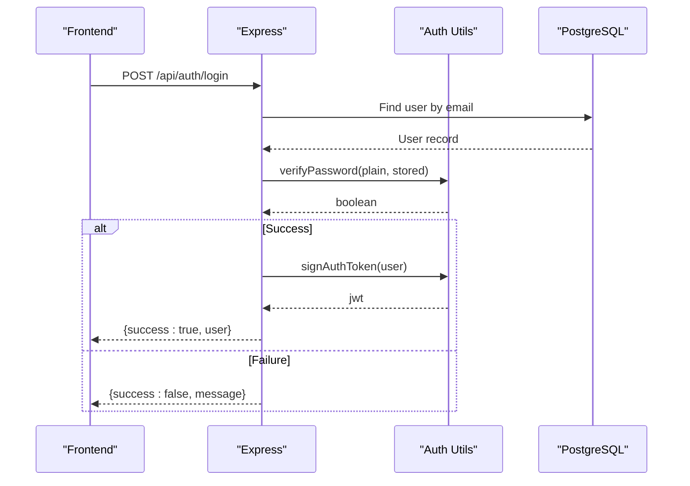
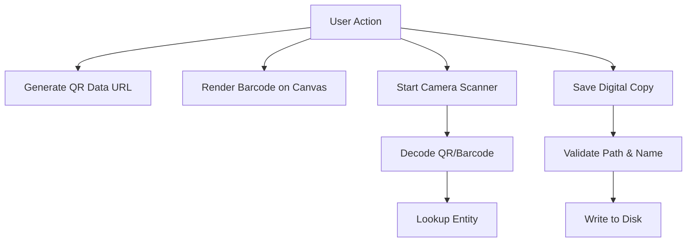
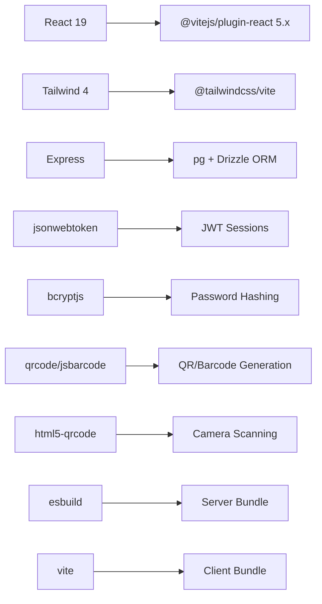

# Technology Stack

<cite>
**Referenced Files in This Document**
- [package.json](file://package.json)
- [vite.config.ts](file://vite.config.ts)
- [tsconfig.json](file://tsconfig.json)
- [server.ts](file://server.ts)
- [src/main.tsx](file://src/main.tsx)
- [src/db/index.ts](file://src/db/index.ts)
- [src/auth/session.ts](file://src/auth/session.ts)
- [src/components/common/QRBarcodeModal.tsx](file://src/components/common/QRBarcodeModal.tsx)
- [src/utils/barcodeUtils.ts](file://src/utils/barcodeUtils.ts)
- [src/components/scanner/CameraQRScannerModal.tsx](file://src/components/scanner/CameraQRScannerModal.tsx)
- [src/files/digitalCopies.ts](file://src/files/digitalCopies.ts)
- [src/App.tsx](file://src/App.tsx)
</cite>

## Table of Contents
1. [Introduction](#introduction)
2. [Project Structure](#project-structure)
3. [Core Components](#core-components)
4. [Architecture Overview](#architecture-overview)
5. [Detailed Component Analysis](#detailed-component-analysis)
6. [Dependency Analysis](#dependency-analysis)
7. [Performance Considerations](#performance-considerations)
8. [Troubleshooting Guide](#troubleshooting-guide)
9. [Conclusion](#conclusion)

## Introduction
This document describes the technology stack powering ArchiveHub, a modern archive management application. It covers frontend technologies (React 19 with TypeScript, Tailwind CSS, Vite), backend services (Express.js server, Drizzle ORM, PostgreSQL), authentication (bcryptjs for password hashing and jsonwebtoken for token-based sessions), utility libraries (QR code generation, barcode rendering, file upload handling), and development tooling (esbuild, TypeScript, modern JavaScript features). For each choice, we provide rationale and version compatibility notes grounded in the repository’s configuration and implementation.

## Project Structure
ArchiveHub is a full-stack application with a Node.js/Express server that serves both API endpoints and the React frontend. The build pipeline uses Vite for the client bundle and esbuild to compile the server into a single CommonJS artifact for production. Development runs via tsx for fast iteration.

**Diagram sources**
- [server.ts:14-50](file://server.ts#L14-L50)
- [server.ts:579-596](file://server.ts#L579-L596)
- [src/db/index.ts:1-10](file://src/db/index.ts#L1-L10)
- [src/db/index.ts:47-68](file://src/db/index.ts#L47-L68)
- [vite.config.ts:6-22](file://vite.config.ts#L6-L22)
- [src/utils/barcodeUtils.ts:1-41](file://src/utils/barcodeUtils.ts#L1-L41)
- [src/components/scanner/CameraQRScannerModal.tsx:1-30](file://src/components/scanner/CameraQRScannerModal.tsx#L1-L30)

**Section sources**
- [package.json:6-12](file://package.json#L6-L12)
- [vite.config.ts:6-22](file://vite.config.ts#L6-L22)
- [server.ts:14-50](file://server.ts#L14-L50)
- [server.ts:579-596](file://server.ts#L579-L596)

## Core Components
- Frontend framework: React 19 with TypeScript and JSX transform configured for modern DX and type safety.
- Styling: Tailwind CSS integrated via Vite plugin for utility-first styling and rapid UI development.
- Build toolchain: Vite for fast dev server and optimized builds; esbuild used to bundle the server for production.
- Backend: Express.js HTTP server exposing RESTful APIs and serving the built SPA in production.
- Database: PostgreSQL accessed through pg driver and Drizzle ORM for type-safe queries and migrations.
- Authentication: bcryptjs for secure password hashing; jsonwebtoken for issuing and verifying tokens.
- Utilities: qrcode for generating QR codes; jsbarcode for rendering barcodes; html5-qrcode for camera-based scanning; local file storage utilities for digital copies.

Rationale and compatibility highlights:
- React 19 paired with @vitejs/plugin-react ensures up-to-date JSX transforms and performance improvements.
- Tailwind v4 via @tailwindcss/vite integrates seamlessly with Vite’s plugin system.
- Vite 6 provides fast HMR and modern bundling; esbuild 0.25 compiles the server quickly to CJS for Node.
- Drizzle ORM 0.45.x works with pg 8.x and supports modern TypeScript targets.
- bcryptjs 3.x and jsonwebtoken 9.x are stable choices for hashing and JWT operations.
- html5-qrcode enables browser-based QR/barcode scanning without native dependencies.

**Section sources**
- [package.json:14-47](file://package.json#L14-L47)
- [vite.config.ts:1-22](file://vite.config.ts#L1-L22)
- [tsconfig.json:1-27](file://tsconfig.json#L1-L27)
- [server.ts:14-50](file://server.ts#L14-L50)
- [src/db/index.ts:1-10](file://src/db/index.ts#L1-L10)
- [src/auth/session.ts:1-66](file://src/auth/session.ts#L1-L66)
- [src/utils/barcodeUtils.ts:1-41](file://src/utils/barcodeUtils.ts#L1-L41)
- [src/components/scanner/CameraQRScannerModal.tsx:1-30](file://src/components/scanner/CameraQRScannerModal.tsx#L1-L30)

## Architecture Overview
The application follows a layered architecture:
- Presentation layer: React components render UI, manage state, and call APIs.
- API layer: Express routes handle requests, validate inputs, and orchestrate business logic.
- Data access layer: Repository functions use Drizzle ORM to interact with PostgreSQL.
- Infrastructure: Vite serves the app in development; in production, Express serves static assets from the dist folder.

**Diagram sources**
- [server.ts:43-51](file://server.ts#L43-L51)
- [server.ts:104-150](file://server.ts#L104-L150)
- [src/db/index.ts:97-135](file://src/db/index.ts#L97-L135)

## Detailed Component Analysis

### Frontend Stack: React 19 + TypeScript + Tailwind + Vite
- React 19 entry point renders the root component under StrictMode.
- TypeScript configuration targets ES2022, uses bundler module resolution, and enables JSX transform for optimal DX.
- Tailwind CSS is integrated via the Vite plugin, enabling utility classes throughout components.
- Vite config sets up plugins, path aliases, and conditional HMR behavior for AI Studio environments.

**Diagram sources**
- [src/main.tsx:1-11](file://src/main.tsx#L1-L11)
- [src/App.tsx:19-173](file://src/App.tsx#L19-L173)
- [vite.config.ts:6-22](file://vite.config.ts#L6-L22)
- [tsconfig.json:1-27](file://tsconfig.json#L1-L27)

**Section sources**
- [src/main.tsx:1-11](file://src/main.tsx#L1-L11)
- [src/App.tsx:19-173](file://src/App.tsx#L19-L173)
- [vite.config.ts:6-22](file://vite.config.ts#L6-L22)
- [tsconfig.json:1-27](file://tsconfig.json#L1-L27)

### Backend Stack: Express.js + Drizzle ORM + PostgreSQL
- Express server initializes JSON parsing, checks database health, runs migrations, seeds data, and mounts API routes.
- Database connection uses pg Pool with SSL support for remote databases and Drizzle ORM instance creation.
- Health endpoint exposes service status and database connectivity details.

**Diagram sources**
- [server.ts:14-50](file://server.ts#L14-L50)
- [src/db/index.ts:36-68](file://src/db/index.ts#L36-L68)

**Section sources**
- [server.ts:14-50](file://server.ts#L14-L50)
- [src/db/index.ts:36-68](file://src/db/index.ts#L36-L68)

### Authentication: bcryptjs + jsonwebtoken
- Passwords are hashed using bcryptjs before storage and verified against stored hashes or plain text fallback.
- JWT tokens are signed with a session secret and verified on subsequent requests.
- Token payload includes user sub, email, and role for authorization decisions.

**Diagram sources**
- [server.ts:104-150](file://server.ts#L104-L150)
- [src/auth/session.ts:23-66](file://src/auth/session.ts#L23-L66)

**Section sources**
- [src/auth/session.ts:23-66](file://src/auth/session.ts#L23-L66)
- [server.ts:104-150](file://server.ts#L104-L150)

### Utilities: QR Codes, Barcodes, Camera Scanning, File Uploads
- QR codes are generated as data URLs for display and printing.
- Barcodes are rendered onto canvas elements for printable tags.
- Camera-based scanning uses html5-qrcode to decode QR/barcode from device cameras.
- Digital copy uploads save files securely under a dedicated directory with safe naming and path validation.

**Diagram sources**
- [src/utils/barcodeUtils.ts:1-41](file://src/utils/barcodeUtils.ts#L1-L41)
- [src/components/scanner/CameraQRScannerModal.tsx:46-96](file://src/components/scanner/CameraQRScannerModal.tsx#L46-L96)
- [src/files/digitalCopies.ts:16-41](file://src/files/digitalCopies.ts#L16-L41)

**Section sources**
- [src/utils/barcodeUtils.ts:1-41](file://src/utils/barcodeUtils.ts#L1-L41)
- [src/components/common/QRBarcodeModal.tsx:1-272](file://src/components/common/QRBarcodeModal.tsx#L1-L272)
- [src/components/scanner/CameraQRScannerModal.tsx:46-96](file://src/components/scanner/CameraQRScannerModal.tsx#L46-L96)
- [src/files/digitalCopies.ts:16-41](file://src/files/digitalCopies.ts#L16-L41)

## Dependency Analysis
Key runtime and development dependencies and their roles:
- Frontend: react, react-dom, @vitejs/plugin-react, tailwindcss, @tailwindcss/vite, lucide-react, motion.
- Backend: express, dotenv, drizzle-orm, pg, jsonwebtoken, bcryptjs.
- Utilities: qrcode, jsbarcode, html5-qrcode, @types/qrcode.
- Build tools: vite, esbuild, tsx, typescript, drizzle-kit.

Compatibility notes:
- React 19 requires compatible plugin versions; @vitejs/plugin-react 5.x supports React 19.
- Tailwind v4 integration via @tailwindcss/vite aligns with Vite’s plugin ecosystem.
- Drizzle ORM 0.45.x pairs well with pg 8.x and modern TypeScript targets.
- esbuild 0.25 compiles server code efficiently to CJS for Node runtime.

**Diagram sources**
- [package.json:14-47](file://package.json#L14-L47)

**Section sources**
- [package.json:14-47](file://package.json#L14-L47)

## Performance Considerations
- Use Vite’s HMR for rapid feedback during development; disable watching when needed to reduce CPU usage.
- Prefer Drizzle ORM for type-safe queries and efficient SQL generation.
- Limit request body size appropriately; the server sets a reasonable limit for JSON payloads.
- Generate QR codes client-side to avoid unnecessary network calls.
- Store digital copies locally with safe naming and path validation to prevent traversal attacks.

[No sources needed since this section provides general guidance]

## Troubleshooting Guide
Common issues and resolutions:
- Database connectivity: If DATABASE_URL is missing or invalid, the server falls back to memory mode and logs warnings. Ensure environment variables are set correctly.
- Migration failures: On startup, migrations run automatically; errors are logged and do not block server startup. Check logs for specific error messages.
- Authentication errors: Verify password hashing strategy and ensure SESSION_SECRET meets minimum length requirements.
- Scanner not starting: Ensure camera permissions are granted and the DOM element exists before initializing the scanner.

**Section sources**
- [src/db/index.ts:97-135](file://src/db/index.ts#L97-L135)
- [server.ts:19-38](file://server.ts#L19-L38)
- [src/auth/session.ts:23-27](file://src/auth/session.ts#L23-L27)
- [src/components/scanner/CameraQRScannerModal.tsx:46-96](file://src/components/scanner/CameraQRScannerModal.tsx#L46-L96)

## Conclusion
ArchiveHub leverages a modern, cohesive technology stack: React 19 with TypeScript and Tailwind for a responsive UI, Vite for fast development and builds, Express for a robust API layer, Drizzle ORM with PostgreSQL for reliable data access, and secure authentication via bcryptjs and jsonwebtoken. Utility libraries enable QR/barcode workflows and camera scanning, while esbuild ensures efficient server packaging. This combination balances developer productivity, performance, and maintainability across the full stack.

[No sources needed since this section summarizes without analyzing specific files]