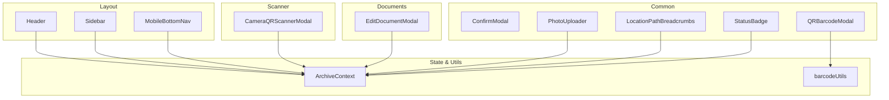
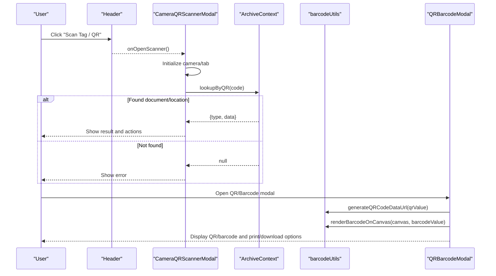
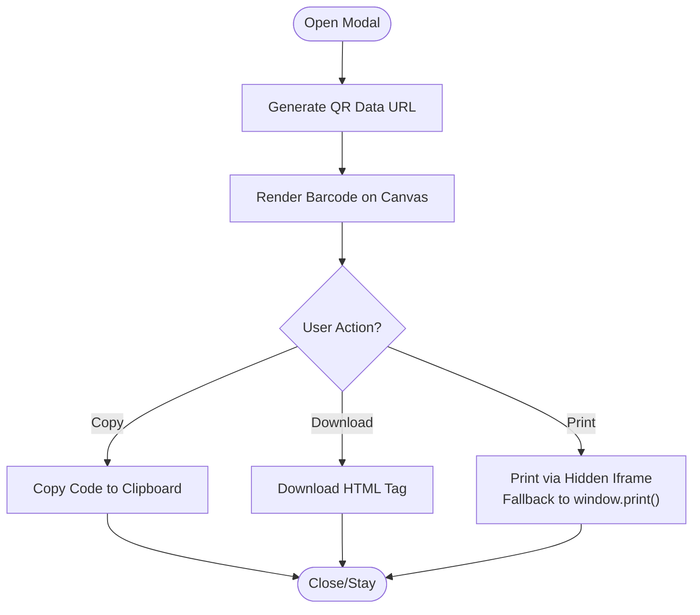
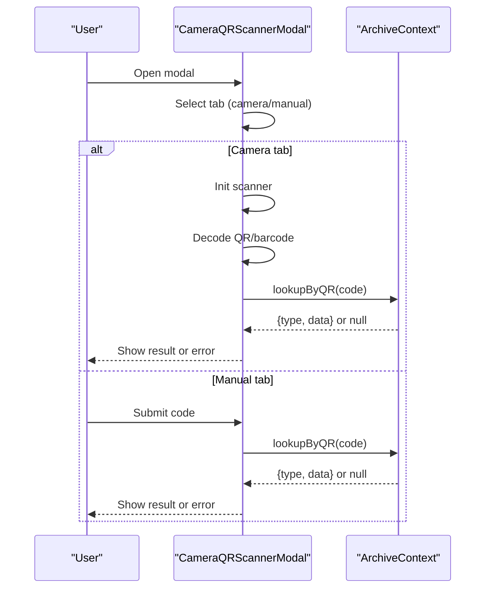
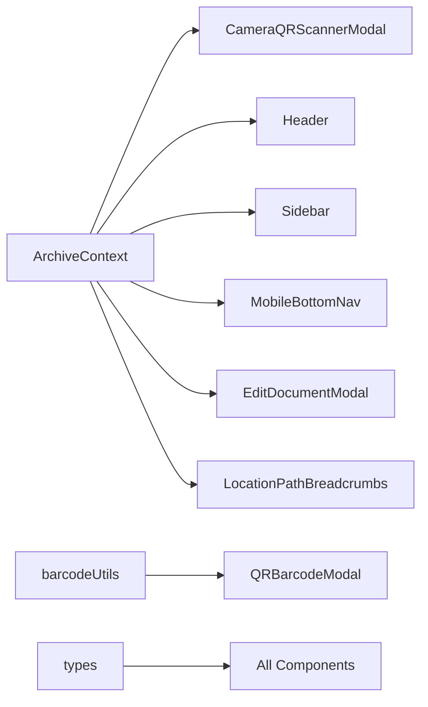

# UI Components

<cite>
**Referenced Files in This Document**
- [ConfirmModal.tsx](file://src/components/common/ConfirmModal.tsx)
- [PhotoUploader.tsx](file://src/components/common/PhotoUploader.tsx)
- [QRBarcodeModal.tsx](file://src/components/common/QRBarcodeModal.tsx)
- [CameraQRScannerModal.tsx](file://src/components/scanner/CameraQRScannerModal.tsx)
- [Header.tsx](file://src/components/layout/Header.tsx)
- [Sidebar.tsx](file://src/components/layout/Sidebar.tsx)
- [MobileBottomNav.tsx](file://src/components/layout/MobileBottomNav.tsx)
- [EditDocumentModal.tsx](file://src/components/documents/EditDocumentModal.tsx)
- [StatusBadge.tsx](file://src/components/common/StatusBadge.tsx)
- [LocationPathBreadcrumbs.tsx](file://src/components/common/LocationPathBreadcrumbs.tsx)
- [barcodeUtils.ts](file://src/utils/barcodeUtils.ts)
- [ArchiveContext.tsx](file://src/context/ArchiveContext.tsx)
- [types.ts](file://src/types.ts)
</cite>

## Table of Contents
1. [Introduction](#introduction)
2. [Project Structure](#project-structure)
3. [Core Components](#core-components)
4. [Architecture Overview](#architecture-overview)
5. [Detailed Component Analysis](#detailed-component-analysis)
6. [Dependency Analysis](#dependency-analysis)
7. [Performance Considerations](#performance-considerations)
8. [Troubleshooting Guide](#troubleshooting-guide)
9. [Conclusion](#conclusion)
10. [Appendices](#appendices)

## Introduction
This document describes ArchiveHub’s React component library with a focus on reusable UI primitives and domain-specific components: modals, form elements, file uploaders, QR/barcode generation and printing, and camera-based scanning. It explains props, events, composition patterns, global state integration via the application context, responsive design strategies, accessibility considerations, Tailwind CSS styling and theming, performance optimizations, and best practices for extending or creating new components.

## Project Structure
The UI is organized by feature area under src/components:
- common: shared UI primitives (modals, badges, breadcrumbs, uploader, QR/barcode modal)
- scanner: camera-based QR/barcode scanning modal
- layout: application chrome (header, sidebar, mobile bottom navigation)
- documents: domain forms (document editing modal)

Global state and utilities are centralized:
- context: ArchiveContext provides user, data, operations, notifications, and helpers
- utils: barcode utilities for QR/barcode generation and printing helpers
- types: shared TypeScript definitions used across components

**Diagram sources**
- [Header.tsx:1-342](file://src/components/layout/Header.tsx#L1-L342)
- [Sidebar.tsx:1-260](file://src/components/layout/Sidebar.tsx#L1-L260)
- [MobileBottomNav.tsx:1-134](file://src/components/layout/MobileBottomNav.tsx#L1-L134)
- [ConfirmModal.tsx:1-102](file://src/components/common/ConfirmModal.tsx#L1-L102)
- [PhotoUploader.tsx:1-286](file://src/components/common/PhotoUploader.tsx#L1-L286)
- [QRBarcodeModal.tsx:1-272](file://src/components/common/QRBarcodeModal.tsx#L1-L272)
- [CameraQRScannerModal.tsx:1-391](file://src/components/scanner/CameraQRScannerModal.tsx#L1-L391)
- [EditDocumentModal.tsx:1-638](file://src/components/documents/EditDocumentModal.tsx#L1-L638)
- [StatusBadge.tsx:1-177](file://src/components/common/StatusBadge.tsx#L1-L177)
- [LocationPathBreadcrumbs.tsx:1-95](file://src/components/common/LocationPathBreadcrumbs.tsx#L1-L95)
- [barcodeUtils.ts:1-41](file://src/utils/barcodeUtils.ts#L1-L41)
- [ArchiveContext.tsx:1-800](file://src/context/ArchiveContext.tsx#L1-L800)

**Section sources**
- [Header.tsx:1-342](file://src/components/layout/Header.tsx#L1-L342)
- [Sidebar.tsx:1-260](file://src/components/layout/Sidebar.tsx#L1-L260)
- [MobileBottomNav.tsx:1-134](file://src/components/layout/MobileBottomNav.tsx#L1-L134)
- [ConfirmModal.tsx:1-102](file://src/components/common/ConfirmModal.tsx#L1-L102)
- [PhotoUploader.tsx:1-286](file://src/components/common/PhotoUploader.tsx#L1-L286)
- [QRBarcodeModal.tsx:1-272](file://src/components/common/QRBarcodeModal.tsx#L1-L272)
- [CameraQRScannerModal.tsx:1-391](file://src/components/scanner/CameraQRScannerModal.tsx#L1-L391)
- [EditDocumentModal.tsx:1-638](file://src/components/documents/EditDocumentModal.tsx#L1-L638)
- [StatusBadge.tsx:1-177](file://src/components/common/StatusBadge.tsx#L1-L177)
- [LocationPathBreadcrumbs.tsx:1-95](file://src/components/common/LocationPathBreadcrumbs.tsx#L1-L95)
- [barcodeUtils.ts:1-41](file://src/utils/barcodeUtils.ts#L1-L41)
- [ArchiveContext.tsx:1-800](file://src/context/ArchiveContext.tsx#L1-L800)

## Core Components
This section summarizes each key component, its purpose, props/events, and usage patterns.

- ConfirmModal
  - Purpose: Generic confirmation dialog with variants and accessible close behavior.
  - Props: isOpen, onClose, onConfirm, title, message, confirmText, cancelText, variant.
  - Events: onClose, onConfirm.
  - Notes: Uses Tailwind classes for dark mode and responsive padding; renders nothing when closed.

- PhotoUploader
  - Purpose: Image input supporting local file upload and URL entry, with preview and presets.
  - Props: value, onChange, label, presets.
  - Events: onChange(value).
  - Features: Drag-and-drop, image compression to base64, toggle between upload and URL modes, preset buttons.

- QRBarcodeModal
  - Purpose: Generate and print QR/barcodes for documents or locations; copy code, download HTML tag, print.
  - Props: isOpen, onClose, title, subtitle, qrValue, barcodeValue, entityType, entityCode, pathString.
  - Events: onClose.
  - Features: Generates QR data URL, renders barcode on canvas, builds printable HTML, uses hidden iframe print fallback.

- CameraQRScannerModal
  - Purpose: Camera-based QR/barcode scanner with manual input fallback; resolves to document or location records.
  - Props: isOpen, onClose, onSelectDocument, onSelectLocation.
  - Events: onSelectDocument(doc), onSelectLocation(loc).
  - Features: Integrates html5-qrcode, tabbed interface (camera/manual), displays result details and actions.

- Header
  - Purpose: Top app bar with branding, search, scanner trigger, notifications, and user controls.
  - Props: onOpenScanner, onOpenMobileMenu, onSelectTab.
  - Events: onOpenScanner, onOpenMobileMenu, onSelectTab(tabId).
  - Features: Global search updates active tab; notification dropdown; user persona switcher.

- Sidebar
  - Purpose: Desktop navigation and mobile drawer with navigation items and user card.
  - Props: onSelectTab, isMobileOpen, onCloseMobile.
  - Events: onSelectTab(id), onCloseMobile().
  - Features: Badge counts, persona switcher, sign out, reset demo data.

- MobileBottomNav
  - Purpose: Mobile-first bottom navigation with prominent scan action.
  - Props: onOpenScanner, onOpenMobileMenu, onSelectTab.
  - Events: onOpenScanner, onOpenMobileMenu, onSelectTab(tabId).
  - Features: Highlights active tab, shows circulation alerts, centers scan button.

- EditDocumentModal
  - Purpose: Comprehensive form to edit document metadata, classification fields, storage location, and digital copy info.
  - Props: document, isOpen, onClose, onSaved.
  - Events: onClose, onSaved(updatedDoc).
  - Features: Dynamic custom fields, bundle association, status/confidentiality/condition selectors, validation and notifications.

- StatusBadge
  - Purpose: Visual indicator for document status, checkout status, confidentiality, and condition.
  - Props: type, value, size.
  - Notes: Provides consistent color/iconography per enum values.

- LocationPathBreadcrumbs
  - Purpose: Breadcrumb trail showing hierarchical physical storage path with icons and optional click handlers.
  - Props: locationId, onNodeClick, showIcon, className, badgeSize.
  - Events: onNodeClick(locationId).
  - Notes: Uses utility to compute ancestors and maps location types to icons.

**Section sources**
- [ConfirmModal.tsx:1-102](file://src/components/common/ConfirmModal.tsx#L1-L102)
- [PhotoUploader.tsx:1-286](file://src/components/common/PhotoUploader.tsx#L1-L286)
- [QRBarcodeModal.tsx:1-272](file://src/components/common/QRBarcodeModal.tsx#L1-L272)
- [CameraQRScannerModal.tsx:1-391](file://src/components/scanner/CameraQRScannerModal.tsx#L1-L391)
- [Header.tsx:1-342](file://src/components/layout/Header.tsx#L1-L342)
- [Sidebar.tsx:1-260](file://src/components/layout/Sidebar.tsx#L1-L260)
- [MobileBottomNav.tsx:1-134](file://src/components/layout/MobileBottomNav.tsx#L1-L134)
- [EditDocumentModal.tsx:1-638](file://src/components/documents/EditDocumentModal.tsx#L1-L638)
- [StatusBadge.tsx:1-177](file://src/components/common/StatusBadge.tsx#L1-L177)
- [LocationPathBreadcrumbs.tsx:1-95](file://src/components/common/LocationPathBreadcrumbs.tsx#L1-L95)

## Architecture Overview
Components compose through controlled modals and event-driven flows, while sharing state via ArchiveContext. The scanner integrates with the camera and resolves entities using context lookups. QR/barcode modal leverages utilities for rendering and printing.

**Diagram sources**
- [Header.tsx:134-143](file://src/components/layout/Header.tsx#L134-L143)
- [CameraQRScannerModal.tsx:46-96](file://src/components/scanner/CameraQRScannerModal.tsx#L46-L96)
- [CameraQRScannerModal.tsx:100-116](file://src/components/scanner/CameraQRScannerModal.tsx#L100-L116)
- [ArchiveContext.tsx:97-98](file://src/context/ArchiveContext.tsx#L97-L98)
- [QRBarcodeModal.tsx:34-46](file://src/components/common/QRBarcodeModal.tsx#L34-L46)
- [barcodeUtils.ts:7-21](file://src/utils/barcodeUtils.ts#L7-L21)
- [barcodeUtils.ts:26-41](file://src/utils/barcodeUtils.ts#L26-L41)

## Detailed Component Analysis

### ConfirmModal
- Props:
  - isOpen: boolean
  - onClose: () => void
  - onConfirm: () => void
  - title: string
  - message: string
  - confirmText?: string
  - cancelText?: string
  - variant?: 'danger' | 'warning' | 'info'
- Behavior:
  - Renders overlay and modal only when isOpen is true.
  - Variant changes icon background and confirm button colors.
  - Close button triggers onClose; confirm calls onConfirm then onClose.
- Accessibility:
  - Focus management relies on parent; ensure trap focus at usage site if needed.
  - Buttons have explicit type attributes.
- Styling:
  - Tailwind classes provide dark mode support and responsive padding.

**Section sources**
- [ConfirmModal.tsx:4-24](file://src/components/common/ConfirmModal.tsx#L4-L24)
- [ConfirmModal.tsx:27-47](file://src/components/common/ConfirmModal.tsx#L27-L47)
- [ConfirmModal.tsx:49-101](file://src/components/common/ConfirmModal.tsx#L49-L101)

### PhotoUploader
- Props:
  - value: string (base64 data URL or web URL)
  - onChange: (value: string) => void
  - label?: string
  - presets?: Array<{label: string; url: string}>
- Behavior:
  - Toggle between Local Device and Image URL modes.
  - Drag-and-drop or file picker triggers compression to base64 before calling onChange.
  - Preview shows current value with change/remove actions.
  - Preset buttons set value directly.
- Performance:
  - Compresses large images to reduce memory footprint and payload size.
- Accessibility:
  - Labels associate with inputs; clear affordances for drag-and-drop and file selection.

**Section sources**
- [PhotoUploader.tsx:9-14](file://src/components/common/PhotoUploader.tsx#L9-L14)
- [PhotoUploader.tsx:20-60](file://src/components/common/PhotoUploader.tsx#L20-L60)
- [PhotoUploader.tsx:62-118](file://src/components/common/PhotoUploader.tsx#L62-L118)
- [PhotoUploader.tsx:116-283](file://src/components/common/PhotoUploader.tsx#L116-L283)

### QRBarcodeModal
- Props:
  - isOpen: boolean
  - onClose: () => void
  - title: string
  - subtitle?: string
  - qrValue: string
  - barcodeValue: string
  - entityType: 'DOCUMENT' | 'LOCATION'
  - entityCode: string
  - pathString?: string
- Behavior:
  - On open, generates QR data URL and renders barcode on canvas.
  - Copy code to clipboard; download standalone HTML tag; print via hidden iframe with fallback.
- Integration:
  - Uses barcodeUtils for QR and barcode rendering.
  - Builds printable HTML tailored for tags.

**Diagram sources**
- [QRBarcodeModal.tsx:34-46](file://src/components/common/QRBarcodeModal.tsx#L34-L46)
- [QRBarcodeModal.tsx:50-54](file://src/components/common/QRBarcodeModal.tsx#L50-L54)
- [QRBarcodeModal.tsx:56-172](file://src/components/common/QRBarcodeModal.tsx#L56-L172)
- [barcodeUtils.ts:7-21](file://src/utils/barcodeUtils.ts#L7-L21)
- [barcodeUtils.ts:26-41](file://src/utils/barcodeUtils.ts#L26-L41)

**Section sources**
- [QRBarcodeModal.tsx:6-16](file://src/components/common/QRBarcodeModal.tsx#L6-L16)
- [QRBarcodeModal.tsx:174-271](file://src/components/common/QRBarcodeModal.tsx#L174-L271)

### CameraQRScannerModal
- Props:
  - isOpen: boolean
  - onClose: () => void
  - onSelectDocument?: (doc: DocumentItem) => void
  - onSelectLocation?: (loc: LocationItem) => void
- Behavior:
  - Tabs: Camera Scanner and Manual Key-In.
  - Camera: Initializes Html5QrcodeScanner when visible; clears after successful decode.
  - Manual: Form submission processes code via lookupByQR.
  - Result: Displays document or location details with contextual actions.
- State Management:
  - Uses ArchiveContext for lookupByQR and calculatePath.
- Error Handling:
  - Shows error when no record matches scanned code.

**Diagram sources**
- [CameraQRScannerModal.tsx:21-26](file://src/components/scanner/CameraQRScannerModal.tsx#L21-L26)
- [CameraQRScannerModal.tsx:46-96](file://src/components/scanner/CameraQRScannerModal.tsx#L46-L96)
- [CameraQRScannerModal.tsx:100-116](file://src/components/scanner/CameraQRScannerModal.tsx#L100-L116)
- [ArchiveContext.tsx:97-98](file://src/context/ArchiveContext.tsx#L97-L98)

**Section sources**
- [CameraQRScannerModal.tsx:21-26](file://src/components/scanner/CameraQRScannerModal.tsx#L21-L26)
- [CameraQRScannerModal.tsx:123-391](file://src/components/scanner/CameraQRScannerModal.tsx#L123-L391)

### Header
- Props:
  - onOpenScanner: () => void
  - onOpenMobileMenu?: () => void
  - onSelectTab?: (tabId: string) => void
- Behavior:
  - Opens scanner modal via onOpenScanner.
  - Toggles mobile search bar; updates global search query and active tab.
  - Notification dropdown with dismiss actions.
  - User persona switcher and settings/sign-out actions.
- Integration:
  - Reads and writes globalSearchQuery and activeTab via ArchiveContext.

**Section sources**
- [Header.tsx:20-30](file://src/components/layout/Header.tsx#L20-L30)
- [Header.tsx:50-143](file://src/components/layout/Header.tsx#L50-L143)
- [Header.tsx:145-304](file://src/components/layout/Header.tsx#L145-L304)
- [Header.tsx:308-338](file://src/components/layout/Header.tsx#L308-L338)

### Sidebar
- Props:
  - onSelectTab?: (tabId: string) => void
  - isMobileOpen?: boolean
  - onCloseMobile?: () => void
- Behavior:
  - Navigation items update activeTab and optionally call onSelectTab.
  - Mobile drawer toggles with backdrop and close behavior.
  - Persona switcher updates current user via context.
- Integration:
  - Uses ArchiveContext for activeTab, users, and data counts.

**Section sources**
- [Sidebar.tsx:21-31](file://src/components/layout/Sidebar.tsx#L21-L31)
- [Sidebar.tsx:85-144](file://src/components/layout/Sidebar.tsx#L85-L144)
- [Sidebar.tsx:146-233](file://src/components/layout/Sidebar.tsx#L146-L233)
- [Sidebar.tsx:235-259](file://src/components/layout/Sidebar.tsx#L235-L259)

### MobileBottomNav
- Props:
  - onOpenScanner: () => void
  - onOpenMobileMenu: () => void
  - onSelectTab: (tabId: string) => void
- Behavior:
  - Highlights active tab; central scan button opens scanner modal.
  - Circulation desk shows alert indicators based on checkouts.
- Integration:
  - Reads activeTab and checkouts from ArchiveContext.

**Section sources**
- [MobileBottomNav.tsx:12-16](file://src/components/layout/MobileBottomNav.tsx#L12-L16)
- [MobileBottomNav.tsx:29-133](file://src/components/layout/MobileBottomNav.tsx#L29-L133)

### EditDocumentModal
- Props:
  - document: DocumentItem | null
  - isOpen: boolean
  - onClose: () => void
  - onSaved?: (updatedDoc: DocumentItem) => void
- Behavior:
  - Initializes form state from document prop when opened.
  - Handles dynamic custom fields based on selected document type.
  - Validates required fields and submits updates via context.
  - Updates audit logs and notifications on success/failure.
- Integration:
  - Uses ArchiveContext for departments, documentTypes, locations, bundles, updateDocument, calculatePath, addNotification.

**Section sources**
- [EditDocumentModal.tsx:25-37](file://src/components/documents/EditDocumentModal.tsx#L25-L37)
- [EditDocumentModal.tsx:80-106](file://src/components/documents/EditDocumentModal.tsx#L80-L106)
- [EditDocumentModal.tsx:147-197](file://src/components/documents/EditDocumentModal.tsx#L147-L197)
- [EditDocumentModal.tsx:199-638](file://src/components/documents/EditDocumentModal.tsx#L199-L638)

### StatusBadge
- Props:
  - type: 'status' | 'confidentiality' | 'condition' | 'checkout'
  - value: string
  - size?: 'sm' | 'md' | 'lg'
- Behavior:
  - Maps enum values to styled badges with icons and colors.
  - Supports multiple sizes for compact layouts.

**Section sources**
- [StatusBadge.tsx:16-22](file://src/components/common/StatusBadge.tsx#L16-L22)
- [StatusBadge.tsx:23-177](file://src/components/common/StatusBadge.tsx#L23-L177)

### LocationPathBreadcrumbs
- Props:
  - locationId: string | null
  - onNodeClick?: (locationId: string) => void
  - showIcon?: boolean
  - className?: string
  - badgeSize?: 'sm' | 'md'
- Behavior:
  - Computes ancestor nodes and renders clickable breadcrumb trail.
  - Maps location types to icons; highlights last node.
- Integration:
  - Uses ArchiveContext locations and locationUtils to build path.

**Section sources**
- [LocationPathBreadcrumbs.tsx:19-33](file://src/components/common/LocationPathBreadcrumbs.tsx#L19-L33)
- [LocationPathBreadcrumbs.tsx:40-94](file://src/components/common/LocationPathBreadcrumbs.tsx#L40-L94)

## Dependency Analysis
Components depend on:
- ArchiveContext for global state and operations (user, data, notifications, lookups).
- Utilities for barcode/QR generation and printing.
- Shared types for consistent interfaces.

**Diagram sources**
- [ArchiveContext.tsx:32-109](file://src/context/ArchiveContext.tsx#L32-L109)
- [CameraQRScannerModal.tsx:34-42](file://src/components/scanner/CameraQRScannerModal.tsx#L34-L42)
- [Header.tsx:31-42](file://src/components/layout/Header.tsx#L31-L42)
- [Sidebar.tsx:32-44](file://src/components/layout/Sidebar.tsx#L32-L44)
- [MobileBottomNav.tsx:23-27](file://src/components/layout/MobileBottomNav.tsx#L23-L27)
- [EditDocumentModal.tsx:38-46](file://src/components/documents/EditDocumentModal.tsx#L38-L46)
- [LocationPathBreadcrumbs.tsx:34-40](file://src/components/common/LocationPathBreadcrumbs.tsx#L34-L40)
- [QRBarcodeModal.tsx:2-3](file://src/components/common/QRBarcodeModal.tsx#L2-L3)
- [types.ts:1-283](file://src/types.ts#L1-L283)

**Section sources**
- [ArchiveContext.tsx:32-109](file://src/context/ArchiveContext.tsx#L32-L109)
- [types.ts:1-283](file://src/types.ts#L1-L283)

## Performance Considerations
- Image compression in PhotoUploader reduces memory usage and payload size by resizing and encoding to JPEG base64.
- Scanner initialization is deferred and guarded to avoid unnecessary work when not visible; scanner is cleared on unmount or after decode.
- QR generation and barcode rendering are asynchronous and isolated to modal lifecycle to prevent blocking UI.
- Notifications are limited in length to avoid excessive re-renders.
- Use memoization in consuming components where appropriate to minimize re-renders triggered by context updates.

[No sources needed since this section provides general guidance]

## Troubleshooting Guide
- Scanner issues:
  - Ensure camera permissions are granted; verify DOM element exists before initializing scanner.
  - Clear scanner on close to release resources.
- QR/Barcode generation:
  - Handle errors gracefully; fall back to empty strings or placeholders when generation fails.
- File uploads:
  - Validate file types; handle read errors and inform users with alerts.
- Form submissions:
  - Validate required fields; surface errors via notifications and disable submit during processing.
- Context operations:
  - Check backend connectivity; use fallbacks and notify users of failures.

**Section sources**
- [CameraQRScannerModal.tsx:46-96](file://src/components/scanner/CameraQRScannerModal.tsx#L46-L96)
- [QRBarcodeModal.tsx:34-46](file://src/components/common/QRBarcodeModal.tsx#L34-L46)
- [PhotoUploader.tsx:73-89](file://src/components/common/PhotoUploader.tsx#L73-L89)
- [EditDocumentModal.tsx:147-197](file://src/components/documents/EditDocumentModal.tsx#L147-L197)
- [ArchiveContext.tsx:197-255](file://src/context/ArchiveContext.tsx#L197-L255)

## Conclusion
ArchiveHub’s UI components follow a consistent pattern: controlled visibility via props, event-driven interactions, and shared state through ArchiveContext. Modals encapsulate complex workflows (scanning, editing, tagging), while layout components orchestrate navigation and user controls. Responsive design and Tailwind classes enable flexible theming and accessibility. Utilities abstract barcode/QR generation and printing, keeping components focused on UX. Following these patterns ensures maintainability and scalability as new features are added.

[No sources needed since this section summarizes without analyzing specific files]

## Appendices

### Component Composition Patterns
- Controlled Modals:
  - isOpen + onClose/onConfirm pattern for predictable state control.
- Event Propagation:
  - Parent handles business logic; child components emit events (e.g., onSelectDocument).
- Context Integration:
  - Components consume ArchiveContext for data and mutations; avoid lifting state unnecessarily.
- Utility Encapsulation:
  - Barcode/QR generation and printing are isolated in utils for reuse and testability.

[No sources needed since this section doesn't analyze specific files]

### Responsive Design and Accessibility
- Responsive:
  - Tailwind breakpoints manage layout shifts (mobile vs desktop).
  - Mobile-only elements (bottom nav, drawer) hide/show based on viewport.
- Accessibility:
  - Semantic buttons and labels; aria-labels for interactive elements.
  - Keyboard-friendly navigation; focus management recommended for modals.

[No sources needed since this section doesn't analyze specific files]

### Style Customization and Theming
- Tailwind Classes:
  - Consistent spacing, typography, and color tokens across components.
  - Dark mode support via dark: variants.
- Theming:
  - Extend Tailwind config to introduce brand tokens; replace hard-coded colors with semantic classes.

[No sources needed since this section doesn't analyze specific files]

### Best Practices for Extending Components
- Keep props minimal and typed; prefer enums for constrained sets.
- Centralize side effects in context or utils; keep components pure where possible.
- Add robust error handling and user feedback via notifications or inline messages.
- Test critical flows (scanner, uploads, form submissions) with mocked contexts and utilities.

[No sources needed since this section doesn't analyze specific files]