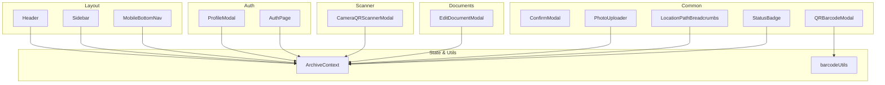
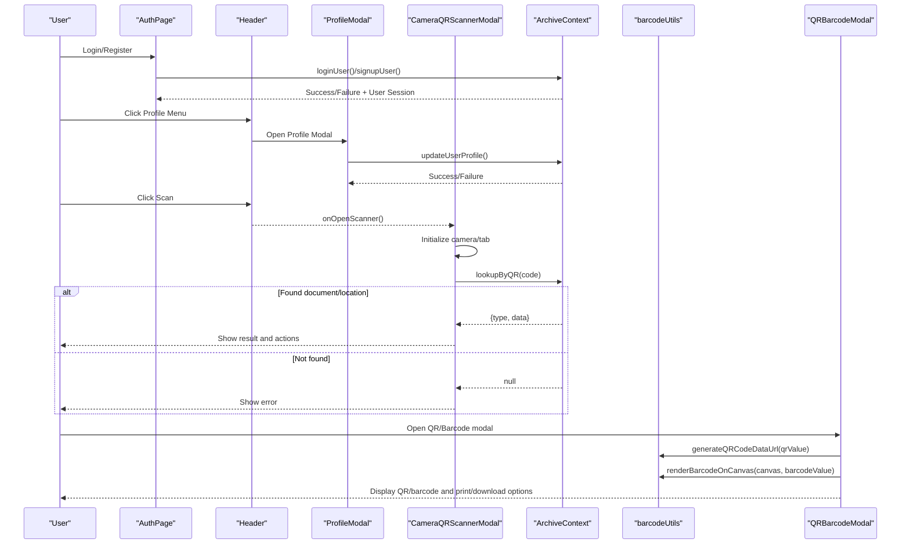
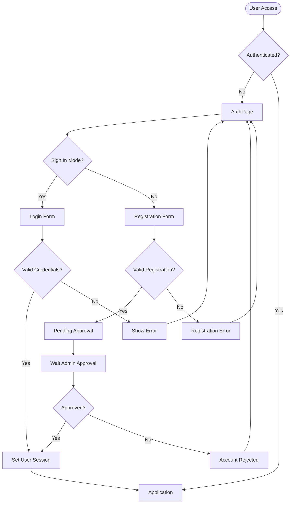
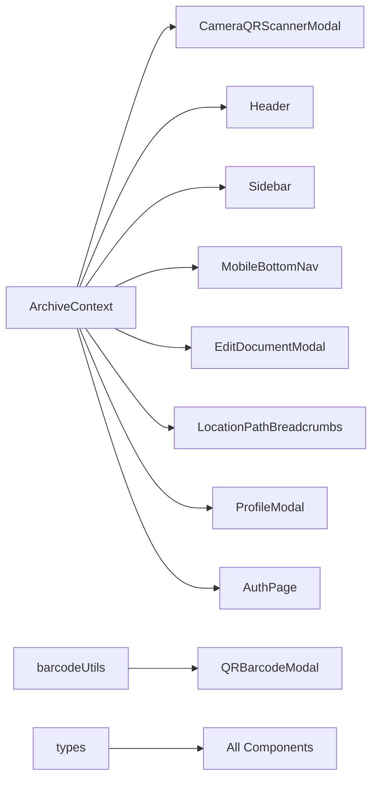

# UI Components

<cite>
**Referenced Files in This Document**
- [ProfileModal.tsx](file://src/components/auth/ProfileModal.tsx)
- [AuthPage.tsx](file://src/components/auth/AuthPage.tsx)
- [ConfirmModal.tsx](file://src/components/common/ConfirmModal.tsx)
- [PhotoUploader.tsx](file://src/components/common/PhotoUploader.tsx)
- [QRBarcodeModal.tsx](file://src/components/common/QRBarcodeModal.tsx)
- [CameraQRScannerModal.tsx](file://src/components/scanner/CameraQRScannerModal.tsx)
- [Header.tsx](file://src/components/layout/Header.tsx)
- [Sidebar.tsx](file://src/components/layout/Sidebar.tsx)
- [MobileBottomNav.tsx](file://src/components/layout/MobileBottomNav.tsx)
- [EditDocumentModal.tsx](file://src/components/documents/EditDocumentModal.tsx)
- [StatusBadge.tsx](file://src/components/common/StatusBadge.tsx)
- [LocationPathBreadcrumbs.tsx](file://src/components/common/LocationPathBreadcrumbs.tsx)
- [barcodeUtils.ts](file://src/utils/barcodeUtils.ts)
- [ArchiveContext.tsx](file://src/context/ArchiveContext.tsx)
- [types.ts](file://src/types.ts)
</cite>

## Update Summary
**Changes Made**
- Added comprehensive documentation for the new ProfileModal component for user account management
- Enhanced header and navigation components documentation with authentication state support
- Updated architecture diagrams to include authentication flow
- Added new section covering user profile management functionality
- Expanded authentication state management documentation

## Table of Contents
1. [Introduction](#introduction)
2. [Project Structure](#project-structure)
3. [Core Components](#core-components)
4. [Architecture Overview](#architecture-overview)
5. [Detailed Component Analysis](#detailed-component-analysis)
6. [Authentication & User Management](#authentication--user-management)
7. [Dependency Analysis](#dependency-analysis)
8. [Performance Considerations](#performance-considerations)
9. [Troubleshooting Guide](#troubleshooting-guide)
10. [Conclusion](#conclusion)
11. [Appendices](#appendices)

## Introduction
This document describes ArchiveHub's React component library with a focus on reusable UI primitives and domain-specific components: modals, form elements, file uploaders, QR/barcode generation and printing, camera-based scanning, and comprehensive user authentication and profile management. It explains props, events, composition patterns, global state integration via the application context, responsive design strategies, accessibility considerations, Tailwind CSS styling and theming, performance optimizations, and best practices for extending or creating new components.

## Project Structure
The UI is organized by feature area under src/components:
- auth: authentication and user management (login/signup forms, profile management)
- common: shared UI primitives (modals, badges, breadcrumbs, uploader, QR/barcode modal)
- scanner: camera-based QR/barcode scanning modal
- layout: application chrome (header, sidebar, mobile bottom navigation)
- documents: domain forms (document editing modal)

Global state and utilities are centralized:
- context: ArchiveContext provides user authentication, data, operations, notifications, and helpers
- utils: barcode utilities for QR/barcode generation and printing helpers
- types: shared TypeScript definitions used across components

**Diagram sources**
- [Header.tsx:1-376](file://src/components/layout/Header.tsx#L1-L376)
- [Sidebar.tsx:1-263](file://src/components/layout/Sidebar.tsx#L1-L263)
- [MobileBottomNav.tsx:1-152](file://src/components/layout/MobileBottomNav.tsx#L1-L152)
- [ProfileModal.tsx:1-253](file://src/components/auth/ProfileModal.tsx#L1-L253)
- [AuthPage.tsx:1-472](file://src/components/auth/AuthPage.tsx#L1-L472)
- [ConfirmModal.tsx:1-102](file://src/components/common/ConfirmModal.tsx#L1-L102)
- [PhotoUploader.tsx:1-286](file://src/components/common/PhotoUploader.tsx#L1-L286)
- [QRBarcodeModal.tsx:1-272](file://src/components/common/QRBarcodeModal.tsx#L1-L272)
- [CameraQRScannerModal.tsx:1-391](file://src/components/scanner/CameraQRScannerModal.tsx#L1-L391)
- [EditDocumentModal.tsx:1-638](file://src/components/documents/EditDocumentModal.tsx#L1-L638)
- [StatusBadge.tsx:1-177](file://src/components/common/StatusBadge.tsx#L1-L177)
- [LocationPathBreadcrumbs.tsx:1-95](file://src/components/common/LocationPathBreadcrumbs.tsx#L1-L95)
- [barcodeUtils.ts:1-41](file://src/utils/barcodeUtils.ts#L1-L41)
- [ArchiveContext.tsx:1-1242](file://src/context/ArchiveContext.tsx#L1-L1242)

**Section sources**
- [Header.tsx:1-376](file://src/components/layout/Header.tsx#L1-L376)
- [Sidebar.tsx:1-263](file://src/components/layout/Sidebar.tsx#L1-L263)
- [MobileBottomNav.tsx:1-152](file://src/components/layout/MobileBottomNav.tsx#L1-L152)
- [ProfileModal.tsx:1-253](file://src/components/auth/ProfileModal.tsx#L1-L253)
- [AuthPage.tsx:1-472](file://src/components/auth/AuthPage.tsx#L1-L472)
- [ConfirmModal.tsx:1-102](file://src/components/common/ConfirmModal.tsx#L1-L102)
- [PhotoUploader.tsx:1-286](file://src/components/common/PhotoUploader.tsx#L1-L286)
- [QRBarcodeModal.tsx:1-272](file://src/components/common/QRBarcodeModal.tsx#L1-L272)
- [CameraQRScannerModal.tsx:1-391](file://src/components/scanner/CameraQRScannerModal.tsx#L1-L391)
- [EditDocumentModal.tsx:1-638](file://src/components/documents/EditDocumentModal.tsx#L1-L638)
- [StatusBadge.tsx:1-177](file://src/components/common/StatusBadge.tsx#L1-L177)
- [LocationPathBreadcrumbs.tsx:1-95](file://src/components/common/LocationPathBreadcrumbs.tsx#L1-L95)
- [barcodeUtils.ts:1-41](file://src/utils/barcodeUtils.ts#L1-L41)
- [ArchiveContext.tsx:1-1242](file://src/context/ArchiveContext.tsx#L1-L1242)

## Core Components
This section summarizes each key component, its purpose, props/events, and usage patterns.

### Authentication Components

#### ProfileModal
- Purpose: Comprehensive user profile management modal for updating personal information and optional password changes
- Props: onClose: () => void
- Events: onClose()
- Features: 
  - Editable fields: full name, email, job title, department selection
  - Optional password change with validation (current password required, minimum 6 characters)
  - Read-only role display (admin-controlled)
  - Real-time form validation with error feedback
  - Integration with ArchiveContext for user profile updates

#### AuthPage
- Purpose: Complete authentication interface supporting sign-in and registration flows
- Features:
  - Dual-mode interface (sign-in/sign-up tabs)
  - Role-based registration with approval workflow
  - Pending approval status handling
  - Department selection during registration
  - Form validation and error handling
  - Responsive design with modern UI patterns

### Layout Components

#### Header
- Purpose: Top app bar with branding, search, scanner trigger, notifications, and user controls
- Props: onOpenScanner, onOpenBatchRelocate, onOpenMobileMenu, onSelectTab
- Events: onOpenScanner, onOpenMobileMenu, onSelectTab(tabId)
- Features: 
  - Global search with tab switching
  - Notification center with overdue alerts
  - User persona switcher dropdown
  - Profile modal integration
  - Mobile-responsive search toggle
  - Batch relocation actions

#### Sidebar
- Purpose: Desktop navigation and mobile drawer with navigation items and user card
- Props: onSelectTab, isMobileOpen, onCloseMobile
- Events: onSelectTab(id), onCloseMobile()
- Features: 
  - Badge counts for various sections
  - Persona switcher with user roles
  - Sign out functionality
  - Reset demo data option
  - Mobile drawer with backdrop

#### MobileBottomNav
- Purpose: Mobile-first bottom navigation with prominent scan action
- Props: onOpenScanner, onOpenBatchRelocate, onOpenMobileMenu, onSelectTab
- Events: onOpenScanner, onOpenMobileMenu, onSelectTab(tabId)
- Features: 
  - Active tab highlighting
  - Circulation desk alerts
  - Central scan button
  - Batch relocate action

### Common Components

#### ConfirmModal
- Purpose: Generic confirmation dialog with variants and accessible close behavior
- Props: isOpen, onClose, onConfirm, title, message, confirmText, cancelText, variant
- Events: onClose, onConfirm
- Notes: Uses Tailwind classes for dark mode and responsive padding; renders nothing when closed

#### PhotoUploader
- Purpose: Image input supporting local file upload and URL entry, with preview and presets
- Props: value, onChange, label, presets
- Events: onChange(value)
- Features: Drag-and-drop, image compression to base64, toggle between upload and URL modes, preset buttons

#### QRBarcodeModal
- Purpose: Generate and print QR/barcodes for documents or locations; copy code, download HTML tag, print
- Props: isOpen, onClose, title, subtitle, qrValue, barcodeValue, entityType, entityCode, pathString
- Events: onClose
- Features: Generates QR data URL, renders barcode on canvas, builds printable HTML, uses hidden iframe print fallback

#### CameraQRScannerModal
- Purpose: Camera-based QR/barcode scanner with manual input fallback; resolves to document or location records
- Props: isOpen, onClose, onSelectDocument, onSelectLocation
- Events: onSelectDocument(doc), onSelectLocation(loc)
- Features: Integrates html5-qrcode, tabbed interface (camera/manual), displays result details and actions

#### EditDocumentModal
- Purpose: Comprehensive form to edit document metadata, classification fields, storage location, and digital copy info
- Props: document, isOpen, onClose, onSaved
- Events: onClose, onSaved(updatedDoc)
- Features: Dynamic custom fields, bundle association, status/confidentiality/condition selectors, validation and notifications

#### StatusBadge
- Purpose: Visual indicator for document status, checkout status, confidentiality, and condition
- Props: type, value, size
- Notes: Provides consistent color/iconography per enum values

#### LocationPathBreadcrumbs
- Purpose: Breadcrumb trail showing hierarchical physical storage path with icons and optional click handlers
- Props: locationId, onNodeClick, showIcon, className, badgeSize
- Events: onNodeClick(locationId)
- Notes: Uses utility to compute ancestors and maps location types to icons

**Section sources**
- [ProfileModal.tsx:1-253](file://src/components/auth/ProfileModal.tsx#L1-L253)
- [AuthPage.tsx:1-472](file://src/components/auth/AuthPage.tsx#L1-L472)
- [Header.tsx:1-376](file://src/components/layout/Header.tsx#L1-L376)
- [Sidebar.tsx:1-263](file://src/components/layout/Sidebar.tsx#L1-L263)
- [MobileBottomNav.tsx:1-152](file://src/components/layout/MobileBottomNav.tsx#L1-L152)
- [ConfirmModal.tsx:1-102](file://src/components/common/ConfirmModal.tsx#L1-L102)
- [PhotoUploader.tsx:1-286](file://src/components/common/PhotoUploader.tsx#L1-L286)
- [QRBarcodeModal.tsx:1-272](file://src/components/common/QRBarcodeModal.tsx#L1-L272)
- [CameraQRScannerModal.tsx:1-391](file://src/components/scanner/CameraQRScannerModal.tsx#L1-L391)
- [EditDocumentModal.tsx:1-638](file://src/components/documents/EditDocumentModal.tsx#L1-L638)
- [StatusBadge.tsx:1-177](file://src/components/common/StatusBadge.tsx#L1-L177)
- [LocationPathBreadcrumbs.tsx:1-95](file://src/components/common/LocationPathBreadcrumbs.tsx#L1-L95)

## Architecture Overview
Components compose through controlled modals and event-driven flows, while sharing state via ArchiveContext. The authentication system provides comprehensive user management with session persistence, while the scanner integrates with the camera and resolves entities using context lookups. QR/barcode modal leverages utilities for rendering and printing.

**Diagram sources**
- [AuthPage.tsx:51-72](file://src/components/auth/AuthPage.tsx#L51-L72)
- [AuthPage.tsx:74-120](file://src/components/auth/AuthPage.tsx#L74-L120)
- [ArchiveContext.tsx:308-358](file://src/context/ArchiveContext.tsx#L308-L358)
- [ArchiveContext.tsx:400-464](file://src/context/ArchiveContext.tsx#L400-L464)
- [Header.tsx:293-331](file://src/components/layout/Header.tsx#L293-L331)
- [ProfileModal.tsx:26-75](file://src/components/auth/ProfileModal.tsx#L26-L75)
- [ArchiveContext.tsx:540-574](file://src/context/ArchiveContext.tsx#L540-L574)
- [Header.tsx:139-148](file://src/components/layout/Header.tsx#L139-L148)
- [CameraQRScannerModal.tsx:46-96](file://src/components/scanner/CameraQRScannerModal.tsx#L46-L96)
- [CameraQRScannerModal.tsx:100-116](file://src/components/scanner/CameraQRScannerModal.tsx#L100-L116)
- [ArchiveContext.tsx:1134-1159](file://src/context/ArchiveContext.tsx#L1134-L1159)
- [QRBarcodeModal.tsx:34-46](file://src/components/common/QRBarcodeModal.tsx#L34-L46)
- [barcodeUtils.ts:7-21](file://src/utils/barcodeUtils.ts#L7-L21)
- [barcodeUtils.ts:26-41](file://src/utils/barcodeUtils.ts#L26-L41)

## Detailed Component Analysis

### ProfileModal
- Props:
  - onClose: () => void
- Behavior:
  - Initializes form state from currentUser context
  - Validates required fields (full name, email) before submission
  - Optional password change with comprehensive validation
  - Updates user profile via ArchiveContext updateUserProfile
  - Shows real-time error messages and loading states
- State Management:
  - Uses ArchiveContext for currentUser, departments, and updateUserProfile
  - Local state for form fields and validation
- Accessibility:
  - Proper form labels and field associations
  - Clear error messaging and validation feedback
- Styling:
  - Modern modal design with backdrop blur
  - Dark mode support with appropriate color schemes
  - Responsive layout for various screen sizes

**Section sources**
- [ProfileModal.tsx:5-25](file://src/components/auth/ProfileModal.tsx#L5-L25)
- [ProfileModal.tsx:26-75](file://src/components/auth/ProfileModal.tsx#L26-L75)
- [ProfileModal.tsx:77-253](file://src/components/auth/ProfileModal.tsx#L77-L253)

### AuthPage
- Purpose: Complete authentication interface with dual-mode support
- Features:
  - Sign-in form with email/password authentication
  - Registration form with role selection and department assignment
  - Pending approval workflow for new accounts
  - Form validation and error handling
  - Responsive design with modern UI patterns
- Integration:
  - Uses ArchiveContext for loginUser and signupUser operations
  - Handles backend API responses and local fallbacks
  - Manages authentication state and user sessions

**Section sources**
- [AuthPage.tsx:21-48](file://src/components/auth/AuthPage.tsx#L21-L48)
- [AuthPage.tsx:51-120](file://src/components/auth/AuthPage.tsx#L51-L120)
- [AuthPage.tsx:122-472](file://src/components/auth/AuthPage.tsx#L122-L472)

### Header (Enhanced with Authentication)
- Props:
  - onOpenScanner: () => void
  - onOpenBatchRelocate?: () => void
  - onOpenMobileMenu?: () => void
  - onSelectTab?: (tabId: string) => void
- Behavior:
  - Opens scanner modal via onOpenScanner
  - Toggles mobile search bar; updates global search query and active tab
  - Notification dropdown with dismiss actions
  - **Enhanced**: User persona switcher with profile modal integration
  - **Enhanced**: Sign out functionality via logoutUser
- Integration:
  - Reads and writes globalSearchQuery and activeTab via ArchiveContext
  - **New**: Profile modal state management and user dropdown interactions
  - **New**: Authentication state access for user information display

**Section sources**
- [Header.tsx:22-47](file://src/components/layout/Header.tsx#L22-L47)
- [Header.tsx:50-143](file://src/components/layout/Header.tsx#L50-L143)
- [Header.tsx:145-304](file://src/components/layout/Header.tsx#L145-L304)
- [Header.tsx:308-376](file://src/components/layout/Header.tsx#L308-L376)

### Sidebar (Enhanced with Authentication)
- Props:
  - onSelectTab?: (tabId: string) => void
  - isMobileOpen?: boolean
  - onCloseMobile?: () => void
- Behavior:
  - Navigation items update activeTab and optionally call onSelectTab
  - Mobile drawer toggles with backdrop and close behavior
  - **Enhanced**: Persona switcher updates current user via context
  - **Enhanced**: Sign out functionality with logoutUser integration
- Integration:
  - Uses ArchiveContext for activeTab, users, data counts, and authentication operations

**Section sources**
- [Sidebar.tsx:22-47](file://src/components/layout/Sidebar.tsx#L22-L47)
- [Sidebar.tsx:85-144](file://src/components/layout/Sidebar.tsx#L85-L144)
- [Sidebar.tsx:146-233](file://src/components/layout/Sidebar.tsx#L146-L233)
- [Sidebar.tsx:235-263](file://src/components/layout/Sidebar.tsx#L235-L263)

### MobileBottomNav (Enhanced with Authentication)
- Props:
  - onOpenScanner: () => void
  - onOpenBatchRelocate?: () => void
  - onOpenMobileMenu: () => void
  - onSelectTab: (tabId: string) => void
- Behavior:
  - Highlights active tab; central scan button opens scanner modal
  - Circulation desk shows alert indicators based on checkouts
  - **Enhanced**: Batch relocate action integration
- Integration:
  - Reads activeTab and checkouts from ArchiveContext

**Section sources**
- [MobileBottomNav.tsx:13-27](file://src/components/layout/MobileBottomNav.tsx#L13-L27)
- [MobileBottomNav.tsx:29-152](file://src/components/layout/MobileBottomNav.tsx#L29-L152)

### Other Components (Unchanged)
- ConfirmModal, PhotoUploader, QRBarcodeModal, CameraQRScannerModal, EditDocumentModal, StatusBadge, LocationPathBreadcrumbs maintain their existing functionality and interfaces as documented previously.

**Section sources**
- [ConfirmModal.tsx:1-102](file://src/components/common/ConfirmModal.tsx#L1-L102)
- [PhotoUploader.tsx:1-286](file://src/components/common/PhotoUploader.tsx#L1-L286)
- [QRBarcodeModal.tsx:1-272](file://src/components/common/QRBarcodeModal.tsx#L1-L272)
- [CameraQRScannerModal.tsx:1-391](file://src/components/scanner/CameraQRScannerModal.tsx#L1-L391)
- [EditDocumentModal.tsx:1-638](file://src/components/documents/EditDocumentModal.tsx#L1-L638)
- [StatusBadge.tsx:1-177](file://src/components/common/StatusBadge.tsx#L1-L177)
- [LocationPathBreadcrumbs.tsx:1-95](file://src/components/common/LocationPathBreadcrumbs.tsx#L1-L95)

## Authentication & User Management

### Authentication Flow
The authentication system provides comprehensive user management with persistent sessions and role-based access control.

**Diagram sources**
- [AuthPage.tsx:24-48](file://src/components/auth/AuthPage.tsx#L24-L48)
- [AuthPage.tsx:51-120](file://src/components/auth/AuthPage.tsx#L51-L120)
- [ArchiveContext.tsx:308-358](file://src/context/ArchiveContext.tsx#L308-L358)
- [ArchiveContext.tsx:400-464](file://src/context/ArchiveContext.tsx#L400-L464)

### User Profile Management
The ProfileModal component provides comprehensive user profile management capabilities.

#### Key Features:
- **Editable Fields**: Full name, email address, job title, department selection
- **Password Management**: Optional password change with security validation
- **Role Display**: Read-only role information (admin-controlled)
- **Real-time Validation**: Immediate feedback on form inputs
- **Integration**: Seamless connection with ArchiveContext for data persistence

#### Security Considerations:
- Current password required for password changes
- Minimum 6-character password requirement
- Password confirmation validation
- Server-side validation for all updates

**Section sources**
- [ProfileModal.tsx:5-25](file://src/components/auth/ProfileModal.tsx#L5-L25)
- [ProfileModal.tsx:26-75](file://src/components/auth/ProfileModal.tsx#L26-L75)
- [ProfileModal.tsx:77-253](file://src/components/auth/ProfileModal.tsx#L77-L253)
- [ArchiveContext.tsx:540-574](file://src/context/ArchiveContext.tsx#L540-L574)

### Session Management
The authentication system maintains user sessions with localStorage persistence.

#### Session Features:
- **Persistent Sessions**: User sessions survive page refreshes
- **Automatic Refresh**: User data synchronized with backend on app load
- **Secure Logout**: Complete session cleanup on logout
- **Fallback Handling**: Graceful degradation when backend unavailable

#### Storage Strategy:
- LocalStorage for session persistence
- Automatic session validation on app startup
- Synchronization with backend user database

**Section sources**
- [ArchiveContext.tsx:121-167](file://src/context/ArchiveContext.tsx#L121-L167)
- [ArchiveContext.tsx:205-264](file://src/context/ArchiveContext.tsx#L205-L264)
- [ArchiveContext.tsx:576-584](file://src/context/ArchiveContext.tsx#L576-L584)

## Dependency Analysis
Components depend on:
- ArchiveContext for global state and operations (user authentication, data, notifications, lookups)
- Utilities for barcode/QR generation and printing
- Shared types for consistent interfaces

**Diagram sources**
- [ArchiveContext.tsx:32-117](file://src/context/ArchiveContext.tsx#L32-L117)
- [CameraQRScannerModal.tsx:34-42](file://src/components/scanner/CameraQRScannerModal.tsx#L34-L42)
- [Header.tsx:35-47](file://src/components/layout/Header.tsx#L35-L47)
- [Sidebar.tsx:33-47](file://src/components/layout/Sidebar.tsx#L33-L47)
- [MobileBottomNav.tsx:26-27](file://src/components/layout/MobileBottomNav.tsx#L26-L27)
- [EditDocumentModal.tsx:38-46](file://src/components/documents/EditDocumentModal.tsx#L38-L46)
- [LocationPathBreadcrumbs.tsx:34-40](file://src/components/common/LocationPathBreadcrumbs.tsx#L34-L40)
- [ProfileModal.tsx:10-11](file://src/components/auth/ProfileModal.tsx#L10-L11)
- [AuthPage.tsx:22-23](file://src/components/auth/AuthPage.tsx#L22-L23)
- [QRBarcodeModal.tsx:2-3](file://src/components/common/QRBarcodeModal.tsx#L2-L3)
- [types.ts:1-283](file://src/types.ts#L1-L283)

**Section sources**
- [ArchiveContext.tsx:32-117](file://src/context/ArchiveContext.tsx#L32-L117)
- [types.ts:1-283](file://src/types.ts#L1-L283)

## Performance Considerations
- Image compression in PhotoUploader reduces memory usage and payload size by resizing and encoding to JPEG base64
- Scanner initialization is deferred and guarded to avoid unnecessary work when not visible; scanner is cleared on unmount or after decode
- QR generation and barcode rendering are asynchronous and isolated to modal lifecycle to prevent blocking UI
- Notifications are limited in length to avoid excessive re-renders
- Use memoization in consuming components where appropriate to minimize re-renders triggered by context updates
- **New**: Authentication state persistence reduces redundant login prompts and improves user experience
- **New**: Profile modal form state is managed locally to minimize context updates during typing

## Troubleshooting Guide
- Scanner issues:
  - Ensure camera permissions are granted; verify DOM element exists before initializing scanner
  - Clear scanner on close to release resources
- QR/Barcode generation:
  - Handle errors gracefully; fall back to empty strings or placeholders when generation fails
- File uploads:
  - Validate file types; handle read errors and inform users with alerts
- Form submissions:
  - Validate required fields; surface errors via notifications and disable submit during processing
- Context operations:
  - Check backend connectivity; use fallbacks and notify users of failures
- **New**: Authentication issues:
  - Verify network connectivity for login/signup operations
  - Check localStorage for session persistence issues
  - Handle pending approval states appropriately
- **New**: Profile update problems:
  - Validate email format and uniqueness
  - Handle password change validation errors
  - Manage offline scenarios with local fallbacks

**Section sources**
- [CameraQRScannerModal.tsx:46-96](file://src/components/scanner/CameraQRScannerModal.tsx#L46-L96)
- [QRBarcodeModal.tsx:34-46](file://src/components/common/QRBarcodeModal.tsx#L34-L46)
- [PhotoUploader.tsx:73-89](file://src/components/common/PhotoUploader.tsx#L73-L89)
- [EditDocumentModal.tsx:147-197](file://src/components/documents/EditDocumentModal.tsx#L147-L197)
- [ArchiveContext.tsx:197-255](file://src/context/ArchiveContext.tsx#L197-L255)
- [AuthPage.tsx:51-120](file://src/components/auth/AuthPage.tsx#L51-L120)
- [ProfileModal.tsx:26-75](file://src/components/auth/ProfileModal.tsx#L26-L75)

## Conclusion
ArchiveHub's UI components follow a consistent pattern: controlled visibility via props, event-driven interactions, and shared state through ArchiveContext. The addition of comprehensive authentication and user profile management enhances the system's security and usability. Modals encapsulate complex workflows (scanning, editing, tagging, profile management), while layout components orchestrate navigation and user controls. Responsive design and Tailwind classes enable flexible theming and accessibility. Utilities abstract barcode/QR generation and printing, keeping components focused on UX. Following these patterns ensures maintainability and scalability as new features are added.

## Appendices

### Component Composition Patterns
- Controlled Modals:
  - isOpen + onClose/onConfirm pattern for predictable state control
- Event Propagation:
  - Parent handles business logic; child components emit events (e.g., onSelectDocument)
- Context Integration:
  - Components consume ArchiveContext for data and mutations; avoid lifting state unnecessarily
- Utility Encapsulation:
  - Barcode/QR generation and printing are isolated in utils for reuse and testability
- **New**: Authentication Pattern:
  - Centralized authentication state management through ArchiveContext
  - Persistent session handling with localStorage
  - Role-based access control throughout the application

### Responsive Design and Accessibility
- Responsive:
  - Tailwind breakpoints manage layout shifts (mobile vs desktop)
  - Mobile-only elements (bottom nav, drawer) hide/show based on viewport
- Accessibility:
  - Semantic buttons and labels; aria-labels for interactive elements
  - Keyboard-friendly navigation; focus management recommended for modals
- **New**: Authentication Accessibility:
  - Proper form labeling for login/register forms
  - Clear error messaging and validation feedback
  - Screen reader support for authentication states

### Style Customization and Theming
- Tailwind Classes:
  - Consistent spacing, typography, and color tokens across components
  - Dark mode support via dark: variants
- Theming:
  - Extend Tailwind config to introduce brand tokens; replace hard-coded colors with semantic classes
- **New**: Authentication Styling:
  - Modern gradient backgrounds for auth pages
  - Consistent modal styling across authentication flows
  - Professional color scheme for user-facing interfaces

### Best Practices for Extending Components
- Keep props minimal and typed; prefer enums for constrained sets
- Centralize side effects in context or utils; keep components pure where possible
- Add robust error handling and user feedback via notifications or inline messages
- Test critical flows (scanner, uploads, form submissions) with mocked contexts and utilities
- **New**: Authentication Extension Guidelines:
  - Follow established patterns for adding new authentication methods
  - Maintain consistency in error handling and user feedback
  - Ensure proper session management for new authentication flows
  - Test thoroughly with different user roles and permission levels